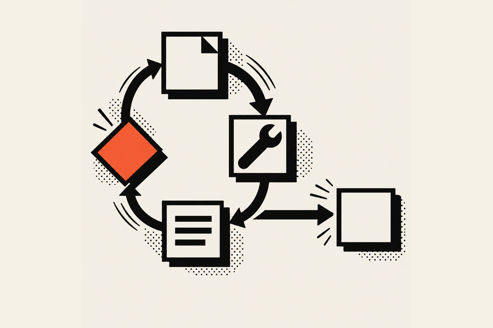
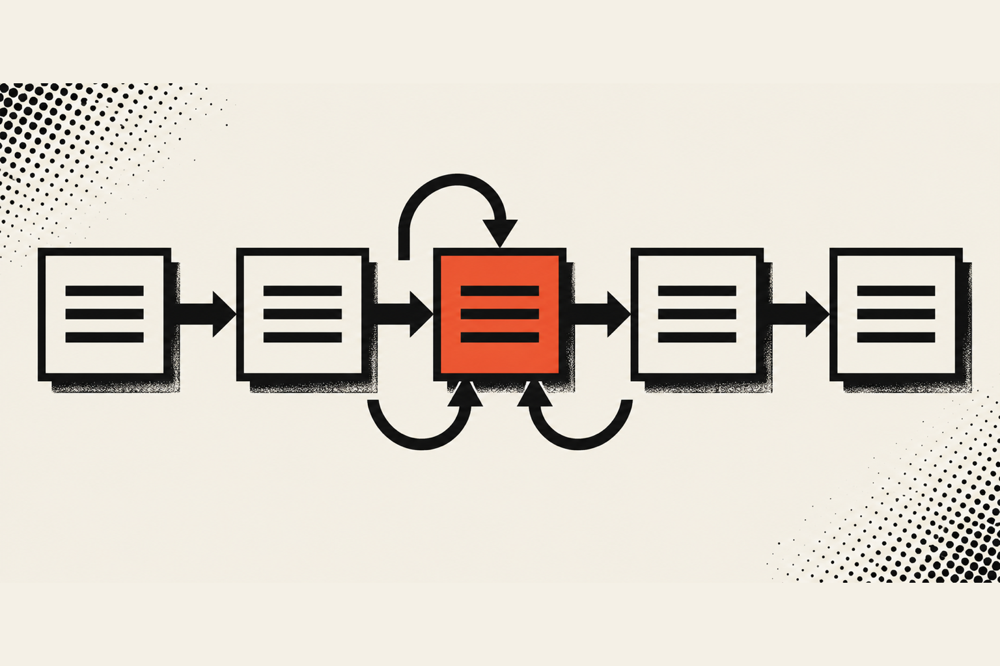
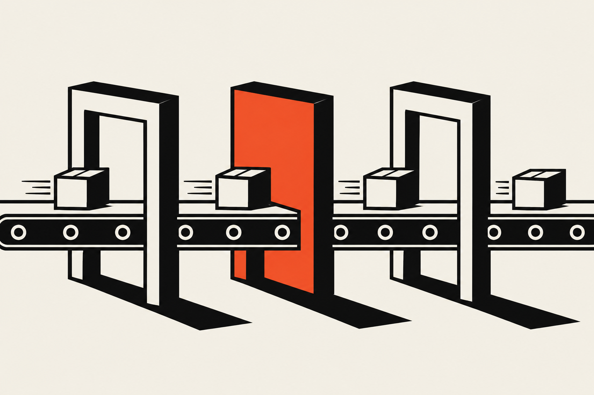

An agentic workflow is a process where an AI model decides the next step instead of following a fixed script. It gets a goal and a set of tools, picks a tool, looks at what came back, and repeats until the job is done or it needs a person. The steps change from run to run.

## What is an agentic workflow?

An agentic workflow is a task where a language model picks its own next action, uses tools to carry it out and checks the result before continuing. <a href="https://zapier.com/blog/agentic-workflows" target="_blank" rel="noopener" aria-label="Zapier's page on agentic workflows, opens in a new tab">Zapier's definition</a> is similar: an AI-driven process where an agent makes decisions and takes actions toward a goal with little human involvement.

There's a lot of vocabulary floating around this topic, and it gets overwhelming fast, so nobody should feel dumb for asking what half of it means. Here is the short version of the words you will keep running into:

<Terms>
<Term name="Model">

The language model itself, like Claude. It reads text and writes text. On its own it cannot send an email or look anything up.

</Term>
<Term name="Tool">

A function you hand the model, such as "look up a booking" or "send an email". <a href="https://platform.claude.com/docs/en/agents-and-tools/tool-use/how-tool-use-works" target="_blank" rel="noopener" aria-label="How tool use works, opens in a new tab">Anthropic's docs</a> put it this way: the model never runs anything on its own. It asks for a tool call, and your code (or Anthropic's servers) runs it.

</Term>
<Term name="Agent">

A model that uses tools in a loop, deciding what to do next based on what the last tool returned.

</Term>
<Term name="Workflow">

The path the work takes from start to finish. In Anthropic's words, workflows are systems where models and tools are orchestrated through predefined code paths, and agents are systems where the model directs its own process.

</Term>
<Term name="Agentic workflow">

A workflow with at least one step where the model, not your code, chooses what happens next. Most useful ones are mostly ordinary code with a model making a few of the decisions.

</Term>
</Terms>

I read <a href="https://www.anthropic.com/engineering/building-effective-agents" target="_blank" rel="noopener" aria-label="Anthropic's Building effective agents, opens in a new tab">Anthropic's Building effective agents</a> before I wrote this, and the advice I keep coming back to is to find the simplest solution possible and only add complexity when you need it. I agree with that, so the rest of this article is built around it.

## What does an agentic workflow look like?

An agentic workflow looks like a loop. The model reads the goal, asks for a tool, your code runs the tool, the result goes back to the model, and the model either asks for another tool or writes its final answer. The loop ends when the model has what it needs.

<a href="https://platform.claude.com/docs/en/agents-and-tools/tool-use/how-tool-use-works" target="_blank" rel="noopener" aria-label="How tool use works, opens in a new tab">Anthropic's tool use documentation</a> spells out that loop for client tools, the ones that run in your own application. It is a `while` loop keyed on the response's `stop_reason`:

1. You send a request with your list of tools and the user's message.
2. Claude replies with `stop_reason: "tool_use"` and one or more `tool_use` blocks naming the tool and its arguments.
3. You run each tool and format the output as a `tool_result` block.
4. You send a new request with the original messages, Claude's reply and the results.
5. You repeat while `stop_reason` is `"tool_use"`. Any other stop reason (`end_turn`, `max_tokens`, `stop_sequence` or `refusal`) ends the loop.



That is the whole trick. A chatbot answers once, while an agent keeps asking for tools until it is done. You are the one running the loop, which means you get to add rules to it.

### A small example

Here is the shape of that loop in TypeScript with the Anthropic SDK. It leaves out error handling to keep it readable, and `runTool` stands in for whatever your tools actually do.

```ts
import Anthropic from "@anthropic-ai/sdk";

const client = new Anthropic();
const messages: Anthropic.MessageParam[] = [
  { role: "user", content: "Find the booking for Dana and confirm it." },
];

for (let turn = 0; turn < 8; turn++) {
  const response = await client.messages.create({
    model: "claude-opus-5-5",
    max_tokens: 1024,
    tools,
    messages,
  });

  if (response.stop_reason !== "tool_use") {
    console.log(response.content);
    break;
  }

  messages.push({ role: "assistant", content: response.content });

  const results = [];
  for (const block of response.content) {
    if (block.type === "tool_use") {
      results.push({
        type: "tool_result" as const,
        tool_use_id: block.id,
        content: await runTool(block.name, block.input),
      });
    }
  }
  messages.push({ role: "user", content: results });
}
```

Notice the `turn < 8`. That cap is mine, not part of the API. If the model gets confused and keeps asking for tools, the loop stops after eight trips instead of running up a bill, and I think every loop you ship should have one.

## How is agentic AI different from traditional automation?

Traditional automation runs the same steps in the same order every time: when X happens, do Y. Agentic AI chooses its steps while it works, so it can handle input nobody planned for. The tradeoff is that it costs more per run and its path is harder to predict.

<a href="https://zapier.com/blog/agentic-workflows" target="_blank" rel="noopener" aria-label="Zapier's page on agentic workflows, opens in a new tab">Zapier's page on agentic workflows</a> makes a point I like: both kinds belong in the same system. Fixed steps handle the predictable work cheaply, and the AI is saved for the steps that need judgment, since every AI step costs tokens. Here is how they compare:

| | Traditional automation | Agentic workflow |
| --- | --- | --- |
| Who picks the next step | Your rules, written ahead of time | The model, while it runs |
| Same input, same path | Yes | Not always |
| Handles input nobody planned for | Breaks or hands it to a person | Can adapt, and can also get it wrong |
| Cost per run | Low and predictable | Higher, because each model call costs tokens |
| Easy to test | Yes, you can list every path | Harder, you test behavior over many examples |
| Best for | Forms, notifications, syncing records | Messy input, open-ended research, tasks where the step count is unknown |

### The roast, for fairness

A typical "AI agent" demo shows one prompt, one beautiful result and a founder saying it replaced a whole department. It looks great, honestly, right up until you ask what happens when the customer misspells their own name. A fixed rule would simply fail that lookup and tell you. An agent might try three other spellings, which is lovely, or might confidently book the wrong Dana, which is criminal. Neither outcome shows up in the demo.

## What is the difference between an AI agent and an agentic workflow?

An AI agent is the model acting in a loop with tools. An agentic workflow is the larger process around it, which can include fixed steps, approvals and several agents. <a href="https://www.omdena.com/blog/agentic-workflows" target="_blank" rel="noopener" aria-label="Omdena on agentic workflows, opens in a new tab">Omdena</a> frames it the same way: the agent is the actor and the workflow is the sequence of steps it carries out.

I find it easier to picture with a restaurant. The agent is the person on the floor who decides what each table needs. The workflow is the whole night: reservations come in, the kitchen gets tickets, a manager approves comps. You can have a workflow with no agent in it (a plain ticket printer), and you can have an agent with no workflow around it (one server improvising), but the useful setup is usually the second one with some structure added.

Anthropic describes five patterns for the structure around the model, and they are worth knowing by name because they are the vocabulary other engineers will use with you:

<Terms>
<Term name="Prompt chaining">

Split a task into a sequence of model calls, where each one handles the output of the last. You can put ordinary code checks between the steps.

</Term>
<Term name="Routing">

Classify the input first, then send it to the follow-up step built for that kind of input.

</Term>
<Term name="Parallelization">

Run several model calls at once, either on different parts of a task or on the same task to compare answers.

</Term>
<Term name="Orchestrator-workers">

One model breaks a task into pieces, hands them to worker calls and puts the results together.

</Term>
<Term name="Evaluator-optimizer">

One model call writes, another call grades the work, and the loop repeats until the grade is good enough.

</Term>
</Terms>

All five are workflows in Anthropic's sense, because the path is set by code. A true agent is the open-ended version, where the model decides how many steps it needs. Anthropic says agents suit problems where you can't predict or hardcode the number of steps, and that they cost more and can compound errors.

## How do you build an agentic workflow?

Start by writing the job as a plain list of steps, mark which steps need judgment, and build only those as model decisions. Give the model a few well-described tools, cap the loop, and add a person for anything risky. Test on real examples before you trust it.

Here is the order I follow.

1. Write the job down without any AI in it. Say it out loud as if you were training a new hire. If every step is predictable, you may not need an agent at all, and a normal automation will be cheaper and easier to trust.
2. Mark the steps that need judgment, like reading a messy message, deciding which of five categories it falls into, or drafting a reply. Those are the places a model earns its cost.
3. Define a small set of tools. Each tool does one thing and has a plain name and a description that says when to use it. Anthropic's tool docs note that Claude decides when to call a tool based on the user's request and the tool's description, so the description is doing real work.
4. Choose the loop. Use a fixed chain of calls if the steps are known and an open loop like the one above if they are not.
5. Put a human at the risky steps. Anything that spends money, emails a customer or deletes a record gets an approval step.
6. Test with examples that bite, such as misspelled names, missing details and a request that makes no sense.



### Tool design matters more than the prompt

Anthropic's engineering post spends a lot of space on tools, and I think that is the right call. It says to design the tools and their documentation clearly and thoughtfully, to make their formats easy for the model to produce, and to test them with many example inputs. It also suggests making tools harder to misuse, which it calls poka-yoke. Its example: the team required absolute file paths after the model had trouble with relative ones.

The same idea works in client work. If a tool needs a customer ID, make the tool refuse anything that doesn't look like one and return a message the model can read and act on. A clear error is a feature here, because the model reads it and tries again.

### Missing details are where models guess

One more documented detail that surprised me when I first read it. <a href="https://platform.claude.com/docs/en/agents-and-tools/tool-use/overview" target="_blank" rel="noopener" aria-label="Tool use with Claude, opens in a new tab">Anthropic's tool use overview</a> says that if a prompt leaves out a required parameter, Claude Opus is much more likely to notice and ask, while Claude Sonnet might ask or might infer a reasonable value, and that this behavior is not guaranteed. So if a missing detail would be expensive (a wrong date, a wrong recipient), check it in your own code before the tool runs instead of hoping the model asks.

## Where agentic workflows go wrong

They go wrong in the boring places: a loop that never ends, a tool that returns something confusing, an action that should have waited for a person. Most of the fixes are the same as in any software, plus a few that are specific to models. Anthropic recommends extensive testing in sandboxed environments, along with appropriate guardrails.

Here are the guardrails I would put on a first build:

- A turn cap, like the `turn < 8` above. Pick a number that fits the job and stop there.
- Read before write. Let the agent look things up freely, and make it ask before it changes anything.
- Narrow tools. A tool called `send_confirmation_email` is safer than one called `send_email` that accepts any recipient.
- A log of every tool call. When something odd happens, you want to read exactly what the model asked for and what came back.
- A fallback to a person. If the model is unsure, or the loop hits its cap, the job goes to a human with the log attached.



### When you should skip the agent

Anthropic's post notes that many applications only need a single model call with retrieval and examples. I would add that a plain automation is often the better answer. Tool use also has its own cost: Anthropic's docs say every tool call is at least one extra round trip, and for lightweight tasks that overhead can exceed the work.

My rule of thumb is a question: can I write down every path? If yes, write the rules. If the input is messy enough that I can't, that is where a model can help.

## How I use this in client work

My own agentic workflow work is smaller and plainer than the demos. For a booking flow I built, I connected Claude to n8n through the n8n MCP server, and Claude built the workflow. When someone submits the form, n8n catches the data, sends an automated email, then sends a follow-up email. At runtime it runs on its own: Claude built it, and Claude does not run inside it. That split is on purpose, because a flow that always does the same three things should be dull and predictable.

I'll admit n8n was extremely hard for me to learn at first, because it is so customizable that it got overwhelming. Once Claude Code did the setup and dialed everything in, managing the workflows finally made sense, because I understood how they worked instead of worrying about what goes where. My advice is to skip building n8n workflows on your own, hook it up to Claude Code, let it structure the workflow from your goals and import the file into n8n.

I also work with the CEO of Vamp Network to design and implement internal AI flows that automate repetitive operational work, so the team can scale without growing headcount at the same rate. You can read more in the <a href="/work/vamp-network">Vamp Network case study</a>.

Automation work is custom for each client, so there is no price list. I start with a conversation about the goal, then I build a scope with the client, and the scope sets the price. After that it is a monthly retainer for upkeep, and retainers run from $2,000 to $10,000 a month depending on the company and the size of the scope. Smaller jobs are usually a simple n8n setup or a scheduled task that saves a few hours a week. Bigger jobs often need a research library, a knowledge base the automation reads from, and part of the upkeep is keeping that library current.

If you own a business, ask yourself which task in your week is repetitive, usually has a clear right answer and costs you hours. That is where an agentic workflow pays you back, and it is why this kind of work costs more than a $1,000 template: you are paying for the judgment about where the model belongs and where it does not. If you want help finding that task, look at my <a href="/services">services</a> and get in touch.

If you're a designer or developer who has been told AI is coming for your job, I'd start with the small loop above. Write one tool, cap the turns, read the log, and see what the model does with a messy request. That teaches you more in an afternoon than a month of headlines. You can find more under <a href="/blog/agentic-workflows">agentic workflows</a>.
