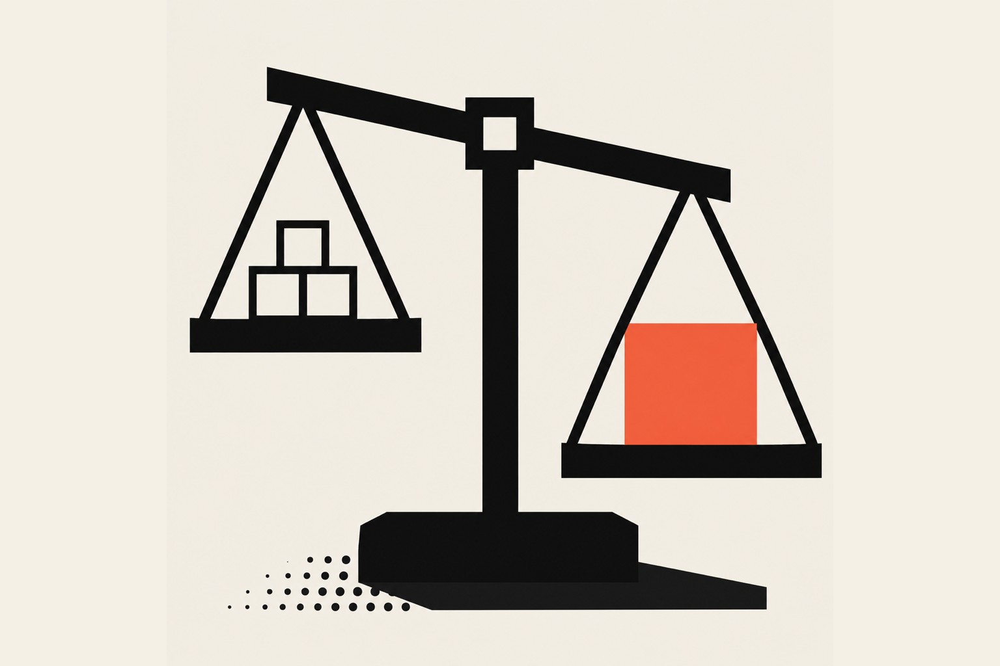
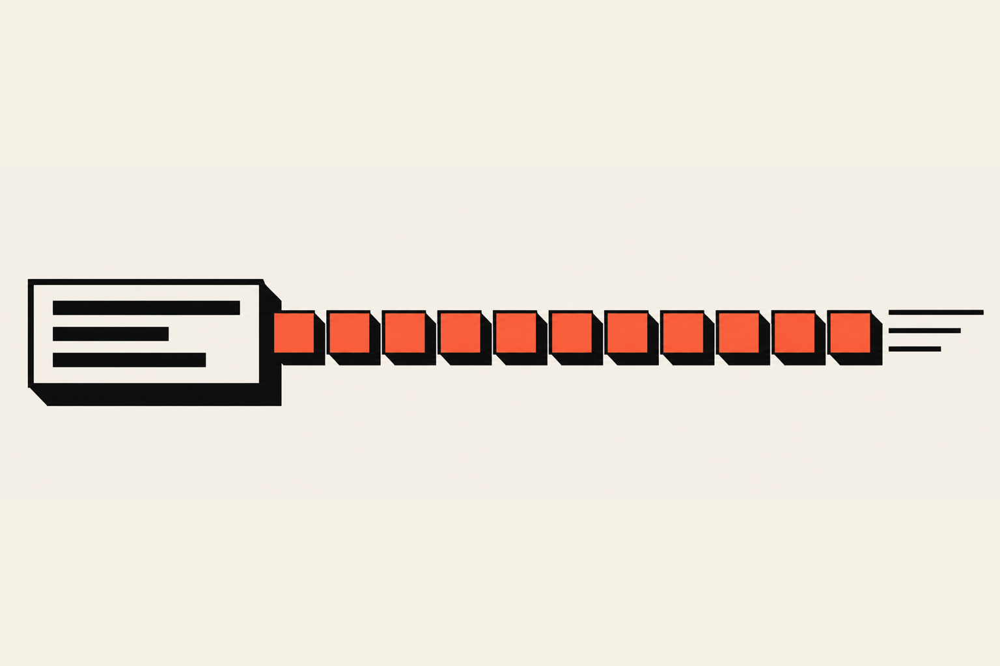

AI automation for a small business usually costs a one-time setup fee of a few thousand dollars for a simple workflow, plus a monthly fee to keep it working. The published ranges disagree a lot, from about $2,000 to $25,000 for the build and from a few hundred to a few thousand dollars a month for upkeep. Scope sets the price, and tool fees are the small part.

## How much does AI automation cost?

The answer is a range, and every source I read gives a different one. Nobody has a standard price list, because the same words ("automate my follow-ups") can mean a one-hour setup or a three-month project.

Here is what three guides say, and keep in mind that all three are written by companies that sell this work:

| Source | Build price | Monthly upkeep |
| --- | --- | --- |
| <a href="https://www.solulab.com/ai-automation-cost-for-small-businesses/" target="_blank" rel="noopener" aria-label="SoluLab on AI automation cost for small businesses, opens in a new tab">SoluLab</a> | $1,500 to $25,000 overall; $3,000 to $15,000 when a consultant builds it | $200 to $800 for consultant-built; $50 to $2,000 overall |
| <a href="https://www.groovyweb.co/blog/ai-automation-cost" target="_blank" rel="noopener" aria-label="GroovyWeb on AI automation cost, opens in a new tab">GroovyWeb</a> | $2,000 to $8,000 for one workflow; $8,000 to $25,000 for a suite | Optional maintenance, no figure given |
| <a href="https://www.lobsterpack.com/blog/ai-automation-cost-smbs/" target="_blank" rel="noopener" aria-label="Lobsterpack on AI automation cost for small businesses, opens in a new tab">Lobsterpack</a> | 3,500 to 15,000 euros, by complexity | From 300 euros, usually 400 to 600 euros with a few hours of support |

They overlap in the middle and fight at the edges. If you collect three quotes and they land inside those ranges, nothing is wrong with the quotes. If one is wildly under, ask what is left out. A quote for "full AI automation" at a few hundred dollars looks great right up until you ask what it includes.

## What are you actually paying for?

Mostly you are paying for someone's judgment and time. The tool subscription is cheap and the AI model usage is cheap, so the money goes to the person who works out your process, builds the workflow and keeps it healthy.

It gets confusing fast, so here is the bill in three buckets.

<Terms>
<Term name="Tools">

The platform that runs the workflow. <a href="https://n8n.io/pricing/" target="_blank" rel="noopener" aria-label="n8n's pricing page, opens in a new tab">n8n</a> is a German company that prices in euros: its cloud plans run 20 euros a month for 2,500 workflow executions, 50 euros for 10,000 and 667 euros for 40,000, all billed annually. Monthly billing costs more, and the free Community Edition can be self-hosted. An execution is one run of a whole workflow, however many steps it has.

</Term>
<Term name="AI model usage">

What the language model costs each time a workflow asks it to read or write something. <a href="https://platform.claude.com/docs/en/about-claude/pricing" target="_blank" rel="noopener" aria-label="Anthropic's pricing page, opens in a new tab">Anthropic's pricing page</a> charges per million tokens (a token is a small chunk of text, roughly a short word). Claude Haiku 5.5 is listed at $0.10 per million input tokens and $0.50 per million output tokens, Claude Sonnet 5.5 at $2 and $10, and the Batch API takes 50 percent off both when a job can wait. SoluLab estimates about $5 to $30 a month for a few hundred automated tasks, which fits that picture.

</Term>
<Term name="Labor">

Mapping the process, building and testing the workflow, fixing it when something upstream changes. SoluLab says the cost is mostly this, and Lobsterpack describes the upkeep as monitoring, model updates, workflow adjustments and repairing broken integrations.

</Term>
</Terms>

So a business owner reading "$20 a month" on a tool page is seeing about the smallest line on the bill. Software keeps getting cheaper, and thinking carefully about your business does not.

## Should you pay a fixed fee or a monthly retainer?

A fixed fee suits a small, finished job with a clear end, like one workflow that copies form entries into a spreadsheet. A retainer suits anything that has to keep working after launch. Most automations do, because the tools around them change.

Think of it like a plant or a pet. You can buy it once, but you still have to feed it. Lobsterpack says about 80 percent of its clients take at least a basic support plan for the first six months, and it points out that third-party API changes can break a workflow without warning. An API is the way one piece of software talks to another, and when one side changes the format, the other side stops understanding it.

SoluLab adds a trap worth knowing about: a low setup fee can be offset by a high monthly fee, so compare the first-year total. Take the setup, add twelve months of the monthly fee, and compare quotes on that number.

### How I price it

I don't have a price list for automation work. Every job is custom, so I talk with the client first, and when they're ready we build a scope together. The scope sets the price, so we settle both on the same call.

Once they say yes, it becomes a monthly retainer, from $2,000 to $10,000 a month depending on the company and the size of the scope. I write an initial brief that lays out the build, the scope and which upkeep tasks I'll do and how often. That is a much bigger monthly number than the consultant-built upkeep figures in the table, because my retainer covers the build, the scope and the scheduled upkeep together.

## What sits at each end of the range?

At the low end you have a small, boring job that saves a few hours a week. At the high end you have a knowledge base the automation has to lean on, and a lot of thought about how people's days change. The price follows the amount of judgment involved.

**The smaller jobs** are usually a simple n8n setup or a scheduled task that saves the company a few hours a week. The upkeep is keeping that task relevant to what the business is doing at the time, and the price goes up as more workflows get added.

**The bigger jobs** usually need a research library, meaning a collection of reference material the automation reads before it answers. Here is a made-up example, not a client: a law firm would need a library built on proper practice for its kind of law, plus the regulations and compliance rules it has to follow. The monthly upkeep is maintaining that library and pruning anything outdated as the rules change. That is real ongoing work, and it is where a bigger retainer comes from.

Bigger jobs also mean working out what each employee does now and which parts of their job can be automated. The goal is faster staff: people who get more done in a day and don't burn out on menial, monotonous tasks. Pricing it that way keeps everybody honest about what the money buys.

## What hidden costs should you plan for?

The costs that surprise people are the cleanup before the build and the repair after it. Messy records, undocumented processes and changing tools all add work that never shows up on the first quote. Ask about each one before you sign.

<Terms>
<Term name="Data cleanup">

SoluLab calls this the line item most often missed and puts it at $500 to $5,000 before automation starts. It also suggests adding 20 to 30 percent to a quote if your records are inconsistent. If your customer list has the same person in it four times, a workflow will happily email them four times.

</Term>
<Term name="Process cleanup">

Lobsterpack says undocumented or chaotic processes have to be organized first and treats that as its own project. A workflow can only follow steps that somebody wrote down, and "then I just kind of know what to do" is not a step.

</Term>
<Term name="Breakage">

Tools change their formats, and a workflow that worked on Monday fails on Thursday. This is the main reason the upkeep exists, and it is why a low upkeep fee deserves a question.

</Term>
<Term name="Self-hosting">

Running your own copy of a tool looks free, but Lobsterpack notes you become responsible for uptime, updates and backups. The time is real even when the license is not.

</Term>
<Term name="Compliance">

SoluLab says healthcare, finance and legal-adjacent work adds cost for audit trails and documentation. If your business lives under rules like that, tell the person quoting you on day one.

</Term>
</Terms>

If you are still deciding which chore to hand off first, I wrote <a href="/blog/ai-automation/small-business-automation">Small business automation: what to automate first, and what to leave alone</a>, and it has the "write the process down first" step in more detail.

{/* IMAGE 3: a tangled knot of lines on the left passing through a gate into a single neat straight line on the right, showing cleanup before automation */}

## How long does AI automation take to pay back?

For a well-scoped project, the sources say about three to six months. High-volume, repetitive work can pay back faster, and a very small business with little admin work can take over a year. The number depends on how many hours the task really eats, so measure first.

Here is how the sources line up:

- SoluLab says most well-scoped projects reach positive return in 3 to 6 months, and it gives a formula: total first-year cost divided by monthly savings. Under six months is solid, and beyond a year the workflow probably is not ready.
- Lobsterpack gives 3 to 6 months for typical businesses, and says a two-person company might need about 18 months to recoup the setup.
- SoluLab also says 30 to 50 percent is a fair efficiency assumption and to be skeptical of claims of 10x.

Those figures come from vendors, so treat them as a starting guess. Run your own numbers too. Say the chore takes you eight hours a month, and your time is worth $50 an hour. That is $400 a month in labor. A $4,000 first-year cost against $400 of savings pays back in ten months, which is fine, and a $12,000 cost against the same savings never does. This arithmetic is the whole reason I tell people to start with the most frequent task.

If the math says a task isn't worth automating yet, that is a perfectly good answer, and a person who tells you so is worth more than one who sells you the build.

## What does this look like in my own work?

My own automation work is priced by scope and billed as a monthly retainer, as I described above, and <a href="/work/the-booking-flow">The Booking Flow</a>, my own SaaS, is the closest public example of the work itself. It replies to every form lead the moment it arrives, books the estimate on the business's calendar and follows up on its own, and n8n is part of its stack. It has no customers yet, so I can't give you a payback number from it.

If you own a business, here is the choice in front of you. You can keep paying a person to do the same copy-and-paste task every week, or you can pay for a build and a monthly retainer that keeps it healthy. The second costs more on the first invoice and less over a year, once the hours it frees up count as part of what you bought. Do you want to pay for the same chore fifty-two times a year, or once? If you want a scope and a price on the same call, check out my <a href="/services">services</a> and reach out.

If you're a designer or developer thinking about selling this work, the lesson I'd pass on is to price the upkeep, not just the build, and to say plainly what the monthly fee covers. You can read more in my <a href="/blog/ai-automation">AI automation articles</a>.
