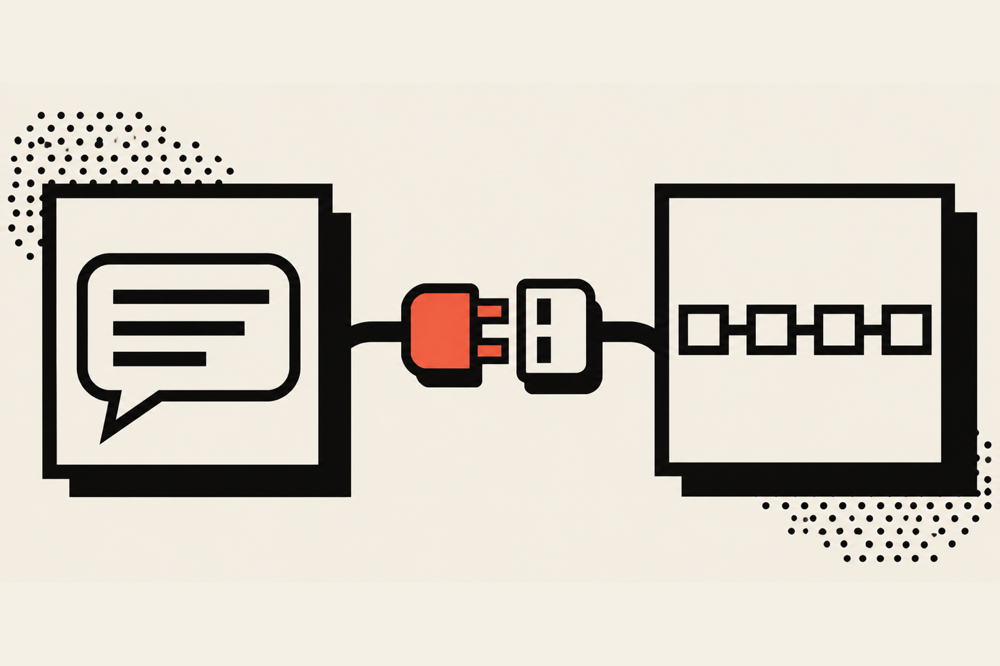
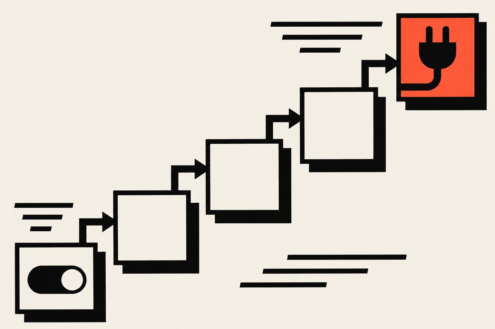
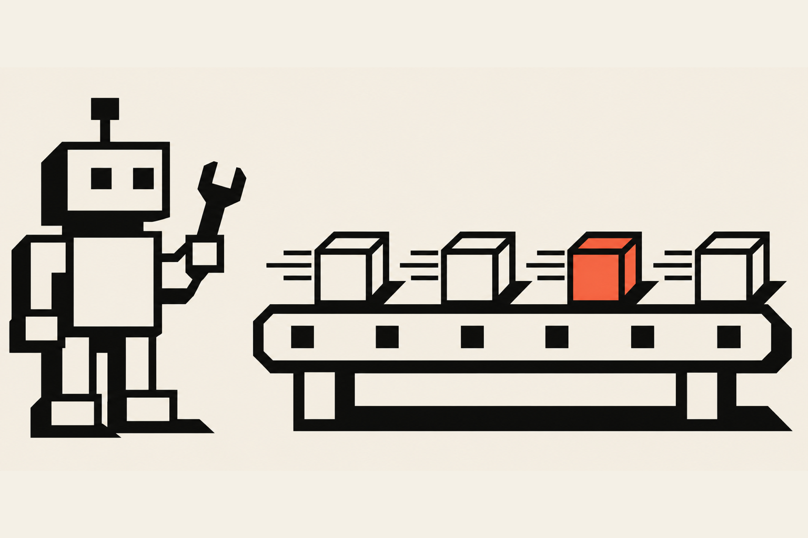

To connect n8n to Claude, turn on MCP access in n8n under Settings, then Instance-level MCP, copy the server URL, and add it to Claude as a custom connector. Claude signs in with OAuth and can then search, build and run the workflows you enabled. n8n's separate MCP Server Trigger node is for exposing your own tools.

## What is MCP, and why would I connect it to n8n?

MCP, the Model Context Protocol, is a shared plug shape that lets an AI app talk to outside tools. The <a href="https://modelcontextprotocol.io/docs/getting-started/intro" target="_blank" rel="noopener" aria-label="MCP introduction, opens in a new tab">official introduction</a> compares it to a USB-C port for AI applications: one standard connection, so any assistant that supports it can use any tool that supports it.

There is a lot of acronym soup around this, and it gets overwhelming fast, so here is the plain version. n8n is a workflow tool: a form comes in, an email goes out, a follow-up goes out two days later. Claude is the assistant you talk to. MCP is the cable between them. Once it is plugged in, you can tell Claude what you want in normal sentences, and it can look at your n8n account, build the workflow, and run it.

I did this on a booking flow I built. I connected Claude to n8n through the n8n MCP server, and Claude built the workflow: n8n catches the data from the form submission, sends an automated email, then sends a follow-up email. After that the workflow runs on its own. Claude built it, and Claude does not run inside it.

I'll be honest about where I started, too. When I first picked up n8n it was extremely hard to learn, because it can be customized in so many ways. Once Claude did the setup and dialed everything in, managing the workflows made sense.

## Which direction does the connection go?

There are two directions, and mixing them up is an easy way to lose an afternoon. In one, Claude is the client and n8n is the server: Claude reaches into n8n to find and run workflows. In the other, n8n is the client and some other server is the tool: an n8n agent reaches out to use it. Most people who search for this want the first one.

| Direction | n8n's role | What it does | Where it lives in n8n |
| --- | --- | --- | --- |
| Claude uses n8n | Server | Claude searches, builds, edits and runs your workflows | Settings, then Instance-level MCP |
| Claude calls tools you choose | Server | Claude gets only the tools you attach to one workflow | The MCP Server Trigger node |
| n8n uses another tool | Client | An agent inside a workflow calls an outside MCP server | The MCP Client Tool node |

The first row is the built-in server. n8n's <a href="https://docs.n8n.io/connect/connect-to-n8n-mcp-server" target="_blank" rel="noopener" aria-label="n8n instance-level MCP server documentation, opens in a new tab">instance-level MCP server</a> lets clients such as Claude Desktop search, trigger, test, create and edit workflows and data tables. The second row is the <a href="https://docs.n8n.io/integrations/builtin/core-nodes/n8n-nodes-langchain.mcptrigger/" target="_blank" rel="noopener" aria-label="n8n MCP Server Trigger node documentation, opens in a new tab">MCP Server Trigger node</a>, which you drop into one workflow to publish a small menu of tools. The third row is the reverse direction, which this article leaves alone. I cover the thinking behind agents that pick their own tools in <a href="/blog/agentic-workflows/agentic-workflows-explained">Agentic workflows explained</a>.

## How do I connect n8n to Claude?

Enable MCP access in n8n, copy the instance's MCP server URL, and add that URL to Claude as a custom connector. You approve the connection with an OAuth sign-in, which means Claude never sees your n8n password. Then switch the connector on in a conversation and ask Claude to find a workflow.

The steps below come from n8n's docs and Anthropic's help article:

1. In n8n, go to **Settings**, then **Instance-level MCP**, and select **Enable MCP access**. You need the instance owner or admin role. Disabling it later disconnects every client.
2. Choose which workflows Claude can see. Each workflow has to be enabled for MCP, either in the workflow's own settings (**Available in MCP**) or from the workflows list. You can also enable a whole project or folder.
3. Open **Connect a client** and copy the **Server URL**. It ends in `/mcp-server/http`.
4. In Claude, go to **Customize**, then **Connectors**, click **Add**, and choose **Add custom connector**. Name it something like "n8n MCP" and paste the URL exactly as n8n shows it.
5. Pick OAuth when n8n offers it. n8n marks the OAuth tab as the recommended one, and the other option is an API key.
6. Sign in when Claude asks, approve the permissions, and then enable the connector in your conversation from the **+** button.

n8n's own <a href="https://docs.n8n.io/connect/connect-to-n8n-mcp-server/mcp-client-examples" target="_blank" rel="noopener" aria-label="n8n MCP client connection examples, opens in a new tab">client examples page</a> gives the exact entries for Claude Desktop, and it also shows the one-line command for Claude Code: `claude mcp add --transport http n8n <your server URL>`. After that you run `/mcp` and select n8n to authorize.

Two details trip people up. First, the server URL is not the address of your n8n editor, so don't paste the one from your browser's address bar. Second, Anthropic's <a href="https://support.claude.com/en/articles/11175166-getting-started-with-custom-connectors-using-remote-mcp" target="_blank" rel="noopener" aria-label="Anthropic help article on custom connectors, opens in a new tab">help article on custom connectors</a> says a remote connector is contacted from Anthropic's cloud, so the server has to be reachable on the public internet over standard HTTPS port 443. An n8n install that only lives on your laptop will not work through claude.ai. n8n says the same thing about its cloud clients needing a publicly reachable instance.

### What can Claude do once it is connected?

n8n's page says clients can search, trigger, test, create and edit workflows and data tables. It marks building and editing workflows with version 2.13.0, so older self-hosted installs may not have it. You can ask Claude to find a workflow, run a published one, or draft a new one from a plain description.

This is where I got the most out of it. My advice is to skip building n8n workflows on your own. Hook it up to Claude, have it structure the whole workflow from your goals, and then read through what it made. You'll tweak some things as you go, but for the most part it just works. The reading is the one step I would never skip.

## What is the MCP Server Trigger node?

The MCP Server Trigger node turns one n8n workflow into an MCP server that exposes only the tools you attach to it. It is not a normal trigger that fires when an event happens. Per n8n's docs, it only connects to and runs tool nodes, and a client such as Claude lists those tools and calls them.

That makes it the narrow option. The built-in server lets Claude look across your enabled workflows, and this node publishes a short, hand-picked menu instead. To put a whole workflow on the menu, you attach it with the **Call n8n Workflow Tool** node.

n8n's page for the node gives these details:

<Terms>
<Term name="Transports">

It supports Server-Sent Events (SSE) and streamable HTTP. It does not support stdio, which is the transport for servers that run on your own machine as a subprocess.

</Term>
<Term name="Two URLs">

You get a test URL and a production URL. The test URL registers while you listen for a test event, and the production URL registers when you publish the workflow. Production runs show up in the **Executions** tab, not in the editor.

</Term>
<Term name="Authentication">

You can pick none, bearer auth, header auth, or n8n User Auth (OAuth2) on node version 2 and later. Choosing none leaves the URL open to anyone who finds it.

</Term>
</Terms>

For Claude Desktop, n8n's page shows a small bridge called `mcp-remote`, started with `npx mcp-remote <your MCP URL>` and a bearer token passed as a header. If you run n8n in queue mode with several webhook replicas, route every `/mcp` request to one dedicated replica, or the connections will frequently break.

## What triggers work with MCP in n8n?

The pages I read do not list trigger types, so I won't guess at a list. What they do say is how the pieces fit. The MCP Server Trigger starts a run when a client calls one of its tools. For the instance-level server, Claude runs a workflow by asking for it by name, and n8n's `execute_workflow` tool defaults to production mode, which runs the published version.

Publishing matters more than it sounds. n8n's docs for the workflow tool say a sub-workflow that is not published returns the message "Workflow is not active and cannot be executed", and the agent may not pass that along to you. If Claude says it ran something and nothing happened, check that first.

The other thing to settle is who starts the workflow when it is live. In my booking flow, nobody asks Claude to do anything at that point. That is the right shape for most small business automation: Claude helps you build the thing, and then the thing runs by itself. I wrote about picking what to automate first in <a href="/blog/ai-automation/small-business-automation">Small business automation</a>.

## How do I secure it?

Use OAuth instead of a static key, enable only the workflows Claude needs, keep the server on HTTPS, and read what Claude builds before you publish it. Anthropic's own help article says custom connectors have not been verified by Anthropic and that Claude can take action in the services you connect.

### Control what Claude can see

n8n's server only exposes workflows you enable, but there are two things to know. Every connected client sees every enabled workflow, because you cannot scope one client to a subset. And `search_workflows` returns previews of all the workflows the user can view, though not their full data. n8n also has an **Auto-expose new workflows** setting, which is off by default. Leave it off. A workflow nobody decided to share should not share itself.

### Use OAuth and watch the callback URLs

n8n marks OAuth as the recommended option, and each client only gets the permissions granted when you connect it. You can revoke a client from the **Connected clients** list, and it has to sign in again to get back in. The API key route works, but n8n notes that clients using one do not appear in that list, and generating a new token revokes the old one. n8n's default callback setting is "All callback URLs", which its page calls less secure, so an admin can switch it to only trusted URLs.

If you build your own server, the MCP project's <a href="https://modelcontextprotocol.io/docs/tutorials/security/authorization" target="_blank" rel="noopener" aria-label="MCP authorization tutorial, opens in a new tab">authorization tutorial</a> says the client sends its token in an Authorization header and never in the URL, that access tokens should be short-lived, and that you should not write your own token validation. The <a href="https://modelcontextprotocol.io/specification/2025-06-18/basic/transports" target="_blank" rel="noopener" aria-label="MCP transports specification, opens in a new tab">transports specification</a> adds that servers must validate the Origin header and should implement proper authentication for all connections.

### Treat prompt injection as real

Anthropic's help article warns that a malicious MCP server may include hidden instructions that try to make Claude do something unintended, and that server developers may update tool behavior without telling you. Your own n8n instance is more trustworthy than a stranger's server, but read the tool calls Claude proposes anyway, use "Allow always" only for tools you trust, and turn off write-capable tools in any mode where Claude can use connectors without asking.

### Review the build before you publish

Claude builds the workflow, and then you read it before it goes live, the way you would read a pull request from a new teammate who is very fast and extremely confident. That teammate will also send a follow-up email to the wrong list with a straight face, so it is a draft until you say it is done. n8n's page even labels its agent features as preview, and tells you to avoid relying on them in production workflows.

## Is this worth setting up for a small business?

Yes, if you have a repeated chore that follows the same steps every time. A form, an email and a follow-up is the textbook case. It is not worth it if nobody on your side will ever read what Claude builds, because a workflow that emails your customers has your name on it. If you are weighing the cost, <a href="/blog/ai-automation/ai-automation-pricing">AI automation pricing</a> covers what setup and upkeep usually cost.

## How I work with this

I chose n8n for its flexibility, and connecting it to Claude through the MCP server is what made it manageable for me. The booking flow I built is the example: Claude built the workflow, and now a form submission lands in n8n, an automated email goes out, and a follow-up email goes out after it, with no one pressing a button.

If you run a business and you are thinking "cool, but I just need the follow-ups to stop slipping," that is exactly the point. A small workflow that runs on its own is an investment that pays you back every week, and it costs more than a free template because someone reads the work. If you are a designer or developer reading this, set it up in a test instance first and break it on purpose. Take a look at my <a href="/services">services</a> if you want a hand with either.
