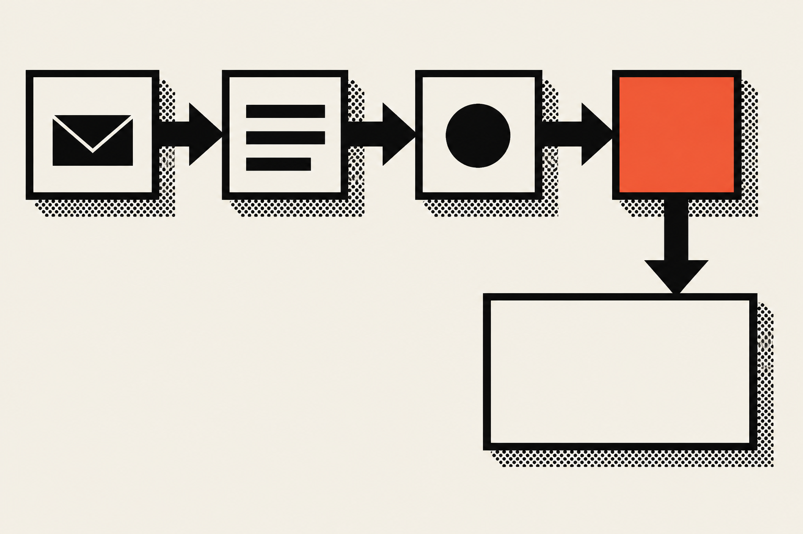
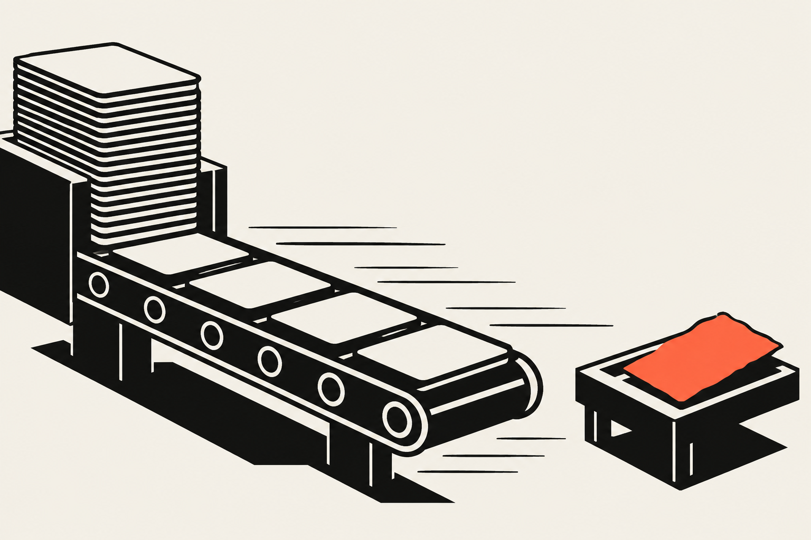
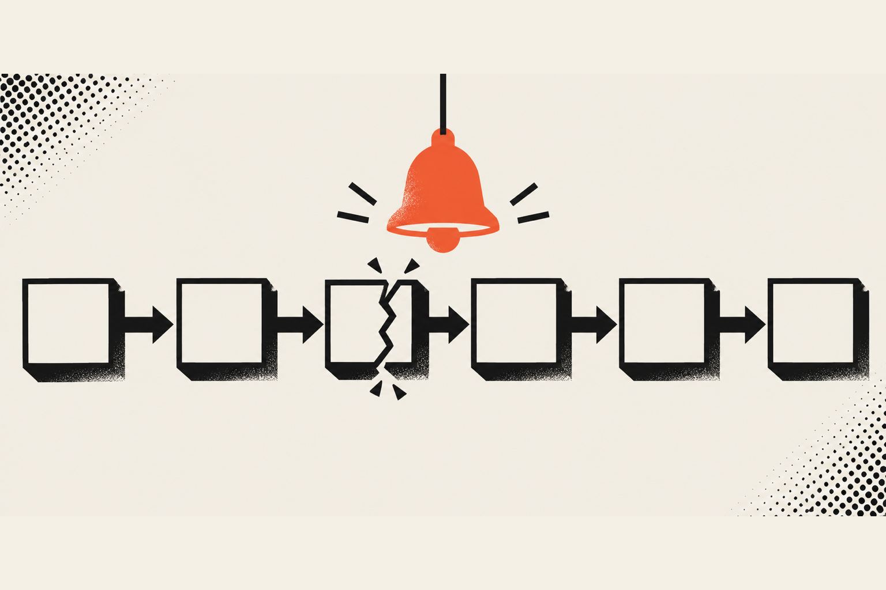

Small business automation means setting up software to do a repeated task for you, such as sending a confirmation email or copying a form entry into a list. Start with the task you do most often, in the same shape each time, where a mistake is cheap. Leave anything involving money, contracts or relationships to a person.

## What is AI automation?

AI automation is a workflow where software does a repeated job for you and an AI model handles the part that needs reading or writing. The model reads a messy email, sorts it and drafts a reply. The rest of the workflow, like saving the record or sending the message, is ordinary software.

There's a lot of vocabulary around this, and it gets overwhelming fast, so here is the plain version. A rule-based automation does exactly what you told it: when a form comes in, send this email. It never improvises, which is a feature. An AI step is for the jobs where humans wrote the input and every message looks a little different. <a href="https://titan.email/small-business-automation/" target="_blank" rel="noopener" aria-label="Titan's small business automation guide, opens in a new tab">Titan's guide</a> draws the same line: rule-based automation for predictable, repeatable steps, and AI for messy or written input.

That split matters more than any tool name. Most of what a small business wants to automate is the boring, rule-based kind, and it works better without an AI model anywhere near it. If you want the deeper version of when a model should pick its own next step, I wrote that up in <a href="/blog/agentic-workflows/agentic-workflows-explained">Agentic workflows explained</a>.

Here are the words you will keep running into:

<Terms>
<Term name="Workflow">

A set of linked steps that does a job from start to finish. <a href="https://docs.n8n.io/workflows/" target="_blank" rel="noopener" aria-label="n8n's documentation on workflows, opens in a new tab">n8n's docs</a> define it as a collection of nodes connected together to automate a process.

</Term>
<Term name="Trigger">

The event that starts a workflow, like a form being submitted or a new email arriving.

</Term>
<Term name="Rule-based automation">

A workflow where every step is spelled out ahead of time. It is cheap, fast and predictable.

</Term>
<Term name="AI step">

One step in a workflow where a language model reads or writes text. The other steps around it are still ordinary rules.

</Term>
<Term name="Human in the loop">

A person who approves, edits or catches something before the workflow finishes. It is the safety catch.

</Term>
</Terms>

## How can a small business automate tasks with AI?

A small business automates tasks by choosing one repeated job, writing down its steps, building a workflow that runs them, and testing it on fake records before real customers see anything. Then you check how long the job takes now compared with before, and only then choose a second job.

That sounds like a lot of ceremony for a confirmation email, but the order is what keeps it from blowing up in your face. <a href="https://titan.email/small-business-automation/" target="_blank" rel="noopener" aria-label="Titan's small business automation guide, opens in a new tab">Titan's guide</a> lays out a 30-day plan that I think is sensible. In week one you log your repetitive tasks as you do them. In week two you clean up the process and build one automation. In week three you test with fake records, try the failure cases and confirm there is an off switch. In week four you compare against your week one baseline and pick the next task.

Here is the same idea as steps you can follow:

1. Keep a running list of every task you repeat for a week. Note how often, how long it takes and which tools it touches.
2. Pick one task and write its steps in plain sentences. If you can't, the process isn't finished yet and shouldn't be automated.
3. Decide which steps are rules and which need an AI model to read or write something.
4. Build the workflow with a trigger, the steps and a place where a person can step in.
5. Test it with fake records. Check what happens when the input is empty, wrong or weird.
6. Run it for a month, compare it with your baseline and give it an owner.

### What tools do you need?

You need a tool that can catch a trigger and run steps, and most small teams get there with one of a handful. n8n is the one I use. <a href="https://n8n.io/pricing/" target="_blank" rel="noopener" aria-label="n8n's pricing page, opens in a new tab">Its pricing page</a> lists unlimited workflows and every integration on every plan, and it counts an execution as one run of an entire workflow, so a ten-step workflow still counts as one.

I haven't used Zapier or Make on a real project. I know how both work, but n8n gave me the flexibility I wanted, and I'd rather tell you that than pretend to have a verdict.

When I started with n8n it was extremely hard to learn, because there is so much you can customize that it gets overwhelming. What changed it was handing the setup to Claude Code. I connected Claude to n8n through the n8n MCP server, and Claude built the workflow for a booking flow I built. n8n catches the data from the form submission, sends an automated email, then sends a follow-up email. Claude built it, but Claude doesn't run inside it, so at runtime the workflow just runs on its own.

My advice is not to build n8n workflows alone. Describe your goal to Claude Code, have it structure the whole workflow, import the file into n8n and expect to tweak a few things. For the most part it just works.

## What should a small business automate first?

Automate first the task you do most often, in roughly the same shape each time, where a wrong result costs you little. Frequency is what makes an automation pay back. A weekly task you automate saves you a lot more than a quarterly one you resent.

<a href="https://www.sheriseadkins.com.au/blog/ai-automation-small-business-what-to-automate-first" target="_blank" rel="noopener" aria-label="Sherise Adkins on what to automate first, opens in a new tab">Sherise Adkins</a> makes the same argument: pick by how often you do it, not by how much it annoys you, because irritation tends to produce a one-off fix. The article also suggests four questions before you build. How often do you do it? Does the shape stay the same even when the content changes? What does a wrong result cost? Can you write the whole process down today?

### How do you score candidates?

You can score each task from 1 to 5 on frequency, time spent, cost of a mistake and how steady the process is. <a href="https://titan.email/small-business-automation/" target="_blank" rel="noopener" aria-label="Titan's small business automation guide, opens in a new tab">Titan's guide</a> uses those four and says steadiness and frequency matter most. The task with the best score wins. Here is what that looks like for a few chores a typical small shop has:

| Chore | Frequency | Cost of a mistake | Steady process | Good first pick? |
| --- | --- | --- | --- | --- |
| Reply to a contact form | Daily | Low if the reply is a plain acknowledgment | Yes | Yes |
| Follow up after a booking | Daily | Low | Yes | Yes |
| Collect new applications in one list | Weekly | Low | Mostly | Yes |
| Weekly sales summary | Weekly | Low if it only goes to you | Yes | Yes |
| Invoice a customer | Weekly | High, it involves money | Mostly | Draft it, have a person send it |
| Answer an angry customer | Rare | High, it is a relationship | No | Leave it alone |
| Write the business plan | Yearly | High | No | Leave it alone |

<a href="https://tkxel.com/blog/which-process-to-automate-first/" target="_blank" rel="noopener" aria-label="tkxel on which process to automate first, opens in a new tab">tkxel</a> adds a few screening rules of its own. It suggests looking at tasks you repeat more than five times a week, checking that similar inputs give predictable outputs at least 70% of the time, and treating a process as higher risk when human judgment drives more than about 30% of cases. The article says these are practical rules of thumb and not industry benchmarks, and I'd read them that way. They are a good gut check, and nothing more official than that.

### What does a good first automation look like in real life?

A good first automation catches something that arrives in the same shape every time, answers it and files it somewhere you can see. Two jobs of mine fit that description: the booking flow above and the intake flow I built for Vamp Network.

For Vamp Network, new creators apply through an intake flow on the site, and every application is collected in the custom dashboard I built. More than 50 creators have applied through it. Collecting applications that way beats copying them out of emails into a spreadsheet, which is the sort of chore that eats an hour on a Friday and has a typo in it by Saturday. You can read the details in the <a href="/work/vamp-network">Vamp Network case study</a>.

For 'Aiwi Waffles, the Home Base app I'm building has a form on the marketing site that sends an automatic reply and saves the message to one list, whether it is a question, a job application or a catering request. It's in build now, so I won't tell you what it changes yet. The design is the point: one form, one reply, one list.

Neither of those needs an AI model to work. That's the surprise for many owners. The first automation that pays you back is usually a plain rule.

## What should you leave alone?

Leave alone anything where a mistake costs real money or damages a relationship, anything you do less than weekly, and any process you can't describe in writing. Automate the draft and let a person do the sending. A half-built process turns into a faster half-built process.

<a href="https://titan.email/small-business-automation/" target="_blank" rel="noopener" aria-label="Titan's small business automation guide, opens in a new tab">Titan</a> says to have a person handle anything involving money, contracts or relationships. The Sherise Adkins article puts it as a rule I like: automate up to the point where the output becomes public, then stop. Drafting a reply is fine, and sending it to a customer without a person reading it is where I'd hold off.

Here is the list I keep in my head:

<Terms>
<Term name="Broken processes">

If the manual version is a mess, automation makes the mess happen faster, like bolting a jet engine onto a shopping cart with a bad wheel. Fix the process first, or delete it. A surprising number of chores vanish at this step.

</Term>
<Term name="Money, contracts and relationships">

Drafting an invoice is fine. Sending one, issuing a refund or replying to a customer who is already upset should keep a person on it.

</Term>
<Term name="Rare tasks">

If you do it once a quarter, the build time will eat the savings. Come back to it when your frequent jobs are running.

</Term>
<Term name="Failures nobody would notice">

If the automation could quietly stop working and no one would find out for a month, make the failure visible first, with an alert or a weekly check.

</Term>
<Term name="Work that makes you who you are">

I wouldn't automate how you talk to your best customers. The reason they like your business is probably that it is a person on the other end.

</Term>
</Terms>

### How do you know when a person has to stay in?

A person has to stay in whenever the output reaches a customer or moves money. The test is simple: if it would be embarrassing or expensive to get wrong, put an approval step in front of it. The workflow does the work up to that point and waits.

This is the same idea I use in agentic workflows. <a href="https://www.anthropic.com/engineering/building-effective-agents" target="_blank" rel="noopener" aria-label="Anthropic's Building effective agents, opens in a new tab">Anthropic's Building effective agents</a> recommends finding the simplest solution possible and only adding complexity when it demonstrably improves outcomes. I read that as permission to keep your first automation boring. It says workflows, where the code decides the path, offer predictability and consistency, while agents, where the model directs its own process, cost more and risk compounding errors. For a small business, boring wins nearly every time.

## How much does AI automation cost?

The tools are cheap and the setup and upkeep are where the money goes. n8n's published plans start at 20 euros a month for 2,500 executions, billed annually, and my own work is priced by scope, with monthly retainers from $2,000 to $10,000 for businesses that want me to build and maintain it.

There is no price list for my automation work, because every job is custom. I talk with the client, and when they're ready we build out a scope, which sets the price on the same call. Once they say yes, it becomes a monthly retainer, and I write a brief that sets out the build, the scope and which upkeep tasks I'll do and how often.

What a retainer buys depends on the size of the job:

<Terms>
<Term name="Smaller jobs">

Usually a simple n8n setup or a scheduled task that saves the company a few hours a week. The upkeep is keeping that task relevant to what the business is doing at the time. The price goes up as more workflows are added.

</Term>
<Term name="Bigger jobs">

These usually need a research library, which is a knowledge base the automation draws on. For a law firm, that could be a library built on proper practice for its kind of law and the compliance rules it follows, and the upkeep is pruning anything outdated as the rules change. That example is hypothetical, not a client.

</Term>
</Terms>

Bigger jobs also mean working out what your employees do all day and which parts of it can be automated. Automation doesn't need to replace people. It can let them move faster, get more done in a day and stop burning out on monotonous chores.

If you want to do it yourself, the cost is mostly your time, plus a tool subscription. Run the numbers the way <a href="https://tkxel.com/blog/which-process-to-automate-first/" target="_blank" rel="noopener" aria-label="tkxel on which process to automate first, opens in a new tab">tkxel</a> does: multiply the monthly hours the task takes by what that time costs you, and only build it if twelve months of savings come to at least twice the build cost. That 2x is the article's rule of thumb. It's a quick way to catch the automation that costs more than the chore.

## Where does AI automation go wrong for small teams?

AI automation goes wrong when the process underneath is broken, the inputs are messier than you planned, nobody owns the workflow, or it was never tested before it touched real customers. The failure is usually quiet. Nothing crashes, and work just stops arriving.

<a href="https://titan.email/small-business-automation/" target="_blank" rel="noopener" aria-label="Titan's small business automation guide, opens in a new tab">Titan's guide</a> lists the same traps: automating a broken process, messy inputs that break rule-based steps, AI output that nobody reviews, too little testing, such as a draft invoice reaching a real customer, and no owner, so the automation degrades over time. The owner problem is easy to picture: a workflow sends its confirmation emails to the address of someone who left, and nobody notices.

Here is how I try to stay out of each trap:

1. Write the process down before you build it. If a step is "and then I just kind of know what to do," that step isn't ready.
2. Test with fake records and a few ugly ones: a blank form, a name with an apostrophe, a message in all caps.
3. Put an off switch on it and know where it is.
4. Give the workflow one owner and a date to review it.
5. Measure the chore before and after. <a href="https://tkxel.com/blog/which-process-to-automate-first/" target="_blank" rel="noopener" aria-label="tkxel on which process to automate first, opens in a new tab">tkxel</a> suggests a review at 90 days and says to check exception rates and workarounds if the savings fall far short of what you projected.
6. Keep a person on anything that goes out under your name.

AI steps add a few failures of their own. A model can write something that sounds right and isn't, which is why <a href="https://www.anz.com.au/business/business-hub/running-business/run/small-business-tasks-you-can-automate-with-ai" target="_blank" rel="noopener" aria-label="ANZ on small business tasks you can automate with AI, opens in a new tab">ANZ's list of tasks small businesses can automate with AI</a> keeps asking you to review every output before you use it. It also reminds you to check your legal obligations before automating follow-up messages, which is good advice for any workflow that sends marketing email.

There's also the "preschool version" of all this, where someone types one prompt, ships whatever comes back and calls it automation. That's how you get AI slop in your customers' inboxes. The better version is trained on how your business actually works, and you throw away what you don't like and start over, which costs nothing. It looks great in the demo, honestly, right up until it emails a customer the wrong name.

## What does this look like in my own work?

In my own work, the automations that last are the small ones tied to a real chore. At Vamp Network I work as Creative Director, and part of that has been designing internal AI flows with the CEO to take on repetitive operational work, so the team can scale without adding people at the same rate. The <a href="/work/vamp-network">Vamp Network case study</a> shows the intake flow and the dashboard behind it, where more than 50 creators have applied.

For 'Aiwi Waffles I'm building Home Base, a private app for the shop's sales, team, checklists and training, and the <a href="/work/aiwi-waffles">'Aiwi Waffles case study</a> explains what's in it. It's still in build, so I'll share results when the team is using it.

If you own a business, here is the choice in front of you. You can keep paying a person to retype the same form every Friday, or you can spend a little once to have it done for you and pay a small amount each month to keep it healthy. A well-built automation costs more up front than a Sunday afternoon of wiring things together yourself, and it pays you back every week after. If you want help picking your first one and getting it dialed in, check out my <a href="/services">services</a> and reach out.

If you're a designer or developer reading this, the same rules apply to you. Pick the boring task you repeat, write down its steps, test it on fake data and keep a human at the risky step. The clever stuff can wait until the dull one is running. You can read more of my writing in the <a href="/blog/ai-automation">AI automation articles</a>.
