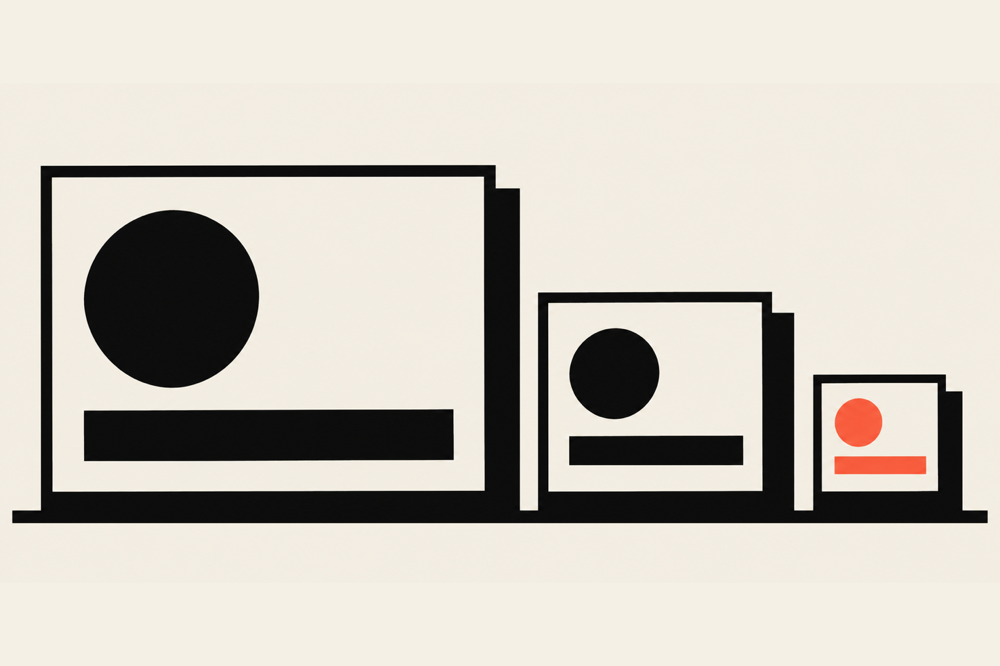
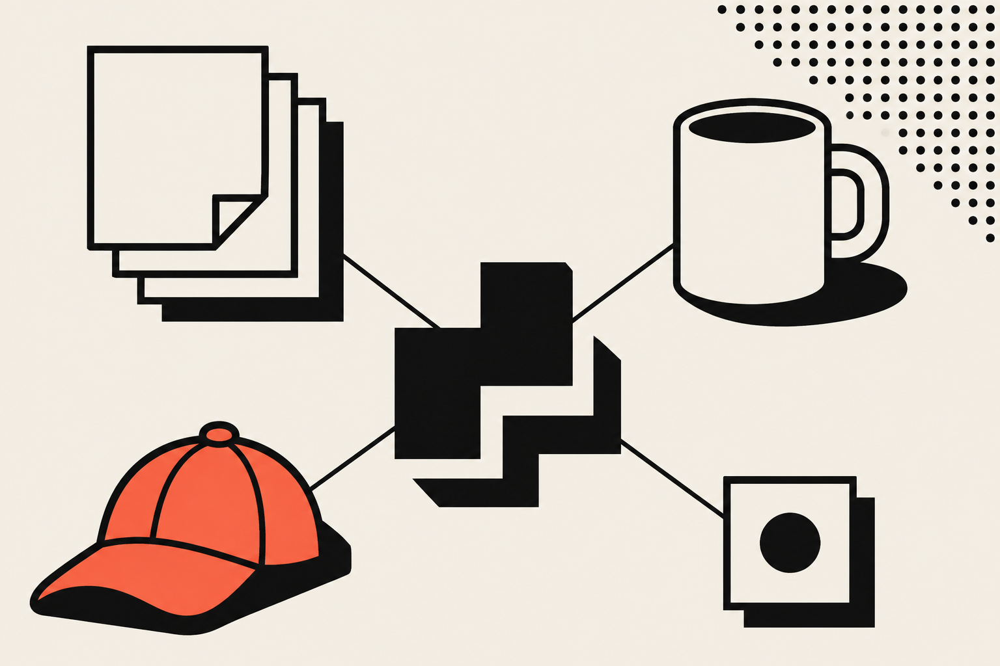

A logo should cost somewhere between a few hundred dollars and a few thousand, depending on who draws it and what you get at the end. My own basic logo runs $1,000 to $1,500. A full brand package with voice and guidelines has run $6,000 to $7,000 for me, and can go higher when a brand needs more.

## How much should a logo cost?

Plan on $100 to $2,000 or more for a freelancer, $2,500 and up for an agency, and close to nothing for a do-it-yourself tool. Price follows the process and the files you receive, so ask what is included before you compare two numbers.

Here is what the big guides say. <a href="https://www.vistaprint.com/hub/logo-design-cost" target="_blank" rel="noopener" aria-label="Vistaprint's logo design cost guide, opens in a new tab">Vistaprint</a> puts do-it-yourself tools and AI logo makers at $0 to $150, entry-level freelancers at $150 to $800, and experienced freelancers or design contests at $800 to $2,500. It says that last range typically buys multiple concepts, a few revision rounds and production-ready files. It lists studios and branding agencies at $2,500 to $10,000 and up. <a href="https://www.designrush.com/agency/logo-design/trends/how-much-does-logo-design-cost" target="_blank" rel="noopener" aria-label="DesignRush's logo design cost guide, opens in a new tab">DesignRush</a> says freelancers charge $100 to $2,000 or more, depending on experience and complexity, and agencies $2,500 and up.

Both of those sites sell design services or connect you with people who do, so read the numbers as a rough map and not a price list. They also disagree a little with each other, which tells you the real answer is "it depends on the deliverables."

| Who you hire | Typical logo price | What the guides say you get |
| --- | --- | --- |
| DIY tool or AI logo maker | $0 to $150 | A template-based logo, limited originality |
| Entry-level freelancer | $150 to $800 | Depends on how well you vet them and how many revisions are included |
| Experienced freelancer | $800 to $2,500 | Several concepts, a few revision rounds, production-ready files |
| Studio or agency | $2,500 to $10,000+ | Research, creative direction and a larger system |

Source: Vistaprint, with the DesignRush ranges as a cross-check.

## What does a freelancer deliver for $1,000 to $1,500?

For a basic logo I charge $1,000 to $1,500. You get five to seven first concepts, up to three rounds of revisions and one final logo in three sizes, delivered as a multi-page PDF plus the vector file. That is a real design process compressed into a small package, and it fits inside the experienced-freelancer band in the table above.

Logo quotes get confusing fast, because "a logo" means different things to different designers. So here is each piece.

<Terms>

<Term name="Five to seven first concepts">

These are different directions, not five copies of one idea with new colors. Most clients look at them, say what they like, and the list shrinks to one or two. I like that moment, because people are usually surprised by what they pick.

</Term>

<Term name="Up to three rounds of revisions">

A revision round is you telling me what to change and me changing it. A basic logo usually takes one round. The cap is there so both of us know when we are done.

</Term>

<Term name="One final logo in three sizes">

The large version is a word mark with the logotype and an icon. The medium version is a simpler lockup. The small version is the icon in a badge, or the icon alone, for a profile picture or packaging. This is, honestly, the part cheap logos skip, and you notice it the first time your logo has to fit in a tiny circle.

</Term>

<Term name="A PDF and the vector file">

You get a multi-page PDF that shows the logo and how the versions relate, plus the Adobe Illustrator vector file. A vector file is one you can scale from a business card to a banner without the edges going soft.

</Term>

</Terms>

## What does a logo leave out that a brand package covers?

A logo is one mark. A brand package adds the voice documents, the brand guidelines and the files for every place the mark will appear. If you buy only the logo, you will still need to decide your colors, fonts and tone, and write them down, or someone else will guess for you.

I covered the difference in more detail in <a href="/blog/brand-identity/small-business-branding-guide">small business branding: how to build a brand identity</a>. For cost, the short version is that a logo-only purchase leaves four jobs open.

1. Writing down how you sound, so your menu, your replies and your captions match.
2. Writing the rules, so a printer or a new hire does not stretch or recolor the mark.
3. Making the profile images, banners and other files each platform needs.
4. Applying the mark to real things like packaging, uniforms and merch, to see whether it holds.

Some of those you can do yourself with a free afternoon. A logo bought on its own is a perfectly good purchase if you have the time and the taste to handle the rest, or a designer-friend who will. If you do not, the gap shows up later, as a sign, a website and an Instagram page that look like three cousins who never met.

## How much does branding cost for a small business?

A basic brand identity from agencies runs roughly $5,000 to $25,000, according to <a href="https://www.designrush.com/agency/branding/trends/how-much-does-branding-cost" target="_blank" rel="noopener" aria-label="DesignRush's branding cost guide, opens in a new tab">DesignRush</a>. My full brand packages have gone up to $6,000 and $7,000, and can go higher, because some brands need a lot more. The price rises with the number of things you need made.

DesignRush breaks the larger number into parts. It prices logo design at $2,000 to $10,000, and puts both a visual identity and a set of brand guidelines at that same $5,000 to $25,000. Messaging and voice work runs $3,000 to $15,000 in its breakdown. It also lists brand strategy at $7,500 to $40,000 and market research at $8,000 to $30,000 as separate lines. Those are agency prices, and an agency is paying for several people to coordinate.

When I scope a full brand identity system, it adds the brand voice documents and brand guidelines, which together make a brand bible your marketing team or a future designer can work from. Bigger packages add more:

- Packaging and merch mockups, like T-shirts, hats, mugs and bags
- Every logo file you need, such as Facebook and Instagram profiles and social media banners
- Starter carousels for social campaigns
- Layered Illustrator or Photoshop templates for different setups

Each of those items takes real hours. That is the whole reason one brand costs $1,000 and another costs $7,000: it is two different amounts of work. A bigger quote can still be a worse deal, and a small one can leave out half of what you need. Ask for the list.

## Should you hire a freelancer or an agency for branding?

Hire a freelancer when you want one person who does the work, answers your messages and charges for the work and not for the office. Hire an agency when you need a large team across many channels at once. DesignRush says agencies cost 2 to 4 times more than freelancers, because you pay for coordination and quality assurance.

For a shop, a service business or a small startup, I think the freelancer route is the better trade most of the time, and I am obviously biased, so do not take my word for it. Here is what to compare.

<Terms>

<Term name="Who does the work">

At a freelancer, the person you meet on the call is the person who draws the logo. At an agency, you may meet a salesperson and a project manager and never talk to the designer. Ask who will do the work.

</Term>

<Term name="Speed">

One person can move fast on a small project, since there is no hand-off between teams. That same one person has a limit, so a very large rollout across many markets is a different job.

</Term>

<Term name="Cost">

You are paying a person's time in one case and a team plus overhead in the other. The guides agree that agencies charge more, and they disagree about how much.

</Term>

<Term name="Ownership">

Ownership is typically included with a freelancer, but DesignRush says to verify it, and extra file formats and licensing rights may cost extra. Read the agreement and ask for the vector file in writing.

</Term>

</Terms>

## What should you ask before you pay for a logo?

Ask what you will receive, how many concepts and revisions are included, which file types you get, who owns the final artwork and how many sizes the logo comes in. A designer who answers those in a sentence each has a process. A designer who dodges them is quoting you a mystery.

Here is the list I would bring to any designer, me included:

1. How many first concepts do I see, and how many revision rounds are included?
2. Do I get a vector file, and in which program is it editable?
3. Is there a version of the logo that works at the size of a profile picture?
4. Do I own the final artwork outright?
5. What does it cost to add voice documents and brand guidelines later?
6. What happens if I do not like any of the first concepts?

Question 5 matters more than people expect. If you buy a logo today and want a brand package in six months, the designer has to learn your business again. If you know up front that you will want the whole thing, say so, and ask for a quote that covers it.

## What did this look like on a real project?

The closest example I can point to is 'Aiwi Waffles, a waffle shop in Waikiki. The brand had to work in a physical store, on a food truck, on an online storefront and on a merch line, so it needed to hold together on a lot of surfaces. I started with the brand and identity, and the work has since grown into an ongoing partnership. You can read the whole story in the <a href="/work/aiwi-waffles">'Aiwi Waffles case study</a>.

That is what a brand identity looks like when it is built to travel. The logo is one piece of the job, and the harder piece is making the same decisions show up on a sign, a screen and a T-shirt.

## Is a cheap logo or a full brand the better investment?

It depends on where your business is. A cheap logo is a good call when you are testing an idea and a new name is likely, though a template logo can look great right up until you spot the same swoosh on a competitor's truck. A full brand pays you back when the business is real, you are about to print things and you want every new page, sign and post to look like it came from the same place.

When I moved to Hawai'i I talked to business owners every day, and some of them told me $1,000 or $2,000 was a big investment for them. They had only ever thought of it as an expense, because they could not see what it would return. I think about that every time a client asks what a logo or a brand package costs, because the price only makes sense once you know what you are getting back for it.

If you run a business and you are thinking "cool, but I just need a logo that looks good," that is a fine place to start, and a $1,000 to $1,500 logo will do that job. If you already know you are opening a second location or launching products, spend once on the full set, because redoing a brand later costs more than building it right the first time.

If you are a designer or developer reading this and wondering what to charge, do the same exercise I did: list the deliverables, put an hour count next to each one and let the price follow. Then write the list into your proposal so the client can see what each dollar buys.

I design brand identities that hold together across logo, signage and merch. If you want a quote for a logo or a full package, take a look at my <a href="/services">services</a> and reach out. Bring your list of what you need, and I will tell you which parts are worth paying for now and which can wait.
