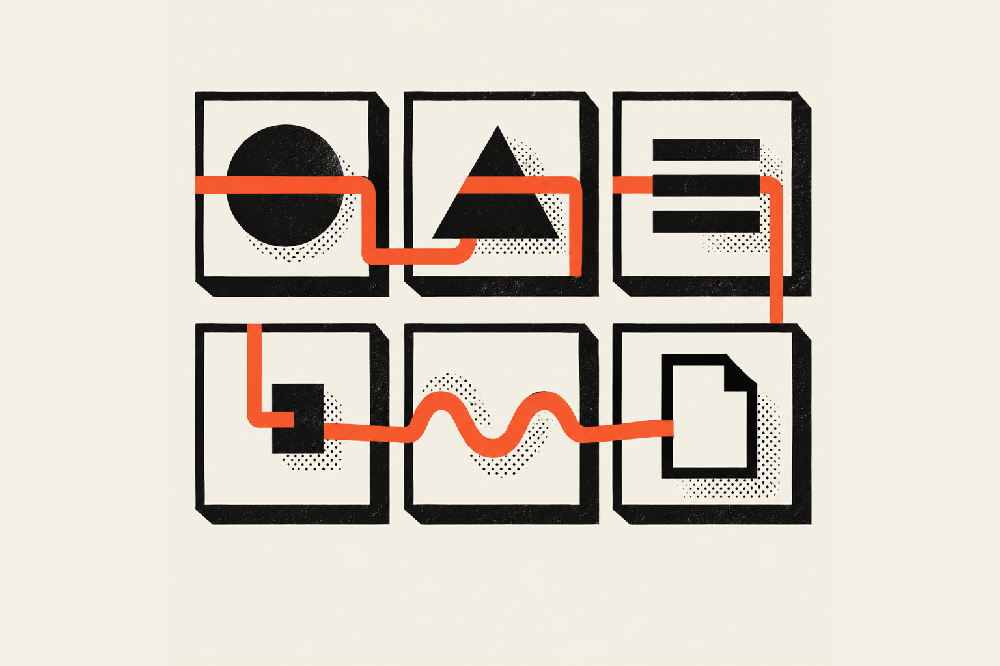
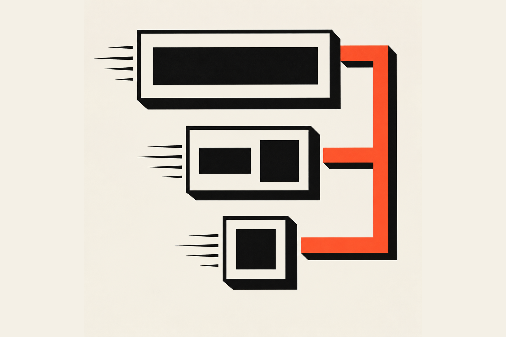

Small business branding is the set of decisions that make your business look and sound like the same business everywhere a customer meets it. A brand identity is those decisions written down: a name, a logo, colors, fonts, a voice and rules for using them. I build it in that order, starting with the name.

## What are the parts of a brand identity?

A brand identity has two halves. The visual half is a logo, a small set of colors, fonts and an image style. The verbal half is your name, your voice and the few sentences that say what you do and who it is for. Written rules tie the halves together.

There is a lot of information out there on this, and it gets overwhelming fast, so here is the plain version. Every guide I read lists roughly the same pieces under different names. <a href="https://www.enterprisenation.com/learn-something/building-a-visual-brand-for-small-business" target="_blank" rel="noopener" aria-label="Enterprise Nation's visual brand guide, opens in a new tab">Enterprise Nation</a> splits the visual side into a logo, a color palette, typography and an image style (photos, icons and illustrations). <a href="https://blog.marketing360.com/design-and-branding/how-to-build-a-strong-brand-identity-for-your-small-business-online/" target="_blank" rel="noopener" aria-label="Marketing 360's brand identity guide, opens in a new tab">Marketing 360</a> adds personality, brand voice and content. <a href="https://countingup.com/resources/how-to-create-a-brand-identity-for-a-small-business/" target="_blank" rel="noopener" aria-label="Countingup's brand identity guide, opens in a new tab">Countingup</a> adds a style guide and a website that matches the rest.

Here is how I group them when I work with a client:

<Terms>

<Term name="Name">

What people call you, say out loud and type into a search box. It has to be easy to spell, easy to say and free to use.

</Term>

<Term name="Logo">

The mark you put on things. It needs more than one version, because a sign over a door and a profile picture the size of a thumbnail are different jobs.

</Term>

<Term name="Color">

A short list of colors with a job for each one: the main color, the background, the text and one accent. Fewer is better.

</Term>

<Term name="Type">

One or two fonts, with a rule for which goes where.

</Term>

<Term name="Voice">

How you write when nobody is checking. Friendly and casual, plain and professional, or bold and a little weird.

</Term>

<Term name="Rules">

A short document that records the choices above so the next person who touches your brand does not have to guess.

</Term>

</Terms>

## What is the difference between a logo and a brand identity?

A logo is one mark. A brand identity is everything around it: the colors, fonts, voice and rules that decide how the mark gets used. You can have a logo with no identity, and many small businesses do, which is why their sign, their website and their Instagram look like three cousins who never met.

Think of it like a surf lineup. The logo is one wave. The identity is knowing the break, the tide and the people in the water, so you can ride the next wave without starting from scratch. A logo tells people who you are. An identity tells them how it feels to deal with you, and it keeps telling them on every surface.

Marketing 360 lists the logo inside the visual identity, which sits inside the whole brand identity. That matches how I scope the work, which I cover below.

## How do I create a brand identity for a small business?

Start by answering three questions on paper: what you do, who it is for and why they should pick you over the next shop. Then make the verbal choices (name and voice), then the visual ones (logo, color, type), then write the rules. Test it on your real signs and pages before you call it done.

Every guide I read starts at the same place. Countingup says to work out who you are, what makes you different and who your customers are before you choose any design. I agree with them, with one change that comes from doing this for a living: the website is for the customer. The owner is not the one buying. So I write down what the visitor needs, which is often different from what the owner wants to see, and I build the brand around that.

Here is the sequence I would use:

1. Write down who you serve and what they need, in plain sentences.
2. Settle the name and check that you can use it.
3. Design the logo in a few versions.
4. Pick the colors and the fonts.
5. Decide how you sound.
6. Put it on the real things, starting with the ones customers see first.
7. Write the rules on one page.

## What order should I build it in?

Build it in the order customers will meet it. Name first, because everything else carries it. Then the mark, colors and type, because they decide how every other piece looks. Then the things people see in person, like signs and packaging, and last the places that can change fast, like a website or a social profile.

There is a reason for that order. A name change after you have printed signs is expensive. A color change on a website takes an afternoon. Spend your slow thinking on the decisions that are hard to undo.

### Step 1: Pick a name you can use

Pick a name that is easy to say and spell, then check that it is free before you fall in love with it. The <a href="https://www.sba.gov/business-guide/launch-your-business/choose-your-business-name" target="_blank" rel="noopener" aria-label="the SBA's guide to choosing a business name, opens in a new tab">U.S. Small Business Administration</a> lists four separate registrations that people mix up: your state entity name, a federal trademark, a DBA ("doing business as") and a domain name. It says to check a name against the USPTO's trademark database before you commit, because infringement lawsuits can be costly.

Most small businesses use one name for all four. Check them all on the same afternoon, before you pay a designer to draw a logo around a name you may not be allowed to keep.

### Step 2: Design the mark in more than one size

A logo needs a large version, a medium version and a small one. When I design a basic logo, the final is one logo in all three. The large version is a word mark with the logotype and an icon. The medium is a simpler lockup. The small one is the icon alone, or the icon in a badge, for a profile image or packaging.

People skip this, and it is why a logo that looks great on a business card turns into a smudge on a phone. Test the small version at thumbnail size before you approve anything.

Google gives you a concrete reason to care. <a href="https://support.google.com/business/answer/6103862" target="_blank" rel="noopener" aria-label="Google's guide to Business Profile photos and logos, opens in a new tab">Google's Business Profile help page</a> says a logo should be a JPG or PNG between 10 KB and 5 MB, recommends 720 by 720 pixels and sets a 250 by 250 minimum. Your logo will be small and square in the place where many customers find you first.

### Step 3: Choose colors with a job for each

Pick one main color, one background, one text color and one accent. Write down what each is for. When an accent has a single job, it stands out, and when it appears everywhere, nobody sees it.

Check the contrast before you fall for a pair. The <a href="https://www.w3.org/WAI/WCAG22/Understanding/contrast-minimum.html" target="_blank" rel="noopener" aria-label="the W3C's WCAG 2.2 contrast minimum explainer, opens in a new tab">Web Content Accessibility Guidelines (WCAG) 2.2</a> require a contrast ratio of at least 4.5 to 1 for normal text and 3 to 1 for large text, which they define as roughly 18 point, or 14 point bold. A pale yellow on white looks sweet in a mood board and is unreadable on a phone in sunlight. Free contrast checkers give you the ratio in seconds, which is cheaper than learning it after the menu is printed.

I use the same idea on this site. I keep a short palette with one accent, and the rules say where the accent is allowed. If you want to see how a small set of decisions turns into a system, I walked through that in <a href="/blog/design-systems/how-to-create-a-design-system">how to create a design system</a>.

### Step 4: Pick one or two fonts and a rule for each

Choose one font for headlines and one for everything else, and write down which goes where. Read the font at body size on a phone, and look at your longest words in the headline font, because a word that breaks across two lines looks like a mistake on a sign.

Check the license too. When a client wants a font they found, I check whether it has an open license, and if it does not, we find the closest one that does.

### Step 5: Decide how you sound

Write five sentences in your voice: a greeting, a thank-you, an apology, a price and a "no". If they sound like they came from five different people, you do not have a voice yet. Pick two or three adjectives (friendly, plain, a little funny) and write a rule for what you never say.

Voice is the part owners skip, and it is the part that makes a business feel like a person. It costs nothing, and once it is written down your menu, your reply to a bad review and your Instagram caption sound like the same place.

### Step 6: Put it on the real things

Apply the identity to the surfaces your customers meet, starting with the ones they see in person: signs, packaging, uniforms and anything people carry away. Then move to the places that are easy to change: your website, your social profiles and your Google listing.

This is where an identity either holds or falls apart. A sign is read from across the street, a mug is read in one hand and a profile picture is a tiny square. If the identity only works on a business card, it is a logo and nothing more.

### Step 7: Write the rules on one page

Put the logo versions, the colors with their hex codes, the fonts, the voice notes and two or three "never do this" examples on one page. That page is your brand guidelines. It keeps a printer, a new hire or a freelancer from guessing.

<a href="https://www.enterprisenation.com/learn-something/building-a-visual-brand-for-small-business" target="_blank" rel="noopener" aria-label="Enterprise Nation's visual brand guide, opens in a new tab">Enterprise Nation</a> recommends the same thing, a short document covering logo rules, color codes, fonts and tone. It also says to rebrand only when your audience, services or values change, which is good advice. Your customers are only starting to recognize the logo when you are sick of it, so leave it alone.

## What did this look like on a real project?

For 'Aiwi Waffles, a waffle shop in Waikiki, the identity had to work on a physical store, a food truck, an online storefront and a merch line. I designed the logo, the brand messaging and a visual system, then the signage for the store and the food truck, then the Shopify storefront and the merch.

The case study lists those pieces, but I don't have a clean day-by-day timeline for them, so the order above is my advice and not a log of what happened. What I can tell you is why the pieces had to agree. The same brand was going to be read from across a street, on a phone and on a T-shirt, and a decision that only worked in one place would have failed in the other two.

Here is what carried over from one surface to the next on that project:

- The logo came in more than one form. The brand and merch photo in the case study shows it in black on ivory and in ivory on black, so the same mark works on a light background and a dark one.
- Signs, the storefront and the merch share one visual system, so a customer who sees one recognizes the next.
- I optimized the Google Business Profile so the listing matches the shop. As of the case study, the storefront ranks #1 on Google for multiple local searches.

That last point matters because of how people really find the shop. Customers have told me they searched "breakfast spot Waikiki," opened the 'Aiwi site next to about four others, and picked it because it looked professional, inviting, warm and friendly, while the others looked outdated. Your identity does its job in the second between the search results and the decision. I wrote up the search side in the <a href="/blog/technical-seo/local-seo-case-study-aiwi-waffles">local SEO case study</a>.

## How long does a brand identity take?

It depends on the scope, and I will not give you a single number that fits everyone. A basic logo usually goes through one round of revisions. A full identity with voice documents, guidelines and mockups takes longer, mostly because of how long the client takes to decide and how many rounds they want.

The slow part is rarely the design. It is the thinking before the design, and the waiting while people agree. Come with your answers to the three questions above and you will save your designer hours.

I don't have a clean timeline for 'Aiwi Waffles to share, and the guides I read give none either: Countingup says only that the process takes hard work, deep thinking and lots of research. Be suspicious of anyone who promises a finished brand in a weekend.

## How much does a brand identity cost?

I don't publish a price for brand work, because no two businesses need the same amount of it. A food truck that needs a logo for its window and its Instagram is a smaller job than a shop that needs packaging, merch and a brand bible for its staff. If you want a real number, book a <a href="/contact?service=brand-development">free call</a>. Tell me what you have and where the brand has to show up, and I'll price it to your business.

Here is what the difference buys you:

| What you get | Basic logo | Full brand identity |
| --- | --- | --- |
| First concepts | 5 to 7, narrowed to 1 or 2 | Not listed separately |
| Revisions | Up to 3 rounds, though a basic logo usually takes one | Not listed separately |
| Logo files | One logo in large, medium and small formats | Every logo file you need, such as social profiles and banners |
| Delivery | A multi-page PDF and the Adobe Illustrator vector file | Brand voice documents and brand guidelines added |
| Extras | None | Packaging and merch mockups, social carousels, layered templates |

A full identity costs more because you get the rules and the files that make the logo usable, plus a brand bible your marketing team or a future designer can work from. A template gives you a picture. An identity gives you something to build on, which is why the good clients treat it as an investment with a return.

If you want to save money, start with the basic logo and add the rest as the business grows.

## What are the common small business branding mistakes?

The biggest mistake is making the logo first and the decisions second. The next biggest is making a brand that only works in one place. After those come a color palette with no contrast, a font with no license and a voice that changes with every post.

Here is a roast of the typical case. The website every plumber has, with a stock photo of a smiling man holding a wrench and a blue gradient button, looks fine at a glance and is absolutely atrocious the moment you see it next to the truck, the invoice and the Google listing, which all look like they belong to three different companies. The fix is dull and effective: one page of rules, applied everywhere.

Three quick checks will catch most of it:

1. Put your logo on a phone-sized square. If you cannot tell what it is, make a small version.
2. Put your main text color on your background color in a contrast checker. If it fails, change one of them.
3. Line up your sign, your website and your Google listing. If a stranger would not guess they belong together, fix the one that is the odd one out.

For more on keeping a brand consistent once it exists, the <a href="/blog/brand-identity">Brand Identity articles</a> collect the rest of what I write on the subject.

## What does this look like when I do it for you?

The full story of 'Aiwi Waffles is in the <a href="/work/aiwi-waffles">case study</a>. It taught me that a brand has to hold up in every place a customer meets it, and I run that test on every identity now.

If you're a business owner thinking "cool, but I just need people to trust my shop," that is the whole point. A brand identity does that job every day without you being there, and it costs more up front than a template because it pays you back every time you add a sign, a page or a product. If you want one dialed in for your business, check out my <a href="/services">services</a> and book a <a href="/contact?service=brand-development">free call</a>.

If you're a designer or developer, take the three quick checks above and run them on your next client before you open a design tool. You will find the real problem faster, and your client will see why you are asking.
