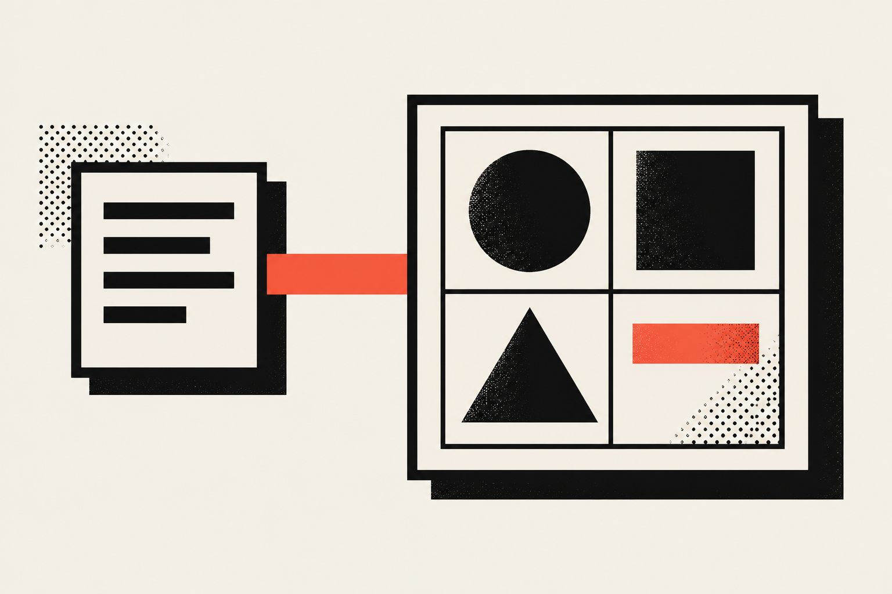

A brand strategy is a short written plan that says who your business serves, what makes it the better choice for them and how it should sound. Your logo, colors and website come after it and carry it out. For a small business, I think the whole plan fits on two pages and takes about a week.

## What is a brand strategy?

A brand strategy is the thinking you do before you design anything. It answers who you serve, what they need, why you beat the other options and how you talk to them. You write the answers down once so every sign, page and post can follow them.

There is a lot of information out there on this, and it gets overwhelming fast, so here is the plain version. When a stranger asks around about your business, what they hear back is your brand. Your strategy is the plan for what you want them to hear, and the reasons that make it true.

The guides I read each use their own words for it. <a href="https://www.vistaprint.com/hub/branding-strategy" target="_blank" rel="noopener" aria-label="Vistaprint's branding strategy guide, opens in a new tab">Vistaprint</a> calls it your long-term plan for how your business presents itself. <a href="https://www.jacobtyler.com/blog/brand-vs-branding-vs-brand-strategy-whats-the-difference/" target="_blank" rel="noopener" aria-label="Jacob Tyler's article on brand and brand strategy, opens in a new tab">Jacob Tyler</a> says it defines your purpose, your promise and your position in the market. <a href="https://www.enterprisenation.com/learn-something/brand-vs-brand-identity-vs-brand-strategy/" target="_blank" rel="noopener" aria-label="Enterprise Nation's brand strategy explainer, opens in a new tab">Enterprise Nation</a> describes it as the questions, conversations and thought process you use to plan your brand, including why you started, what sets you apart, who your audience is and who your competitors are.

Those are three phrasings of one idea: you decide the "why" and the "who" in words first, and the visuals follow.

## What is the difference between brand strategy and brand identity?

Brand strategy is the plan, and brand identity is the visible and audible result of it. Strategy decides who you serve and what you promise. Identity is the logo, colors, fonts, photos and tone of voice that show that promise to people. Branding is the ongoing work of putting both in front of customers.

<a href="https://firebrandagency.com/articles/brand-strategy-vs-brand-identity" target="_blank" rel="noopener" aria-label="Firebrand's article on brand strategy and brand identity, opens in a new tab">Firebrand</a> puts it as the plan and the execution. I like that because it matches how I work: I write the plan, then I design the execution, and I check each design choice against the plan.

Not every source draws the line in the same place. <a href="https://smallbiztrends.com/brand-strategy-for-small-business/" target="_blank" rel="noopener" aria-label="Small Business Trends' brand strategy guide, opens in a new tab">Small Business Trends</a> starts its strategy by defining your "brand identity," and means your mission, core values and unique value proposition by that. In my work I call those strategy and keep identity for what people can see and hear. Whatever you call the pieces, write them down before you choose a font.

| | Brand strategy | Brand identity |
| --- | --- | --- |
| What it is | The plan | The visible and audible result |
| Main question | Who do we serve and why do they pick us? | What does that look and sound like? |
| Typical output | Two pages of written decisions | Logo, colors, fonts, voice rules |
| Who it is for | You, your team and your designer | Your customers |
| What changes it | A shift in audience, offer or values | A refresh when the strategy has not changed |

I covered the identity half, step by step, in <a href="/blog/brand-identity/small-business-branding-guide">small business branding</a>. This article covers the half that comes before it.

## Should I do brand strategy before a logo?

Yes. Do the strategy first, because a logo is a design decision and a design decision needs something to be right or wrong against. With a written strategy, you can tell your designer why a mark is wrong. Without one, every opinion on the logo is a coin flip.

Firebrand is blunt about this. It says strategy comes before identity, and that without strategic clarity the identity choices tend to be arbitrary. It also warns that a rebrand often fails to stick when a company updates its look without revisiting the strategy.

I have a more personal reason. The website is for the customer, and the owner is not the one buying. My job is to connect what the business is aiming for with what the visitor needs, and a strategy is where I write both down side by side. If I skip it, I end up designing for what the owner likes to look at.

Here is the roast, because I can't help it. The logo-first brand, a swoosh and a nice blue picked on a Friday afternoon, looks great right up until someone asks "what is this for?" and the room goes quiet. The blue was fine. The decision about who it was for was criminally missing.

## How do I build a brand strategy?

Make seven decisions in order: the customer, the problem, the alternatives, your difference, your position, your messages and your voice. Write each in plain sentences. The first four are research and thinking, and the last three are writing. Together they are your strategy.

Other guides list different numbers of steps. <a href="https://www.getbumpa.com/blog/how-to-develop-an-effective-brand-strategy-for-your-small-business-in-8-steps" target="_blank" rel="noopener" aria-label="Bumpa's eight step brand strategy guide, opens in a new tab">Bumpa</a> has eight, from defining your identity through messaging and positioning to tracking and adjusting. Vistaprint has six. They overlap a lot, and mine is one more way to cut the same ground, kept small on purpose so a shop owner can finish it.

### Decision 1: Who is the customer?

Name the one kind of person you most want more of, and describe them by what they are trying to get done. Skip the age bracket and write the situation: what they searched, what they were worried about and what they did next.

The U.S. Small Business Administration (SBA) says in its <a href="https://www.sba.gov/business-guide/plan-your-business/market-research-competitive-analysis" target="_blank" rel="noopener" aria-label="the SBA's market research and competitive analysis guide, opens in a new tab">market research guide</a> that you should understand your consumer base from the outset, and that asking consumers yourself can give you a nuanced understanding of your specific audience. I agree with that, and I will go further: ask them in person. Five short conversations beat any template.

### Decision 2: What problem do they bring you?

Write the problem in the customer's words, not yours. A bike shop owner may say "drivetrain service," while the customer says "my bike makes a noise and I have a ride on Saturday." The second sentence is the one your homepage should speak to.

### Decision 3: What else could they pick?

List the real alternatives, including doing nothing. The SBA describes competitive analysis as learning from the businesses that compete for your potential customers, and it suggests mapping competitors by product or service and by market segment.

Keep it small. Pick four or five names, open their sites and write down in one line what each one promises. You are looking for the gap, and also for the sentence every competitor uses, because you will avoid that one.

### Decision 4: Why you?

Write the one or two things you do that the alternatives don't, and make each one something a customer could check. "Quality service" cannot be checked. "We call you the same day with a price" can.

If you can't find a difference, look at who you serve before you look at what you sell. A narrower customer often makes the difference obvious.

### Decision 5: What is your position?

A position is one sentence that places you in the customer's mind: who it is for, what you are, and why you are the better pick. A simple frame is "For [customer] who [problem], we are [what you are] that [difference]."

Here is a made-up example, not a client: "For riders with a race on Saturday who can't wait a week for a repair, we are the bike shop that quotes a price by phone and fixes it in a day." It is long, and it does its job. Everyone in the shop can say it, and you can test any new idea against it.

### Decision 6: What are your messages?

Take the position and break it into three or fewer short statements you will repeat everywhere, each with one proof behind it. A proof is a fact: a review count, a turnaround time, a thing you do that others skip.

Do not invent proof. If you don't have a number yet, use a plain claim you can stand behind and collect the number later. Only state results you can show.

### Decision 7: How do you sound?

Pick two or three adjectives for your voice and write five sample lines: a greeting, a thank-you, an apology, a price and a "no." If the five lines read like five different people, you don't have a voice yet.

Voice is the part that keeps your menu, your reply to a bad review and your Instagram caption sounding like the same place. It also makes your strategy easy to hand to a freelancer or a new hire.

## What does a small brand strategy look like on paper?

It is two pages: a page for the customer, the problem, the alternatives and your difference, and a page for your position, your messages and your voice. Put today's date on it, because you will want to see how it changes. Here is the shape.

<Terms>

<Term name="Customer">

One paragraph on the person you most want, in their situation and their words.

</Term>

<Term name="Problem">

One sentence in the customer's own words.

</Term>

<Term name="Alternatives">

Four or five competitors, with what each one promises in a line.

</Term>

<Term name="Difference">

One or two things you do that a customer could check.

</Term>

<Term name="Position">

The single sentence that places you.

</Term>

<Term name="Messages">

Up to three short statements, each with its proof.

</Term>

<Term name="Voice">

Two or three adjectives and five sample lines.

</Term>

</Terms>

That is the whole thing, honestly. A bigger company needs more, such as brand architecture for several products, and a small shop does not. If the plan runs past two pages, you are probably writing a brand guide, which is the identity step.

## How long does a brand strategy take?

A small business can finish the strategy in about a week if the owner makes the decisions and the research stays small. The time goes on the conversations and on the wording, not on the writing. This is my suggested schedule, and I didn't log it from a client project.

| Day | Work | What you have at the end |
| --- | --- | --- |
| 1 | Write down what you know about your customer. Book five short conversations. | A first draft of the customer and a list of people to ask |
| 2 | Hold the conversations. Write down their exact words. | The problem, in the customer's words |
| 3 | Review four or five competitors. | The alternatives and the gap |
| 4 | Decide your difference. Draft the position. | One position sentence |
| 5 | Write the messages and their proof. | Up to three messages |
| 6 | Write the voice lines and read them out loud. | The voice |
| 7 | Put it on two pages. Test it on one real sign or page. | The strategy |

The Day 7 test matters. Take a real thing, such as your Google listing or a window sign, and ask whether it follows the plan. If it doesn't, fix the thing or fix the plan.

## What does this look like on a real project?

On the projects where I own the brand, the strategy question shows up before the design: who is this for, and what do they need to see. Two of my case studies show it from different sides, and I'll tell you only what the case studies say.

'Aiwi Waffles needed one brand that worked in a store, on a food truck, in an online shop and on merch. For that project I designed the logo, the brand messaging and a visual system, and I made the signage for the store and the truck. You can see the pieces in the <a href="/work/aiwi-waffles">'Aiwi Waffles case study</a>.

The customer part of the story is my favorite. The owner first assumed her customers were people walking past the Waikiki storefront. Over many conversations I showed her the traffic in her Google Business Profile, Google Search Console and Google Analytics, until she saw that visitors search on their phones and then walk or take an Uber to the shop. That is Decision 1 in action, and she learned it from data instead of a guess. It changed which channels mattered, and I wrote up the search side in the <a href="/blog/technical-seo/local-seo-case-study-aiwi-waffles">local SEO case study</a>.

Vamp Network has the opposite problem, because one business serves creators, managers and brands. The <a href="/work/vamp-network">Vamp Network case study</a> describes a platform for all three audiences, and an intake flow where a creator picks whether they want management, commission or portfolio optimization. A brand strategy for a business like that has to say who each audience is and what each one needs, and the product I built mirrors that split. I don't have a written strategy from that project to show you, so treat it as an example of why one customer sentence is not always enough.

## What are the common brand strategy mistakes?

The four common mistakes are writing for yourself, writing a position nobody could disagree with, inventing proof and filing the plan where nobody reads it. Starting with the logo is a fifth, and the earlier section covers it. Each one has a small fix.

<Terms>

<Term name="Writing for yourself">

If the strategy reads like the owner's favorite things, check it against the customer's words from Decision 2. Replace any sentence you can't tie to something a customer said.

</Term>

<Term name="A position nobody could disagree with">

"Quality products at a fair price" is true of every shop and tells nobody anything. Test a position by asking whether a competitor could say the opposite. If not, sharpen it.

</Term>

<Term name="Inventing proof">

Every message needs a fact behind it. Only claim what you can show, and leave a number out until you have it.

</Term>

<Term name="Filing it away">

A strategy that sits in a folder is a school assignment. Put the position and the voice lines where your team works, and check one real thing against them each month.

</Term>

</Terms>

## What should I do next?

Start with the five customer conversations, because they are the cheapest and most useful hour you will spend this month. Then write the two pages, check one real sign or page against them and fix what doesn't match.

If you run a business, a strategy costs more than a $1,000 template, and it pays you back on every sign, page and post that you no longer have to argue about. If you want one dialed in for your shop or product, check out my <a href="/services">services</a> and book a <a href="/contact?service=brand-development">free call</a>. I'll help you write the two pages, then design to them.

If you're a designer or developer, try writing the position sentence before you open your design tool on the next job. If you can't, you have found the real first task, and your client will be glad you asked. The rest of what I write on this lives in the <a href="/blog/brand-strategy">Brand Strategy articles</a>.
