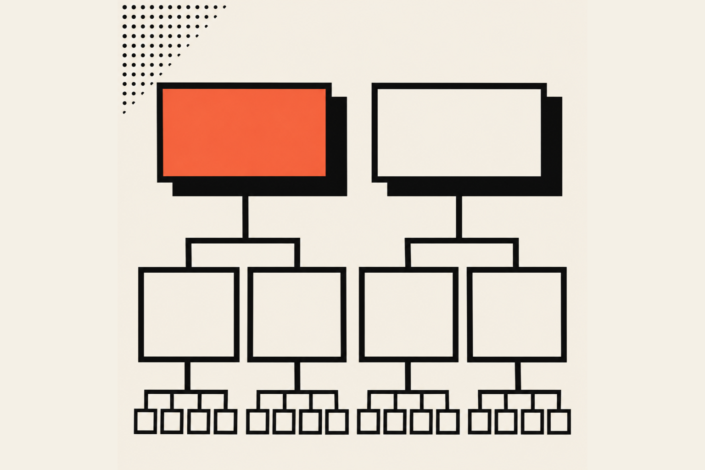
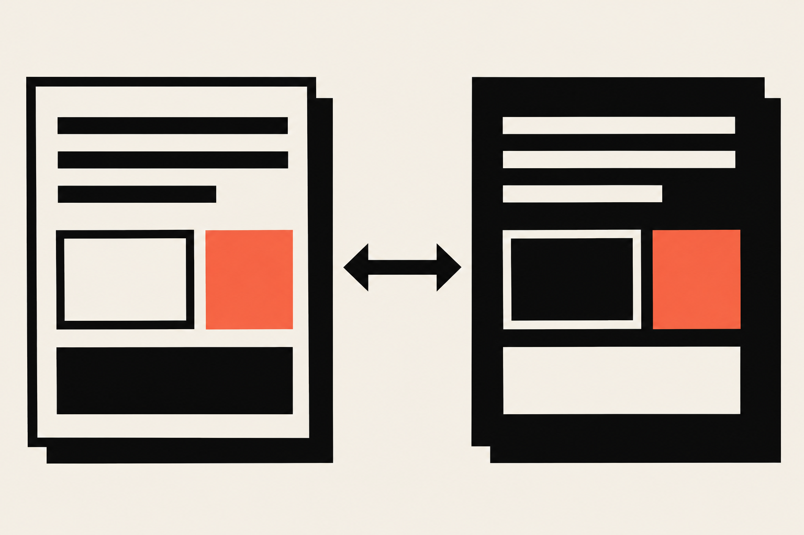
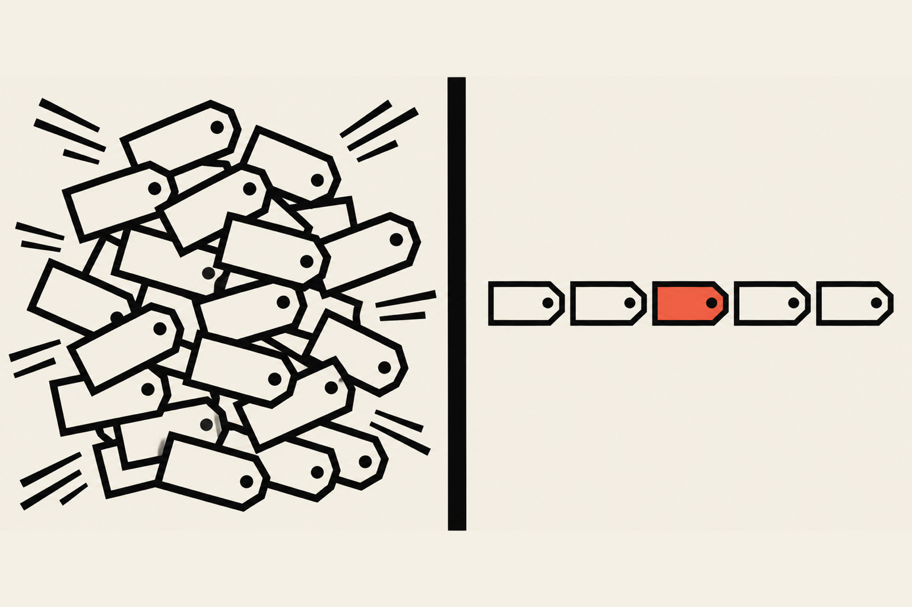

A design token is a design decision with a name, stored in one place and used everywhere. "Brand color" becomes a name and a value, and every button, link and heading reads from it. Tokens come in three tiers: primitive, semantic and component. Most small products only need the first two.

## What are design tokens?

Design tokens are named design decisions, usually a color, a size, a font or a duration, kept in one file so the whole interface reads from the same source. Change the value once and everything that uses the name changes with it. The name is the useful part, because a name means the same thing to a designer, a developer and an AI coding tool.

There's so much written about this that it gets overwhelming, and plenty of it reads like the author is trying not to be understood. Here's the plainest version I can give. Picture a house where every light switch is labeled "kitchen" or "hallway" instead of "the third switch from the left." You don't need to remember the wiring, because you just say which light you want.

The W3C Design Tokens Community Group keeps a draft format spec, and it defines the term in one line. In <a href="https://www.designtokens.org/tr/drafts/format/" target="_blank" rel="noopener" aria-label="the Design Tokens Format Module draft, opens in a new tab">the Design Tokens Format Module draft</a>, a token is "information associated with a human readable name, at minimum a name/value pair." That's the whole idea, and everything else in this article is about how many layers of names you stack on top of it.

### What does a token look like in code?

In CSS, a token is usually a custom property. You declare it with two dashes, and you read it with `var()`. The <a href="https://developer.mozilla.org/en-US/docs/Web/CSS/Using_CSS_custom_properties" target="_blank" rel="noopener" aria-label="MDN guide to using CSS custom properties, opens in a new tab">MDN guide to custom properties</a> says the selector you declare it on "defines the scope in which the custom property can be used," so declaring on `:root` makes it available everywhere.

```css
:root {
  --color-ink: #0c0c0c;
}

body {
  color: var(--color-ink);
}
```

In the W3C draft format, the same decision is a JSON object with a `$value` property, and the parent key is the token's name. Both forms say the same thing: a name, and a value attached to it.

### Why bother with a name?

A value like `#f86343` tells you nothing about where it belongs, while a name tells you what the decision was for. Picture the typical template site, which looks great right up until you find seventeen slightly different grays and a button color nobody can explain. When a client says "make the orange a little warmer," you change one line instead of searching a codebase for a hex code that appears forty times and, because someone typed it by hand once, forty-one.

## What is the difference between primitive and semantic tokens?

Primitive tokens name the raw values in your palette, such as a specific blue or a spacing step. Semantic tokens name the job a value does, such as the color of body text or the background of a danger button. Primitives say what something is. Semantic tokens say what it's for.

Here's the everyday comparison I like. A primitive token is a paint chip in a hardware store, labeled "Soft Gray 4." A semantic token is the note you leave for the painters: "the hallway gets Soft Gray 4." Next year you can change the hallway to a different chip without rewriting the entire list of what colors exist.

The tiers, laid out side by side:

| Tier | What it names | Example name | Changes when |
| --- | --- | --- | --- |
| Primitive | A raw value | `--color-ivory` | The palette itself changes |
| Semantic | A job a value does | `--color-page-bg` | You swap what plays that job |
| Component | One part of one component | `--button-bg` | That component needs its own exception |



### How do the tiers connect?

The tiers connect through references. A semantic token doesn't hold a value of its own. It points at a primitive. The W3C draft calls this an alias, and says a token's value can reference another token, so one value can have several names. The draft treats "alias" and "reference" as the same word.

In CSS, a reference is just one custom property using another:

```css
:root {
  /* primitive */
  --blue-600: #1f4fd8;
  --gray-900: #1a1a1a;

  /* semantic */
  --color-link: var(--blue-600);
  --color-text: var(--gray-900);
}
```

The primitives are a list of what exists. The semantic tokens are the decisions. Your components only ever read the semantic names, so a rebrand edits the two lines that point at primitives and nothing else.

### What goes wrong when you skip the semantic tier?

Without it, a primitive name ends up doing two jobs. Say `--blue-600` colors your links and also your focus rings. A designer later decides focus rings should be orange for contrast, and now you have to figure out which of the two hundred uses of `--blue-600` were really focus rings. With a semantic name, you'd have changed one reference.

## Do I need component tokens?

Usually not. A component token is a name for a value used by exactly one component, such as `--button-bg`, and it points at a semantic token by default. It earns its place only when a component needs to differ from the rest of the system, or when you're shipping a component library to people who customize it.

I want to be upfront that this one is a judgment call, and design system teams disagree. Larger systems with several products and several teams often do add a third tier, because those teams need a safe place to override one component without touching the shared meaning of a color. If that sounds like your situation, add it.

If you're a team of one to five people shipping one product, it probably doesn't sound like you. A third tier doubles the number of names you have to remember and keep in sync, and every name is a thing that can drift. I'd rather you spend those hours on the components.

### When should I add a component token?

Add one when a real component needs its own value and you've already written the same exception twice. Three signs it's time:

1. A button, card or input needs a color that no semantic name describes, and you keep overriding it in the stylesheet.
2. Someone outside your team customizes the component and needs a documented place to do it.
3. You want a theme, such as a dark card inside a light page, to change one component without changing the shared tokens.

If none of those has happened, leave the tier out. You can add it later in an afternoon. Taking a third tier out of a system that grew around it takes a lot longer.

## How many tokens does a small product need?

A small product needs somewhere between 15 and 40 tokens in total: a handful of colors, two or three font families, a short type scale, a spacing scale and a few durations. There's no official number, and I'm not going to pretend there is. The test is whether each token removes a decision you were making by hand.

That range is my own rule of thumb, not a published standard. What I can show you is a real set, and it's small. This site's colors live in one block in `src/styles/global.css`:

```css
@theme {
  --color-ivory: #f4f0e6;
  --color-ink: #0c0c0c;
  --color-vermilion: #f86343;
  --color-stone: #e4dfd3;
  --color-line-dark: rgb(244 240 230 / 0.16);
}
```

That's five colors for the whole site. The names are plain words because with only five colors, `--color-ink` is easier to remember than `--color-neutral-900`. The page then reads from those names, for example `background: var(--color-ivory)` on the body.

Motion has its own tokens in `src/lib/motionTokens.ts`. Durations are `fast`, `base` and `slow`, and the ease names are `out`, `inOut` and `wipe`. The project's rules say every animation takes its timing from that file, so nobody hardcodes a number in a component. So here the tokens work as a rule that people follow, and the names are only part of it.

### Are those primitive or semantic tokens?

Mostly primitive, and that's fine. `--color-ivory` names a raw value, and the body background reads it directly. This site has one theme, one brand and a handful of colors, so a semantic layer between them would be an extra name for each decision without a second use for it yet.

So my answer to "do I need two tiers?" is: not yet, on a site like this one. A one-theme site can live happily on primitives for a long while. The moment you need a second theme, a dark mode, a rebrand you want to try side by side or a client who wants their own colors on your component, the semantic tier stops being optional. I'd add it at that moment and not before.

### What should I put in tokens, and what should I leave out?

Put in values you choose on purpose and reuse: colors, font families, type sizes, spacing, radii, shadows, border widths, durations and breakpoints. Leave out one-off layout numbers, like the width of a single illustration, and anything computed from something else on the page. If a value appears once, it's a detail.

A good smell test is whether a designer would ever say the name out loud. "Primary button color" gets said. "The 37 pixel gap under the third card" does not.

## How do tokens make dark mode and rebrands easier?

Tokens make both easier because components read names and never raw values. For dark mode, you give the semantic names different values under a different selector, so a page's background name resolves to a dark primitive instead of a light one. For a rebrand, you repoint the primitives. The components don't change.

The CSS mechanism is the scope rule from MDN. Custom properties follow the cascade, so a value declared on a more specific selector wins inside that selector.

```css
:root {
  --color-page-bg: var(--gray-50);
  --color-text: var(--gray-900);
}

[data-theme="dark"] {
  --color-page-bg: var(--gray-900);
  --color-text: var(--gray-50);
}
```



Every component that reads `var(--color-page-bg)` now works in both themes without knowing that themes exist. This is why the semantic tier matters so much: it's the layer that has two sets of values.

A rebrand is the same trick from another direction. You keep your semantic names and point `--color-link` at a different primitive. If your components only read semantic names, a rebrand becomes an afternoon of changing lines in one file, followed by a long look at contrast.

### How do I check contrast when tokens change?

Check every text and background pair you use, and recheck when you change a primitive. WCAG, the Web Content Accessibility Guidelines, sets the floor: normal text needs a contrast ratio of at least 4.5 to 1 and large text needs at least 3 to 1, per the <a href="https://www.w3.org/WAI/WCAG22/Understanding/contrast-minimum.html" target="_blank" rel="noopener" aria-label="Understanding Success Criterion 1.4.3 Contrast Minimum, opens in a new tab">W3C explanation of the contrast criterion</a>.

Tokens help here because the pairs are finite. With a few text colors and a few backgrounds, you can check every combination in one sitting and write the rule down.

## How do design tokens work with Tailwind CSS and design tools?

In Tailwind CSS version 4, you define tokens in an `@theme` block, and each one becomes both a CSS variable and a utility class. Either way you're keeping one source of truth, and the format is just how you write it.

On the Tailwind side, the <a href="https://tailwindcss.com/docs/theme" target="_blank" rel="noopener" aria-label="Tailwind CSS theme variables documentation, opens in a new tab">theme variables documentation</a> says `@theme` variables "influence which utility classes exist in your project," and that Tailwind also generates regular CSS variables so you can reference your tokens in arbitrary values or inline styles. So `--color-vermilion` in `@theme` gives you a `bg-vermilion` class and a `var(--color-vermilion)` variable from one line. That's what this site does.

### What does @theme inline do?

`@theme inline` is for a token that references another variable. The same docs explain that without it, a utility class can resolve to an unexpected value, because CSS resolves `var()` where the variable is defined. With `inline`, the utility uses the resolved value directly.

This site uses it for fonts. The `@theme inline` block in `global.css` points `--font-display` at `var(--font-anton)`, `--font-sans` at `var(--font-archivo)` and `--font-mono` at `var(--font-jetbrains-mono)`. The colors are plain values, so they sit in a regular `@theme` block. That's the difference in one file: a direct value, and a reference to another variable.

### Where do design tools like Figma fit?

I haven't read Figma's documentation for this article, so I won't describe how its variables map to the W3C format. What I can say from the W3C draft is that it's a preview draft and says not to implement it yet, so any export tool you pick today may change its output format later. Treat the file in your repository as the source of truth, and treat your design tool as one of the places it shows up.

## What mistakes do people make with design tokens?

The most common mistakes are naming tokens after their values, adding tiers before they're needed and letting tokens and code drift apart. Each one turns the system into a second pile of values to maintain. A token set should have fewer names than the decisions it replaces, or it's costing you more than it saves.



<Terms>

<Term name="Naming by value">

`--blue-button` is a fine name until the button turns green. Name semantic tokens for the job (`--color-action`), and keep value-based names like `--blue-600` in the primitive tier only, where describing the value is the point.

</Term>

<Term name="Too many tiers too early">

Three tiers on a five-page site means three names for every decision, and each one needs documentation. Start with the tiers you can justify today. This is the main reason I'd tell most small teams to stop at two.

</Term>

<Term name="Tokens that nothing enforces">

A rule that nothing checks will slip. The fix is to make the build care: a lint rule that rejects hardcoded hex codes, or a project rule that says every duration comes from one file. On this site the rule lives in the project instructions and the motion file, and it's the reason there's one place to change a timing.

</Term>

<Term name="A token for everything">

A token for the width of one illustration is noise. If a value appears once and nobody would name it out loud, leave it as a plain value in the component.

</Term>

</Terms>

## Where should I start?

Start by listing the colors, type sizes and spacing values already in your interface, then give each a name, and add a semantic layer only when you need a second theme or a rebrand. That's one afternoon of work. You can see the same method applied to a whole system in <a href="/blog/design-systems/how-to-create-a-design-system">how to create a design system for a small team</a>, and the other articles in the <a href="/blog/design-systems">design systems topic</a> go deeper on each piece.

If I handed a friend with a small product one page of advice, it would say this. Name your raw values. Name the jobs they do once you have a reason to. Leave the third tier until a real component demands it. Then write the rules in a short file next to the code, because Claude Code, which I build with every day, follows rules it can read and guesses when it can't.

If you own a business, this is the part that pays back: a small token set means a rebrand, a new page or a new designer costs hours instead of weeks, and that's an investment with a return a $1,000 template can't give you. If you design or build for a living, start with the five-color file and see how far it goes before you reach for a second tier. If you want a token set dialed in for your site or product, take a look at my <a href="/services">services</a> and get in touch.
