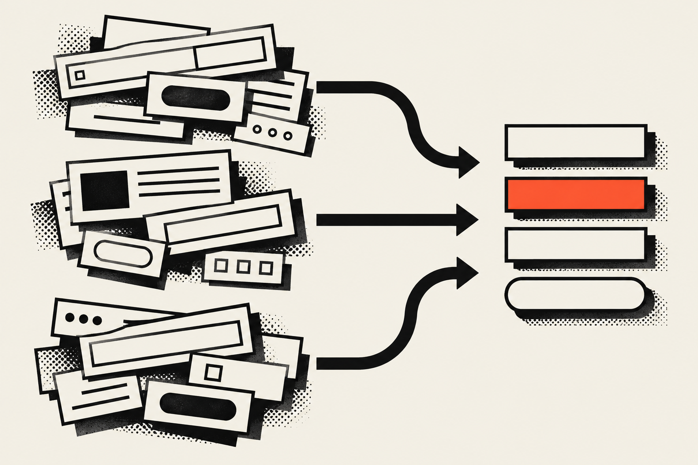

To create a design system, audit the interface you already have, define a few tokens for color, type and spacing, build only the components you keep repeating, and write the rules down next to the code. A small team can get a useful first version done in days. You don't need a component library on day one.

## What is a design system, and do I need one?

A design system is a shared set of decisions about how your interface looks and behaves, kept where the people building it can actually use them. It usually holds design tokens, a set of reusable components and some written rules. You need one when you catch yourself making the same decision by hand over and over.

The test is repetition. Picture three buttons that are almost the same, two grays nobody can tell apart and a spacing value that changes on every page. I've seen that site more times than I can count, and every time it's a little bit atrocious. A system pays for itself fast there. If you're one person with one page, it probably doesn't. The Sparkbox post <a href="https://sparkbox.com/foundry/design_systems_that_get_used" target="_blank" rel="noopener" aria-label="Design Systems That Get Used on Sparkbox, opens in a new tab">Design Systems That Get Used</a> makes the sizing point directly: "A design system built to be supported by a team of six doesn't help a two-person team." Its advice is to build for the team that will realistically own the system.

Everything below comes from that idea. Build the smallest system that gets rid of the decisions you keep repeating today.

### What does a design system cost, and what does it return?

A design system costs time to build and time to keep up, and both costs are real when your team is small. What you get back is fewer repeated decisions, fewer one-off fixes and a faster start on every new page. I don't have a trustworthy percentage to give you, and I'm not going to make one up.

You can measure the return in your own work, though. Count how many times in a month you pick a color, a type size or a spacing value by hand. Count how many pages need a manual fix when the brand color changes. Those numbers are your baseline, and a good first version should push them toward zero. Think of it like an investment: you put the hours in once, and every page after that gets cheaper to build.

## When should a small team build a design system?

Build one when you notice the same decision being made for the third time, or when a second person starts working on the interface. Before that, a style sheet with a few well-named variables is plenty. After that, the informal habit starts to drift, because two people will never remember the same value.

Good signs it's time:

1. You've rebuilt the same button, card or form field on more than one page.
2. A brand change, such as a new accent color, means editing a pile of files.
3. A new person or an AI coding tool joins the work and needs to know the rules without asking you.
4. The same accessibility problems keep showing up, like low contrast text in several places.

That third one is my daily life. I build with Claude Code, and the first thing it reads in this site's repository is a rules file I wrote for it. When the rules are written down, the AI follows them. When they only live in my head, I get the preschool version of AI work, where it guesses and I clean up after it.

Signs it's too early: the product still changes direction every week, or you have a single page. In that case, write your colors and fonts down in one place and wait.



## How do I create a design system, step by step?

You create a design system in six steps: audit what exists, choose tokens, set type and spacing, build the components you repeat, write the rules, and add checks that enforce them. Each step is small, and you can stop after any of them and still have something you can use.

### Step 1: Audit what you already have

Start with a UI audit. Screenshot every page or screen, then sort what you see into groups: buttons, headings, forms, cards, navigation. Note every variation inside each group. In <a href="https://www.freecodecamp.org/news/how-to-build-a-design-system-with-a-small-team-53a3276d44ac/" target="_blank" rel="noopener" aria-label="How to build a design system with a small team on freeCodeCamp, opens in a new tab">How to build a design system with a small team</a>, Naema Baskanderi calls a UI audit of all properties "a must," and she also recommends looking at existing public design systems instead of starting from scratch.

The audit tells you how big the problem is. Seven shades of gray is a very different afternoon from two.

### Step 2: Choose the color tokens

A design token is a design decision with a name, such as a color, stored once and used everywhere. Pick the fewest colors that cover your interface. Name each one by its role or by a short plain word, and make sure every text and background pair you plan to use passes contrast.

WCAG 2.2 success criterion 1.4.3 sets the minimum. WCAG is the Web Content Accessibility Guidelines, the standard most accessibility rules point back to. In the <a href="https://www.w3.org/WAI/WCAG22/Understanding/contrast-minimum.html" target="_blank" rel="noopener" aria-label="Understanding Success Criterion 1.4.3 Contrast Minimum, opens in a new tab">W3C explanation of the criterion</a>, normal text needs a contrast ratio of at least 4.5:1, and large-scale text needs at least 3:1. Check your pairs while you choose the tokens, so you never have to go back and patch them later.

### Step 3: Set type and spacing

Choose your font families, a short list of text styles and a spacing scale you'll actually stick to. You don't need ten heading levels. List the ones that showed up in your audit and keep those. Give each style a name that says what it's for, because "card title" still makes sense after a redesign and "18px bold" doesn't.

### Step 4: Build only the components you repeat

A component is a reusable piece of interface with its own markup, styles and states. Build the ones your audit found on several pages, and leave the rest alone for now. The same Sparkbox post says that sometimes "the right answer is a small, well-built system that covers the basics everyone actually uses."

My rule of thumb is to wait until a pattern shows up three times. Once, it's a detail on one page. Twice could be a coincidence. By the third time, it has earned a name.

Document the states while you build: default, hover, focus, disabled and error. The states are where a small system saves the most time later, because nobody has to guess what a focused button looks like.

### Step 5: Write the rules next to the code

Documentation is the part small teams skip, and it's the part that lets anyone besides you use the system. Keep it short and keep it in the repository, so it changes in the same commit as the code. Pixelmatters, in its guide on <a href="https://pixelmatters.com/blog/design-systems-smaller-teams" target="_blank" rel="noopener" aria-label="design systems for smaller teams on Pixelmatters, opens in a new tab">design systems for smaller teams</a>, suggests updating the system after each task and documenting "the component states, behaviors, variations, and edge cases" for engineering.

### Step 6: Add checks that enforce the rules

A rule that nothing enforces will slip, and hell, that goes for my own rules too. If your build can fail on a broken rule, such as a banned color or a missing page title, the system protects itself even on the days you don't. The next section shows what that looks like in a real project.

## What goes into a first version of a design system?

A first version has four things: a handful of color tokens, a few type styles, the components you repeat and a one-page rules file. Anything past that is optional. The easiest way to see how small it can be is a working example, so here's the system behind this site.

### The system behind this site

I built matbrown.io with Astro, React islands and Tailwind CSS, and its design system is small enough to read in one sitting. These are the real parts, taken straight from the repository.

<Terms>
<Term name="Five color tokens">

The colors are defined once in the `@theme` block of `src/styles/global.css`: ivory, ink, vermilion, stone and a translucent line color for dark sections. The page background is ivory, the text is ink, and vermilion is the single accent. The rule that goes with them is written down too: small vermilion text appears only on ink, and text on a vermilion fill is ink.

</Term>
<Term name="Two type utilities">

There are three typefaces: Anton for display, Archivo for body text and JetBrains Mono for labels. Two utilities cover almost every use, `type-display` for large uppercase headings and `type-label` for small tracked labels. Body text is the default.

</Term>
<Term name="Motion tokens">

Every duration and ease lives in `src/lib/motionTokens.ts`: three durations (0.2, 0.5 and 0.9 seconds) and three named eases. Components import them, and none of them hardcode a value. A single query constant holds the `prefers-reduced-motion` check that all the animation code shares.

</Term>
<Term name="A short list of components">

Components are grouped by area in `src/components`, such as `ui`, `blog`, `case-study` and `nav`. The shared button has three variants: accent, outline and ink. A new page gets assembled from these pieces instead of inventing new ones.

</Term>
<Term name="A DESIGN.md file">

One file in the repository root records the colors, the type, the page devices, the motion rules and the pattern for each page type. It's the first place I look when I change a page.

</Term>
<Term name="Build checks">

The production build runs a script after Astro that fails the build when a page breaks a rule: a missing title, a missing share image, a dash or emoji in the text, or a common British spelling. The rules live in code, so I can't forget them even if I try.

</Term>
</Terms>

Here's the color block, copied from the stylesheet:

```css
@theme {
  --color-ivory: #f4f0e6;
  --color-ink: #0c0c0c;
  --color-vermilion: #f86343;
  --color-stone: #e4dfd3;
  --color-line-dark: rgb(244 240 230 / 0.16);
}
```

Tailwind's own documentation explains why this works as a place to keep tokens. According to the <a href="https://tailwindcss.com/docs/theme" target="_blank" rel="noopener" aria-label="Tailwind CSS theme variables documentation, opens in a new tab">Tailwind theme variables page</a>, a variable defined in `@theme` is both a CSS variable and an instruction to generate utility classes. So a color named `--color-vermilion` gives you `bg-vermilion` and `text-vermilion` with no extra setup. The same page says to use `@theme` when you want a token to map to a utility class, and `:root` for ordinary variables that shouldn't.


The point of the example is how small it is. Five colors, two type utilities, three durations and a handful of components are enough to build a whole site and keep it consistent. None of it needed a separate documentation site or a dedicated team.

## How do I document a design system?

Document your design system in one file in the repository that covers colors, type, spacing, components and motion, with the reason behind each rule. Keep it short enough to read in a few minutes. Update it in the same commit as the code, so it never describes a system that doesn't exist anymore.

A useful rules file answers these questions:

| Section | What it records | Example question it answers |
| --- | --- | --- |
| Color | Each token, its role and the allowed pairings | Can I put this accent on that background? |
| Type | Families, the named styles and where each is used | Which style is a card title? |
| Spacing | The scale and any layout rules | How far apart are sections? |
| Components | Variants and states for each shared piece | What does the disabled state look like? |
| Motion | Durations, eases and the reduced-motion rule | How long should a fade take? |
| Decisions | Choices the owner has locked, with dates | Why is there no dark theme? |

That last row matters more than it looks. Write down what you decided not to do, and why. It saves you from reopening the same argument six months later, and it tells a new teammate or an AI tool which options are already closed.

Pixelmatters also recommends one consistent structure and set of terms across everything in the system, so anyone on the team can work with it. A table like the one above gives you that structure without a tool or a subscription.

### Where should the documentation live?

Put it where the code is. A rules file in the repository gets read by everyone who touches the project, reviewed in the same pull request as the change and versioned automatically. A separate documentation site is worth adding later if you grow, and the file you already wrote becomes its content.

## What mistakes should a small team avoid?

The common mistakes are building too much before you need it, copying a big public system whole and leaving the rules unwritten. Each one makes the system harder to use than the problem it was supposed to solve. Keep the scope small and the rules where people can see them.

- Building for a team you don't have: Sparkbox's warning about sizing applies here. A system designed for six maintainers goes stale in the hands of two.
- Naming tokens after their values: A token called `gray-300` has to be renamed when the gray changes. A name that describes a role survives a rebrand.
- Skipping the states: A component without a focus state isn't finished, and keyboard users are the first to hit the gap.
- Waiting for the perfect system: A first version that covers your most repeated decisions beats a complete one that ships three months from now.
- Leaving the rules in your head: If a rule only exists in your memory, it gets broken the first time someone else works on the project.

## Where this fits in my work

The closest thing I run to a design system in client work is <a href="/work/portfolio-optimization">Portfolio Optimization</a>, a Vamp Network service. I design a logo and a color palette for each UGC creator, write their copy in their own voice and build the site on Astro with React islands and Tailwind CSS. Ten of those sites are live right now. Every one starts from the same small set of decisions about logo, color and voice, and honestly, that's all a first design system is. You make the calls once, you write them down, and you stop arguing about them on every new page.

If you're a business owner thinking "cool, but I just need my site to sell," that's exactly the point. A small system is what keeps the next page you add from looking like it was built by a different, slightly unhinged company. It costs more up front than a $1,000 template, and it pays you back every time you add something new. If you want one dialed in for your site or product, check out my <a href="/services">services</a> and reach out. If you're a designer or developer just getting started, the <a href="/blog/design-systems">design systems topic</a> has your next steps, and <a href="/blog/ux-ui-design/what-is-a-design-engineer">what a design engineer does</a> explains the role that ties it all together.
