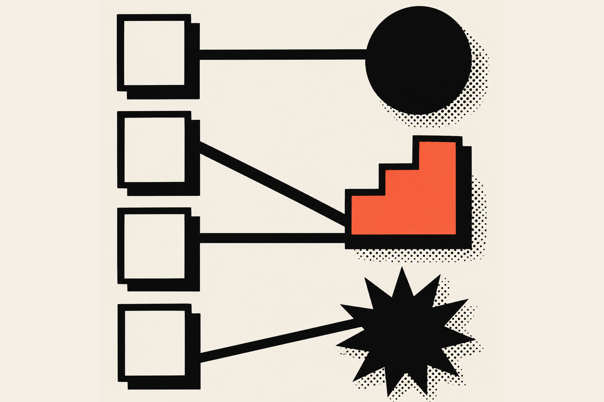
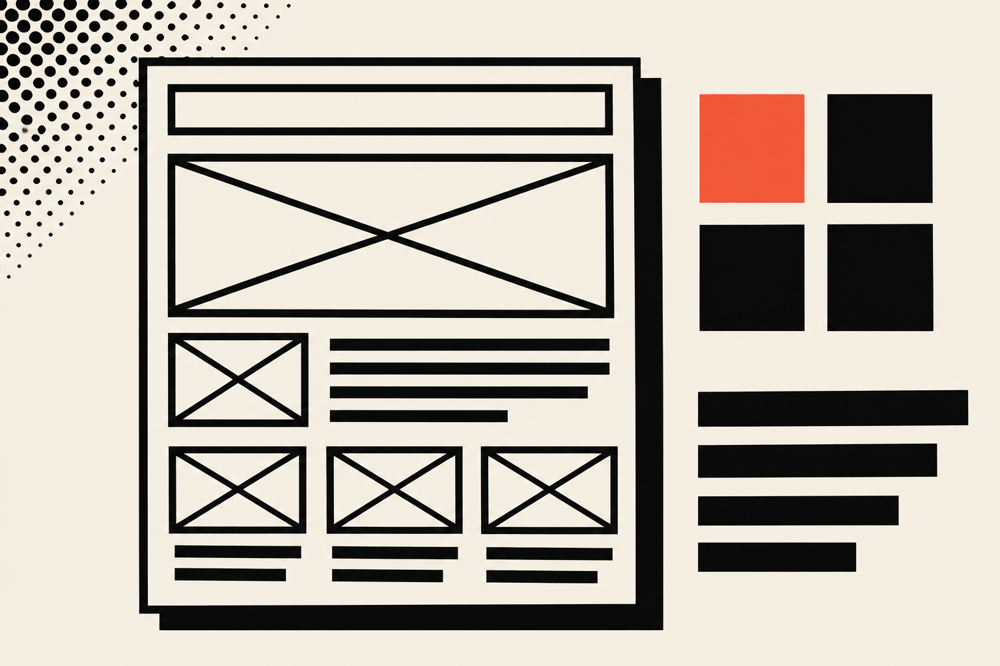
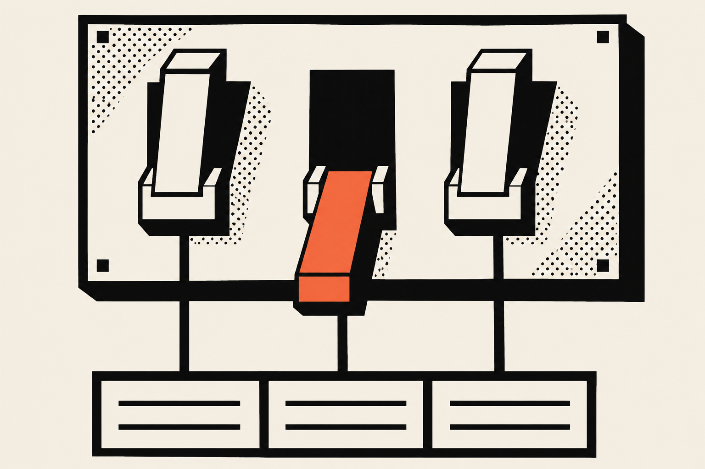

A multi-brand design system is one shared set of components and layout rules, with each brand's colors, fonts, logo and copy kept in a separate layer on top. You theme it by changing named values, and the components stay exactly as they are. What stays shared is structure and behavior. What changes per brand is everything a visitor would call "the look."

## How do you theme one design system for several brands?

You give every brand the same list of token names, such as "page background" or "accent," and let each brand fill in its own values. Components only ever ask for the name. Swap the values and the same button, header and card render as a different brand without anyone touching the component.

There's a lot of information out there on this, and it gets overwhelming fast. Most of what ranks is written for big companies with a dozen product teams, and it reads that way. I'm one person building websites for UGC creators (user-generated content creators, the people who make short videos for brands), so this is the small-studio version. The idea is identical, though, and it fits on an index card.

Think of a restaurant kitchen that serves ten different restaurants' menus. The stoves and the prep routine are the same every night. The recipes and the name on the door are different. Nobody would say the kitchen is ten kitchens, and nobody eating at any of the ten would guess they share one.

The W3C Design Tokens Community Group published the first stable version of its token format in October 2025, and its announcement says the spec lets teams <a href="https://www.w3.org/community/design-tokens/2025/10/28/design-tokens-specification-reaches-first-stable-version/" target="_blank" rel="noopener" aria-label="the W3C announcement of the first stable Design Tokens specification, opens in a new tab">"manage light/dark modes, accessibility variants, and brand themes without file duplication."</a> That last part is the point. If you have to copy a whole file to make a second brand, you have a second system, and you will be fixing the same bug in both of them.

If tokens are new to you, I wrote <a href="/blog/design-systems/design-tokens-explained">a plain explanation of design tokens</a> first, and <a href="/blog/design-systems/how-to-create-a-design-system">how to create a design system</a> covers the small version end to end.

## What changes per brand and what stays shared?

Colors, logo, fonts and copy change for each brand. The tech stack, the testing setup, the flow of the page and most components stay the same. A useful test is to ask whether a visitor would notice the difference. If they would, it belongs to the brand. If only a developer would, it belongs to the base.

Here is how that split works for the creator portfolio sites I build for Vamp Network's Portfolio Optimization service, which I wrote up in <a href="/work/portfolio-optimization">the case study</a>.

| Layer | Shared or per creator | What it is |
| --- | --- | --- |
| Tech stack | Shared | Astro, React and Tailwind CSS |
| Test setup | Shared | The test-driven development kit I built, which every site uses |
| Home page flow | Shared | The order sections appear in |
| Common components | Shared | Parts that repeat from site to site |
| Colors and logo | Per creator | Custom to each person |
| Fonts | Per creator | Free ones from Google Fonts or another open-license source |
| Copy | Per creator | Written for them, usually from a brand voice document they share |
| Section changes | Per creator | A few creators have asked me to switch things up, and I do |



### Why do the sites not look alike if the base is the same?



Because the shared part is the skeleton, and a skeleton is hard to spot from outside. Two people can have the same bones and look nothing alike. A creator's logo, palette, typeface and the way their copy talks carry nearly all of what a visitor sees in the first second.

I'll admit I didn't plan it this way. I built the first creator sites one at a time, from scratch. Then I noticed that every one of them had parts that stayed the same, and I had Claude Code help me turn those parts into a scaffolding template. The system came out of repeating myself, which I think is the honest way most of them start.

### What about a creator who wants something different?

Then they get it. The page sections usually stay the same, but a few creators have asked me to switch things up, and I do. This is where a shared base earns its keep, because changing one section is a small job when the sections around it are already known to work. A base that fights you every time you leave the template would be worse than having no base at all.

## How do agencies reuse a site build across clients without them looking the same?

Keep the reusable part in the structure and make the brand part impossible to skip. Start every client from the same scaffold, then run a real design phase for each one with their own references, palette and fonts. The scaffold saves the setup time. It should never save the design thinking.

This is the part most "reusable website template" advice gets backwards. The lazy version swaps the logo and one hex code on the last client's site and calls it done, and the result looks fine for about a minute before it turns out to be atrociously familiar. Here is my version. I call a slash command (a saved shortcut inside Claude Code) with the creator's name and the address of their old portfolio. It scaffolds the whole codebase and pulls in the information from that old portfolio. Each site is its own codebase from that moment on.

Then comes the design phase, and it's the real work. I tell Claude how I want everything designed and hand it reference images, usually color palettes the creator found on Pinterest and typography examples they like. We find the closest font. If the one they want has an open license, we use it.

This is also where I throw things away. If a first pass looks like a template, I say so and we start over, and starting over costs almost nothing. The result is that every creator's portfolio is completely custom to what they want it to look like, even though the first hour of every project was identical.

Here are a few things I'd tell any studio that wants to reuse a build:

1. Decide what is shared before client number two, and write it down.
2. Give each client their own design phase, with their own references.
3. Let a client change a section when they ask, and fold the change back into the base only if the next client would want it too.
4. Use licensed or open-license fonts, so a site never ships with a typeface its owner has no right to use.

## Where do brand tokens live in code?

Brand tokens live in one place that every component reads from, usually a CSS file or a config file. In a Tailwind CSS v4 project it's the `@theme` block. Components use utility classes that come from those names, so changing a value in one place changes it across the whole site.

I can't show you a creator's actual files, but I can show you how the mechanism works in the tool I build with. Tailwind's documentation describes theme variables as <a href="https://tailwindcss.com/docs/theme" target="_blank" rel="noopener" aria-label="Tailwind CSS theme variables documentation, opens in a new tab">"special CSS variables defined using the `@theme` directive that influence which utility classes exist in your project."</a> Define a color there and you get `bg-`, `text-` and `fill-` classes for it.

Here is a small brand file, using the example from those docs:

```css
@import "tailwindcss";

@theme {
  --color-mint-500: oklch(0.72 0.11 178);
}
```

### How do you start a brand from a clean slate?

Reset the default theme so only the brand's values exist. Tailwind's docs say to set a namespace to `initial` to override it completely, and to set the global namespace to `initial` to disable the default theme and use only custom values. That means a stray default color can never leak into a client's site.

```css
@theme {
  --*: initial;
  --spacing: 4px;
  --font-body: Inter, sans-serif;
  --color-lagoon: oklch(0.72 0.11 221.19);
}
```



The same documentation says sharing theme variables across projects is "just a matter of throwing them into their own CSS file that you can import in each project." That is the simplest multi-brand setup there is: one file per brand, imported by a shared app.

### Can one site switch between brands at runtime?

Yes, and plain CSS can do it. A custom property is part of the cascade, so a value declared on a selector applies to that element and its descendants. MDN's custom properties guide shows a default declared once and overridden inside a narrower scope. Scope a brand's values to an attribute and you have a theme switch.

<a href="https://panda-css.com/blog/building-a-multi-brand-design-system-with-panda-css" target="_blank" rel="noopener" aria-label="the Panda CSS guide to a multi-brand design system, opens in a new tab">Panda CSS's multi-brand guide</a> does exactly this: defaults go on `:root`, each named brand compiles to a selector scoped by a `data-panda-theme` attribute, and only the values that differ from the default need listing. You change the attribute and the components don't change at all. You can do the same by hand:

```css
:root {
  --color-accent: #f86343;
}

[data-brand="mint"] {
  --color-accent: #3ecf9e;
}
```

I don't use a runtime switch for the creator sites, because each creator has their own domain and only ever needs their own brand. It matters when one product shows several brands, a white-label app for example. Matching the setup to the job is most of the skill here.

### What should every brand fill in?

Every brand should define exactly the same token names. A name that exists for one brand and not another is how a page quietly breaks in a color nobody chose. Treat the list of names as a contract, and let only the values vary. That is a rule I follow when I write any token file, whether it holds one brand or ten.

## What does this look like when it works?

It looks like Savannah June's site and Charlie Smith's site, which both came out of the process above and look nothing like each other. Savannah's carries her UGC by Sav logo and Charlie's carries a CS monogram. Both are linked from the case study, and ten creator sites are in production.

The numbers creators have shared with me are in the case study too. One reports two to three more high-paying jobs a month, and another saw a 20% increase in her close rate. I can't promise a shared system causes any of that, because the creators and the sites changed at the same time. What I can say is that a shared base means I don't rebuild the parts that never change, so my time goes into the design phase for each creator.

## What I'd do if you're building for more than one brand

If you're a business owner with several brands or locations, the question to ask any designer is what is shared and what is yours. A good answer is specific. A system costs more up front than a $1,000 template, and it pays you back every time a new page or a new brand shows up and looks like it belongs.

If you're a designer or developer, start smaller than you think. Pick the five or six decisions that change per client, give them names, and put them in one file. You can grow a system from there. That is what the first version of my starter was, and honestly, I still think of it that way.

If you want a system like this dialed in for your own product or sites, check out <a href="/services">my services</a> and reach out. If you'd like to see what goes into a brand before any code gets written, <a href="/blog/brand-identity">my articles on brand identity</a> cover it.

