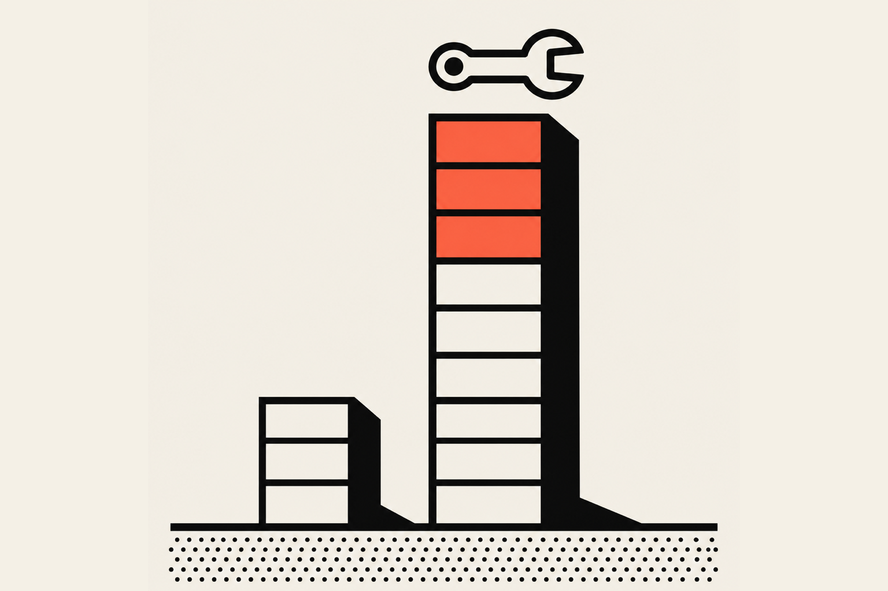
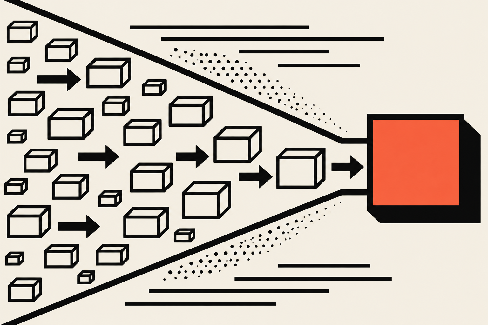

A custom dashboard or internal tool for a small business starts at $10,000 with me and goes up with the scope, and that is usually a one-time build fee. After launch you pay for hosting, which can be a few dozen dollars a month, plus upkeep, which depends on who maintains it and what you ask them to change.

## How much does a custom internal tool cost?

The price of an internal tool follows how many kinds of users it has and how many other systems it connects to. A simple tool costs the least, a multi-role portal costs several times more, and every integration adds a line item. My own minimum for a dashboard or internal tool is $10,000, and it rises with the scope.

There is a lot of pricing advice out there, and it gets overwhelming, mostly because the numbers disagree by a factor of ten. So I read a few of the pages that rank for this question before writing this one. They are all written by vendors, so treat their numbers as a map of the territory and not as a quote.

| Source | What it says |
| --- | --- |
| <a href="https://techconcepts.org/blog/internal-tool-development-cost" target="_blank" rel="noopener" aria-label="TechConcepts on internal tool development cost, opens in a new tab">TechConcepts</a>, a consultancy | A simple form or view runs $8K to $15K, an operations workflow tool $12K to $30K, and a multi-role admin portal $25K to $55K |
| <a href="https://www.rapidevelopers.com/cost/software-development-cost" target="_blank" rel="noopener" aria-label="RapidDev's software development cost guide, opens in a new tab">RapidDev</a>, an agency | An admin panel with role-based access runs $10,000 to $25,000, and its "small" agency tier is $40,000 to $145,000 |
| Me | Dashboards and internal tools start at $10,000 and go up with the scope |

The cheap end of the agency pages and my starting price sit in the same neighborhood, so a freelancer is no guaranteed bargain and an agency is no guaranteed luxury. The biggest numbers belong to projects most small businesses should not start with, and a first version that handles one job well sits near the bottom of those ranges.

### What do you get for the money?

You get a working tool that your team signs into, built on accounts that you own. That means the screens, the database tables, the sign-in and the rules about who can see what. It does not include a team of ten, a mobile app or an AI feature unless you scope those in, because each one is its own project.

I wrote a longer walkthrough of what such a build contains in <a href="/blog/saas-development/react-admin-dashboard-supabase">How to build a React admin dashboard on Supabase for a small business</a>. It is the plain-language version of what the money pays for.

## What drives the price up?

The biggest drivers are the number of user roles, the number of systems the tool connects to, and a process that is still changing while the build happens. Each one multiplies the work, because every role and integration has to be designed, built and tested on its own.

Here is how the pages I read describe each driver.

<Terms>
<Term name="User roles">

TechConcepts says a two-role tool costs 30 to 50 percent more than a single-role one, and that five roles may cost twice as much. That matches how this works in practice: an owner, a staff member and a read-only viewer each see different screens and need different rules in the database.

</Term>
<Term name="Integrations">

TechConcepts prices a read-only integration at $2K to $4K, a two-way sync at $4K to $8K and a real-time sync at $6K to $12K. RapidDev puts extra integrations at $1,000 to $6,000 each. The pattern is the same everywhere: reading data from another system is cheap, and writing back to it is not.

</Term>
<Term name="An audit trail">

If you need a record of who changed what and when, TechConcepts says to add $5K to $10K. Some businesses genuinely need this, such as clinics and anything that touches money. Most small teams can leave it out of version one.

</Term>
<Term name="A process that keeps changing">

If the team has not settled how the work actually happens, the software becomes the place where that argument is held, and the build keeps restarting. It is the most expensive item on this list and it never shows up on a quote.

</Term>
</Terms>

Nothing on this list is the size of the screen or how pretty the buttons are. A quiet, ordinary-looking tool with five roles costs far more than a gorgeous one with a single role, which is a little unfair to the gorgeous one.

## What are the yearly maintenance costs?

Maintenance has two parts: running costs, which are the bills for hosting, the database and any API accounts, and upkeep, which is a person fixing and changing things. Running costs for a small tool can be well under $50 a month. Upkeep is the larger number, and it is the one nobody puts on the first quote.

### What do hosting and the database cost?

For a tool like the ones I build, the running costs are small. These figures come from the vendors' own pricing pages, <a href="https://supabase.com/pricing" target="_blank" rel="noopener" aria-label="Supabase pricing, opens in a new tab">Supabase</a> and <a href="https://www.netlify.com/pricing/" target="_blank" rel="noopener" aria-label="Netlify pricing, opens in a new tab">Netlify</a>, and prices change, so check them before you budget:

- Supabase, the hosted database, has a Pro plan from $25 a month. The plan includes $10 a month in compute credits, which covers one Micro instance, and each project beyond the first adds its own compute cost.
- Netlify, the host, has a free plan, a Personal plan at $9 a month and a Pro plan at $20 a month with unlimited members.
- Supabase charges extra when you go past the included limits: 250 GB of egress (data sent out) and 8 GB of disk space per project, then $0.09 per GB for egress and $0.125 per GB for disk.

So a small tool on the Pro database plan and the Personal host plan lands around $34 a month before any overages, which is about $400 a year. That is a number I computed from the two prices above, and it depends on you staying inside the included limits. Other APIs your tool calls, such as email, maps or payments, bring their own bills. <a href="https://www.rapidevelopers.com/cost/software-development-cost" target="_blank" rel="noopener" aria-label="RapidDev's software development cost guide, opens in a new tab">RapidDev</a> says each connected system can add roughly $1,000 to $3,000 a year in upkeep when the other company changes its API, which is the kind of thing that breaks quietly on a Tuesday.

### What does upkeep cost?

The rule of thumb in the pages I read is 15 to 20 percent of the build cost per year. <a href="https://www.codestringers.com/articles/software-maintenance-costs-explained" target="_blank" rel="noopener" aria-label="CodeStringers on software maintenance costs, opens in a new tab">CodeStringers</a> states it that way, and RapidDev says 15 to 25 percent. Neither one cites a study for it, so it is a planning number and not a law of nature.

On a $10,000 build, 15 to 20 percent is $1,500 to $2,000 a year. That covers security updates, bug fixes and keeping the tool working when the services around it change. It does not cover new features, and it assumes somebody is on call who already knows the code.

My own prices sit well above that rule of thumb. Most of my clients have no in-house developer or designer, so instead of calling me for each fix they pay a monthly retainer, which is $2,500 to $5,000 a month. That is far more than 15 percent of a $10,000 build, because it also pays for any changes they ask for, not only upkeep. If you only want things kept running, you can ask for a smaller arrangement, and if your team will do it themselves you pay no retainer at all.

### Who owns the accounts?

You do. If I do the upkeep, I host the site on my own Netlify account, which makes DNS changes easier for me. If you have people in house who will manage it, I deploy to your Netlify account or whatever hosting you want. Either way, every other account the build needs, usually the Supabase database and any API accounts, is in your name. You own the whole stack and the intellectual property, and I set the accounts up and manage them as an authorized user or with logins you give me.

I have never set software up in my own accounts and handed over a login, because software that lives in my accounts would not really be yours. If you are comparing quotes, ask each bidder this question first: whose name is on the database?

## How do I scope a v1 so it ships?

Pick one job, one kind of user and one screen that replaces the spreadsheet, then build only that. A version one that does a single job well gets used, which tells you what to build next. A version one that tries to do everything stays in review for months.

1. Write down the one task the tool must do, in a sentence a new employee would understand.
2. Name the people who will use it and give each a role. If you have more than two roles, ask which one can wait.
3. List every outside system it touches, and cut every integration that is read and write down to read only, or cut it from version one.
4. Skip the audit trail, the charts and the live updates until the team has used the first version for a few weeks.
5. Keep the process fixed while you build. Change the process on paper first, then change the software.
6. Put a number on what the tool saves, such as hours a week. That is your return, and it tells you whether the next phase is worth buying.

If you are not sure what belongs in version one, that is exactly what my audit is for. It starts at $3,500, takes two weeks, and the fee comes off a build that starts within 60 days. The point is to settle what goes in version one before you commit to a build.

## What does this look like in my own work?

The closest example on this site is the backend dashboard I built for Vamp Network on React, Vite and Supabase, which manages creators, managers and brands in one place. You can read the whole project in the <a href="/work/vamp-network">Vamp Network case study</a>. I am not quoting its price here, because a client's price is not a range you can apply to your own tool.

If you own a business and you are thinking "I just need to stop running everything out of a spreadsheet", that is a good first build. It costs more up front than a $1,000 template because it is built around how your team works, and the return is the hours that come back every week. If you are a designer or developer pricing your own first dashboard, write your number down before the call and put the ownership question in the contract, so nobody argues about it later. If you want a tool scoped and priced for your business, take a look at my <a href="/services">services</a> and reach out. If you are weighing it against other automation work, my guide to <a href="/blog/ai-automation/ai-automation-pricing">AI automation pricing</a> covers the retainer side in more detail.
