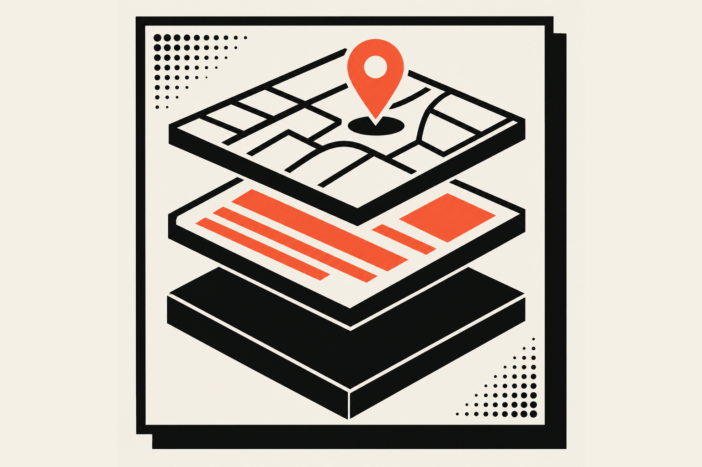
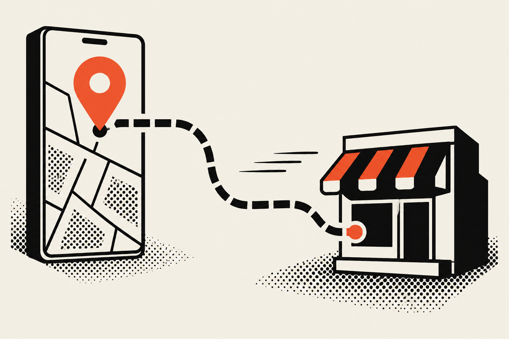

This local SEO case study covers 'Aiwi Waffles, a waffle shop in Waikiki. I optimized its Google Business Profile and built its website, and the shop now ranks #1 on Google for multiple local searches. It gets 30 to 40 phone calls a week, and 13,000 views a month across Google Search and Maps.

## What did a real local business do to rank #1 locally?

I worked in layers, and the order mattered. I'm the lead designer, developer and SEO person for 'Aiwi Waffles, so I started with the brand: the logo, the messaging and the signage for the store and the food truck. Then I built a Shopify storefront, and then I did the local search work on top.

Local SEO is confusing, so here is the plain version. When someone types "breakfast spot Waikiki" into Google, it shows a short list of nearby businesses, usually on a map. Getting onto that list, near the top, is local SEO (search engine optimization for places people can walk or drive to).

The Google Business Profile is the free listing on Maps and in search with your hours, photos, reviews and a button to call you. Google's page on <a href="https://support.google.com/business/answer/7091" target="_blank" rel="noopener" aria-label="Google's guide to improving your local ranking, opens in a new tab">improving your local ranking</a> says it ranks by relevance (how well a profile matches the search), distance (how far you are from the searcher) and prominence (how well known you are, including review count and ratings). I can't move the shop closer to a tourist in a hotel, so the work lives in relevance and prominence.

## What are the results, in numbers?

These are the owner's numbers, as I have them. A high-intent keyword is a search by someone ready to act, and an interaction is a call or a request for directions. Google Search Console, the free tool that reports how your site does in search, shows an average <a href="https://support.google.com/webmasters/answer/7042828" target="_blank" rel="noopener" aria-label="Search Console's Performance report help page, opens in a new tab">click-through rate</a> of 4.1%, which Google defines as clicks divided by impressions.

| Result | What I can say |
| --- | --- |
| Local ranking | #1 on Google for multiple local searches |
| Keywords | Ranking high for more than 20 high-intent keywords |
| Listing views | About 13,000 a month across Google Search and Maps |
| Listing interactions | 638 a month |
| Click-through rate | 4.1% average in Google Search Console |
| Phone calls | 30 to 40 a week on average |
| Search visits | More than $1,000 a day on average at the Waikiki location |

The last row is the one I care about most, and it needs a caveat: it is the owner's figure, I don't know it to the penny, and I'm reporting it as she gave it to me.

## How do I get my restaurant to the top of Google Maps?

Fill in your Business Profile completely and honestly, keep it accurate, make your website say what your profile says, and earn real reviews. Google says you can't pay for a better local ranking, so the work is making the business easy to match, easy to find and easy to trust.

There's no secret trick. Google's ranking page says it: "There's no way to request or pay for a better local ranking on Google."

### Get the profile basics right

Google has <a href="https://support.google.com/business/answer/3038177" target="_blank" rel="noopener" aria-label="Google's guidelines for representing your business, opens in a new tab">guidelines for representing your business</a>, and they're worth ten minutes of your time.

- Use your real name. Extra marketing words in it can get a profile suspended, so skip "best waffles Waikiki."
- Use a precise address and regular hours, because wrong hours send people to a closed door.
- Pick the fewest categories that describe you, and keep one profile per business, since duplicates can cause display problems.

### Make the website match the listing

When a customer taps through, the website has to confirm what the listing said, quickly, on a phone. A typical restaurant site looks great for about four seconds and then hands you a criminally slow menu PDF. I built the 'Aiwi storefront so the shop's identity, location and menu are easy to find, and I optimized its local SEO for the same searches.

Customers have told me they searched "breakfast spot Waikiki," saw the 'Aiwi site come up first and opened it next to about four other sites. They picked 'Aiwi because its site looked professional, inviting, warm and friendly, while the others looked outdated or had copy written incorrectly.

### Earn reviews the honest way

Reviews count toward prominence. As of October 2026, 'Aiwi Waffles has 4.9 stars from 214 Google reviews at its main location, and 5.0 from 182 reviews on Find Me Gluten Free, where it ranks #1 for gluten-free waffles in Honolulu.

The shop doesn't ask for reviews outright. The owner goes around to tables while people eat and talks about their breakfast, and when a customer says "that was so good" on the way past the register, she or the staff mention that a Google review helps a lot. The ask only follows the customer starting the conversation.

That's on purpose. Google's <a href="https://support.google.com/contributionpolicy/answer/7400114" target="_blank" rel="noopener" aria-label="Google's policy on prohibited and restricted content for contributors, opens in a new tab">contributed content policy</a> bars merchants from selectively soliciting positive reviews, and says they shouldn't pressure people to leave reviews while on the premises.

## How many calls can a Google Business Profile bring in?

It depends on the business, the location and how many people are searching, so no honest number applies to everyone. 'Aiwi Waffles in Waikiki averages 30 to 40 phone calls a week. Published case studies report other numbers, and the agency that did the work wrote most of them.

The three I read (KrishaWeb, Atul Sharma on Fueler and Egochi) give you no way to check their figures, so read them as claims and skip them as benchmarks.

## How long does local SEO take to work for a restaurant?

Plan on months. I don't have a clean timeline for 'Aiwi Waffles, and I won't invent one. The vendor case studies I read report four to six months, and yours depends on your competition, your starting profile and your reviews.

Check your Business Profile performance every month, and if views and interactions sit flat, look at your categories, your reviews and your website.

'Aiwi also shows up in AI answers. On October 16, 2026, around 7:30pm Hawaii time, I ran "best waffles in Waikiki," "best gluten-free breakfast in Honolulu" and "where can I get gluten-free waffles on Oahu" in Google AI Mode, ChatGPT, Gemini and Perplexity, logged out. 'Aiwi appeared in all 12 answers and was first in 8. For "best waffles in Waikiki" it came second in all four, behind Waffle and Berry, which has about 2,900 Google reviews.

## Is local SEO worth it for a small shop?

Yes, when your customers search on their phones before they walk in. For 'Aiwi Waffles the search visits are worth more than $1,000 a day on average, by the owner's account. Weigh that against what the work costs.

The owner first assumed her customers were people walking past the Waikiki storefront. I showed her the traffic in her Google Business Profile, Search Console and Google Analytics until she saw it the other way around: visitors search on their phones and then walk, or take an Uber, to the shop.

Copy the order, and skip anyone who promises a ranking by a certain date or offers to buy you reviews.

## What did this look like on my side?

For 'Aiwi Waffles I designed the brand, the signage, the Shopify storefront and the merch line, and I handle the local SEO and the Google Business Profile. The full story is in the <a href="/work/aiwi-waffles">'Aiwi Waffles case study</a>.

If you own a shop and you're thinking "cool, but my site just needs to bring in customers," that is the whole point. A site that looks like a real business, with a Google listing that says the same thing, is an investment that keeps paying back, which is why it costs more than a $1,000 template. Take a look at my <a href="/services">services</a> and get in touch. If you're a designer or developer, check your client's Business Profile before you touch their site. More posts live under <a href="/blog/technical-seo">Technical SEO</a>.
