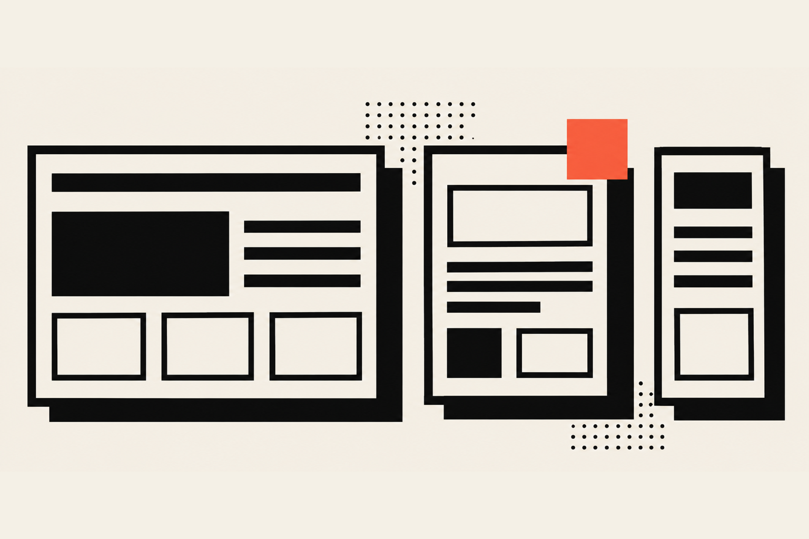
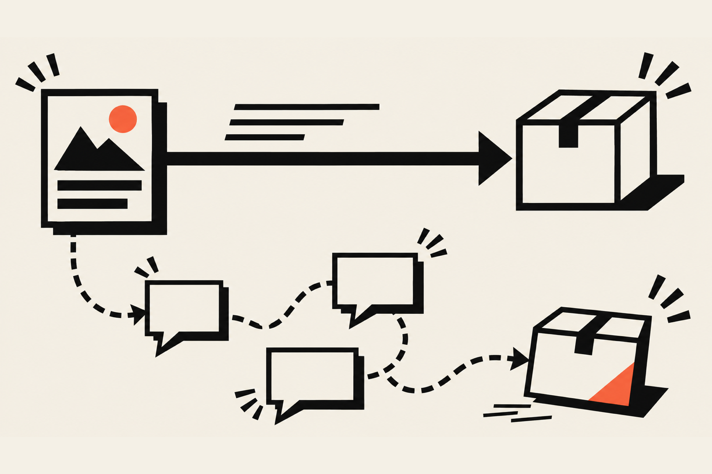
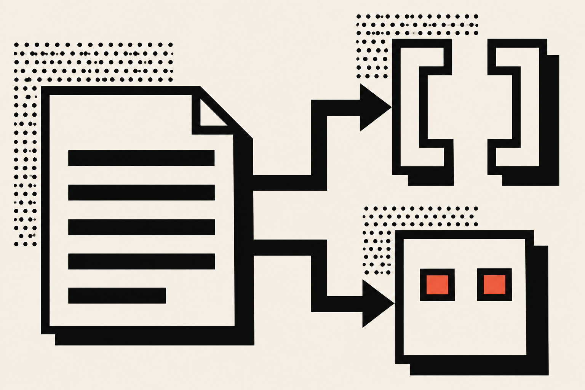

A good design handoff gives the developer finished screens, every state of every component, the layouts at each breakpoint, the motion values, the assets and the reasons behind your choices, with the final version clearly marked. The point is that the developer never has to guess, because a guess ends up in production.

## What should a design handoff include?

A design handoff should include final screens, every component state, layouts at each breakpoint, motion values, export-ready assets, real content and a short note on the decisions behind it all. If a developer would have to ask about it, put it in the handoff before they do.

There's so much advice out there on this that it gets overwhelming fast, so here is the version I actually use. I'd rather hand you a short list you can finish than a long one you'll skim. (The <a href="https://www.uxpin.com/studio/blog/design-handoff-checklist/" target="_blank" rel="noopener" aria-label="UXPin design handoff checklist, opens in a new tab">UXPin checklist</a> has 47 points, and it's a decent reference if you want the long one.)

<Terms>

<Term name="Final screens">

The version the developer should build, clearly marked. If three versions of the checkout page live on the canvas, the developer will build the wrong one at least once.

</Term>

<Term name="States">

Default, hover, focus, active, disabled, loading, empty and error, for every component that has them. This is where most handoffs go quiet.

</Term>

<Term name="Breakpoints">

The layout at the smallest width, the largest width and each width where the layout changes shape. Say what happens in between too.

</Term>

<Term name="Motion">

What moves, how long it takes, which easing it uses and what it does for people who ask their system for less motion.

</Term>

<Term name="Assets">

Icons as SVG, images exported at the sizes the layout uses, fonts with their licenses, and the real copy instead of lorem ipsum.

</Term>

<Term name="Reasons">

A line or two on why something is the way it is. This is the part a screenshot can never carry.

</Term>

</Terms>

Each of those gets its own section below, but first it helps to know where handoffs break.

## Why does design handoff fail?

Design handoff fails when the developer can't tell which design is final, can't tell how a screen behaves beyond the happy path, or can't tell why a choice was made. Those gaps get filled with guesses, and the guesses show up later as rework, delays and a build that doesn't match the design.

Zeplin's team <a href="https://blog.zeplin.io/figma-handoff-why-winning-teams-go-beyond-the-inspect-panel" target="_blank" rel="noopener" aria-label="Zeplin on why Figma handoff needs more than the Inspect panel, opens in a new tab">describes the first gap</a> well: developers can always open the latest Figma file, but "what they actually want is a finalized design." Zeplin sells a handoff tool, so take the pitch with a grain of salt, but the problem it names is real. A canvas has no edges, and a pile of screens in no order feels like landing on another planet to anyone who didn't make it. It looks great to you, and it's absolutely unhinged to everyone else.

The second gap is the one I see most. A mockup shows a screen at one moment: the form with perfect data in it, the card with a two-line title, the page on a laptop. Real use shows the form with an error, the card with a title that runs to six lines and the page on a phone held sideways. Nobody drew those, so the developer invents them.

The third gap is reasons. If a button is vermilion on one page and ink on another, the developer can't tell whether that's a rule or a slip. They'll ask, or they'll pick one and hope.

## How do you hand off a Figma design to a developer?

To hand off a Figma design, organize the file so the final screens are easy to find, delete the layers you no longer use, name things the way the code will name them, mark the frames that are ready, and walk the developer through it. The file is the start of the handoff, and the conversation finishes it.

Here is the order I'd work in:

1. Put the final screens in their own page or section, in the order a user meets them.
2. Delete unused layers instead of hiding them. The UXPin checklist makes this exact point: hidden layers "may confuse developers."
3. Name components and variants with the same words the code will use, so "primary button" in Figma is "primary button" in the repository.
4. Lay out every state of each component side by side, using variants where you can.
5. Show each key screen at the smallest and largest width, plus any width where the layout changes.
6. Mark the finished frames as ready for development.
7. Get on a call, share the screen and walk through the file once. Ten minutes of talking beats a week of comments.

Step 6 is a real feature. In Figma's own help center, <a href="https://help.figma.com/hc/en-us/articles/15023124644247-Guide-to-Dev-Mode" target="_blank" rel="noopener" aria-label="Figma's guide to Dev Mode, opens in a new tab">Dev Mode</a> lets you mark frames, components and sections as "ready for dev," and those items then show up in their own section for developers. Developers with the right seat type get a notification when you mark something.

## Is Figma Dev Mode enough for handoff?

Dev Mode is a good start, but it is not enough alone. It shows a developer the properties, styles, variables and exports for what you drew, and it can show changes between versions. It can't show what you never drew, such as the error state or the reason for a choice.

Figma describes Dev Mode as a workspace for inspecting designs, viewing properties and generated code, downloading assets and comparing changes. The word that matters there is inspecting. Developers explore variants and read values, but they don't edit the file, and nothing in the inspect panel tells them about a state you skipped.

I haven't used Dev Mode on a client project, and I'm not going to pretend I have, because I don't design in Figma day to day. So I can't review it for you. What I can say is that any inspect panel reports on what is on the canvas, which means the checklist you bring is what fills the holes. Think of Dev Mode as a very good tape measure: it's great at measuring the room you built and silent about the room you forgot.

## What do designers forget to hand off?

Designers most often forget states, in-between widths, motion details and real content. Each is easy to leave out because the screen looks complete without it, and each is expensive to discover at the end, when the developer has already built what the mockup showed.

### Component states

Every interactive piece has more states than the one you drew. The UXPin checklist says prototypes should account for "all interaction states, error states, and transitions between states."

My short list per component: default, hover, focus, active, disabled, loading, empty and error. A button won't have an empty state and a table won't have a hover state, so cross out what doesn't apply and draw the rest. I wrote a whole piece on this for buttons, in <a href="/blog/ux-ui-design/button-states-that-convert">button states that convert</a>.

Focus deserves a special mention, because it's the state that gets dropped most. MDN explains that `:focus-visible` matches a focused element only when the browser decides the focus should be evident, which is why a mouse click on a button shows no ring and a Tab key press does. As a designer you don't need to write the selector. You do need to draw the focus ring, so the developer isn't left choosing the color and thickness alone.

### The layouts between breakpoints

A mockup at 1440 pixels and another at 390 pixels leaves a lot of room between them. A tablet, a small laptop and a window dragged halfway across a monitor all land in that gap.

UXPin's advice is to start with the smallest and largest viewports to bracket the content, then design the major breakpoints on a grid. I'd add one sentence to each: say how the layout behaves between them. "The three cards wrap to two, then one, and never get narrower than 280 pixels" is a full spec, and it takes a minute to write.

### Motion

Motion is the item the long checklists mostly skip. The UXPin list I read covers transitions only as part of prototype states, and doesn't mention animation on its own. So here's what I put in a motion note:

- What triggers it: scroll position, hover, page load or a click.
- How long it takes, in seconds.
- Which easing curve it uses.
- What happens for a visitor who has asked their system to reduce motion.

The last one gets forgotten most. On this site every duration and easing curve lives in one file, `src/lib/motionTokens.ts`, as three durations (0.2, 0.5 and 0.9 seconds), a few named eases and the reduced-motion media query. That means a motion note in a handoff can say "use the base duration" instead of describing a number three different ways. If you hand a developer a video of the animation, also hand them the numbers. A video shows the feeling and a number lets them rebuild it.

### Content, assets and the awkward data

Lorem ipsum looks tidy and hides every problem. Real headings run long and real names are short. A product title with 60 characters will break your card, and you want to learn that in the design, not after launch. UXPin suggests testing data extremes such as long names and non-US postcodes, and I'd run that test on every design that holds real content.

For assets, the same checklist recommends organized folders, SVG wherever possible and 2x versions of raster images. Add the font licenses to the folder, so nobody has to wonder whether a font is allowed on the web.

## Is a handoff really one moment?

A handoff is not one moment. It's a conversation that starts when the design is half finished and ends when you've checked the build against the design. Bring a developer in early to flag what's hard, and compare the finished page to your mockup before anyone calls it done.

The UXPin checklist breaks the process into what happens during design, during handoff and after handoff, and the "after" part is the one most teams skip: checking that the build matches the design, and updating the design system if something changed on the way.

If you work with a developer, ask them one question before you finish: "What would you want to know that this file doesn't tell you?" It's a bit humbling, because the answer is usually the thing you were sure you'd covered.

## How do AI tools change design handoff?

AI coding tools make a written handoff more valuable, because the tool reads text and follows it. When your rules sit in a file next to the code, an agent can follow them on every task. When they live only in your head, the agent guesses, and you clean up after it.

Claude Code reads a file called `CLAUDE.md` at the start of every session, and the Anthropic docs explain that it holds instructions you write for persistent context. They also say something worth taping to your monitor: "The more specific and concise your instructions, the more consistently Claude follows them." That sentence is also a decent description of a good handoff note for a person.

It's the same idea as everything above, pointed at a different reader. The developer who joins in six months, an AI agent starting a fresh session and future me are all strangers to the project, and each of them needs the states, the widths, the motion values and the reasons in words.

On this site that means two files. `DESIGN.md` holds the design system: the colors, the type, the devices and the motion rules. `CLAUDE.md` holds the working rules, such as which colors are allowed, how motion is declared and what a new page needs. If you want the longer version of building this kind of rule set, I walk through it in <a href="/blog/design-systems/how-to-create-a-design-system">how to create a design system for a small team</a>.

## What I do when I'm on both sides

I design and build Portfolio Optimization sites for UGC creators by myself, so I'm the designer and the developer on the same project. The handoff there is from me to me, a few days later, which sounds like it should be easy and isn't. Anyone who has opened a project from last month knows the feeling of looking at their own code and wondering who wrote it.

For <a href="/work/portfolio-optimization">Portfolio Optimization</a>, I design a logo, a color palette and the copy in the creator's voice, then build each site on Astro with React islands and Tailwind CSS. The creator reviews it on a private link and gets three rounds of revisions. Every one of those rounds goes better when the decisions are written down: this is the palette, this is the type, this is how the page behaves on a phone. The checklist above is the one I use so that future me isn't confused.

If you're a business owner reading this, a clear handoff is one of the cheapest ways to get a build that matches what you approved, and it's one reason a professional costs more than a $1,000 template. You're paying for the part where nothing gets lost between the design and the code, and that pays you back every time you add a page.

If you're a designer or developer, try this on your next project: write the six items from the list at the top, even if the developer is you. And if you'd like someone who works both sides of that line on your own site or product, take a look at my <a href="/services">services</a> and get in touch.
