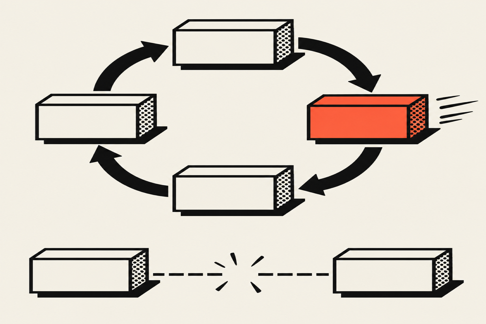
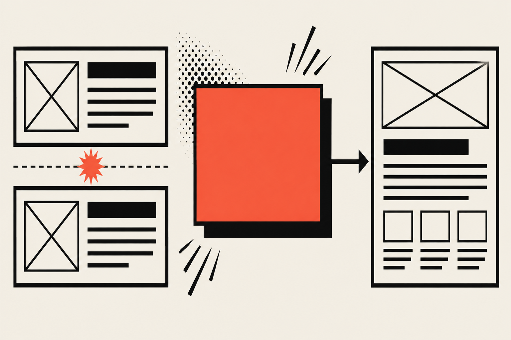

A design engineer is one person who designs an interface and builds it in production code. They decide how something should look and behave, then write the HTML, CSS and JavaScript themselves, so the design does not pass through a handoff. In software the title is a hybrid of a designer and a front-end developer.

## What does a design engineer do?

A design engineer takes a problem from a sketch to a shipped interface. They work out the layout and the interaction, prototype it in code, build the final components, and check accessibility and speed before it goes live. One person owns the result instead of one stage of the work.

Vercel describes the role in its post on <a href="https://vercel.com/blog/design-engineering-at-vercel" target="_blank" rel="noopener" aria-label="design engineering at Vercel, opens in a new tab">design engineering at Vercel</a> as a mix of aesthetic sensibility and technical skill, so a design engineer can "design, build, and ship a solution autonomously." The same post lists what that covers beyond how a page looks: interaction quality, reusable components, page speed, cross-browser support, touch and pointer input, and accessibility for assistive technology.

Maggie Appleton makes the same point from the process side in her essay on <a href="https://maggieappleton.com/design-engineers" target="_blank" rel="noopener" aria-label="design engineers by Maggie Appleton, opens in a new tab">design engineers</a>. She describes someone who can "quickly iterate on ideas by cycling between design exploration, research, and live code." The related work she lists includes prototyping, exploratory interaction design, building design systems and writing usage documentation.

### A typical project, step by step

1. Learn what the business needs the page or product to do, and who uses it.
2. Sketch the structure and the key interactions.
3. Prototype the parts that are hard to judge on paper, such as a form flow or an animation, directly in code.
4. Build the real components with the colors, type and spacing defined once as design tokens.
5. Test with a keyboard, a screen reader and a slow connection, then fix what fails.
6. Deploy, and change the live site when the business changes.

## Is a design engineer a designer or a developer?

A design engineer is both, and the weight depends on the person. Some lean toward visual design and write code to realize it. Others are front-end engineers with a strong eye for spacing, type and motion. What they share is that they do not need someone else to translate a design into code or to explain what the code can do.

Vercel states that "there's no best background" for the role, and that its own team covers Figma, production coding, browser performance debugging and copywriting between them. The titles are loose, and Appleton admits that most design titles lack clear definitions. When you read a job description or a portfolio, look at what the person has shipped instead of the title.

The practical test is simple. Ask whether the person can show you a live interface that they designed and also built. If they can, the title matters less than the evidence.

## What is the difference between a design engineer and a UX engineer?

The two titles overlap a lot, and companies use them differently. A UX engineer is usually described as a front-end developer first, who turns a designer's prototypes into working code. A design engineer is usually described as taking part in the design decisions too. Check the job description, because the same title can mean either.

UXPin describes UX engineers in its article on <a href="https://www.uxpin.com/studio/blog/ux-engineer-vs-ux-designer/" target="_blank" rel="noopener" aria-label="UX engineer versus UX designer on UXPin, opens in a new tab">the difference between a UX engineer and a UX designer</a> as "front-end developers who take care of feasibility of prototypes." It says they "don't actively participate in most UX design activities," and it calls the people who do both "engineer/designer hybrids." That article never uses the phrase "design engineer."

The table sets the common readings side by side. It summarizes the sources I read, and any company can use either title for the other role.

| | UX engineer | Design engineer |
| --- | --- | --- |
| Starts from | Front-end engineering | Design and code together |
| Main job | Turn prototypes into working code and check they can be built | Decide how it looks and behaves, then build it |
| Design decisions | Applies UX principles, rarely leads design | Takes part in or leads them |
| Typical output | Components, prototypes, design system code | Shipped interfaces, prototypes, design systems |

My own work fits the design engineer reading, because on my projects I make the design decisions and write the production code. More articles on this are in the <a href="/blog/ux-ui-design">UX/UI design</a> topic.

## Does a small business need a design engineer or a designer and a developer?

A small business that needs a website or a small product often gets better value from one design engineer than from a designer plus a developer. There is no handoff to manage, and changes go live faster because one person answers every question. A larger product with a backend team, many contributors and a heavy infrastructure load still needs a full team.

The Paraform guide to <a href="https://www.paraform.com/blog/what-is-a-design-engineer-and-how-they-re-different-from-product-engineers" target="_blank" rel="noopener" aria-label="what a design engineer is and how they differ from product engineers on Paraform, opens in a new tab">design engineers and product engineers</a> notes that software startups "typically don't hire software design engineers" until after Series A or growth stage, and that early-stage companies might hire a design-oriented product engineer or a versatile founding engineer instead. A small business has no team to polish yet, so a single person who covers design and front-end code removes a hire.

### What to ask before you hire one

Ask the person to walk you through one live project from the first sketch to the deploy. A good answer names the tools, says what changed after launch and admits what went wrong. Ask who wrote the code, who chose the colors and type, and who fixed the last bug. If three different people answer, you are hiring a team.

Also ask what happens after launch. Hosting, small changes and fixes need an owner, and a design engineer who built the site is the quickest person to make them.

### When one design engineer is the better fit

- You need a marketing site, a booking or intake flow, or a small internal tool.
- The project is mostly interface work: pages, forms, components, motion.
- You want one person to answer for how it looks and how it works.
- You expect the site to change often and do not want a ticket queue between design and code.

### When you need more than a design engineer

- The product needs a large backend, complex data pipelines or heavy infrastructure work.
- Many engineers will contribute, and the codebase needs a dedicated platform or design systems team.
- You need specialist research, such as extensive user testing with large panels.

## What does one person remove from a project?

One person removes the handoff and the rebuild. In a split setup a designer produces mockups, a developer rebuilds them, and the two spend time reconciling what was drawn with what was built. When one person does both, the mockup and the code come from the same decisions, so there is nothing to reconcile.

Jim Nielsen, quoted in Appleton's essay, says design engineers "can bridge the chasm of design to browser engineering, skipping the need for 60+ artifacts." Vercel makes the same claim in its post, saying the model skips "the traditional handoff process."

The saving also shows up in smaller places. A spacing value lives in one token instead of three places. An accessibility question gets answered during the build. A change to the intake form does not need a design ticket and a development ticket.

## What skills does a design engineer need?

A design engineer needs visual design basics (spacing, type, color, grids), front-end engineering (HTML, CSS, JavaScript and a framework such as React), design systems and tokens, prototyping at different fidelities, and accessibility. Systems thinking ties these together: a change to one component should not break the rest.

The UI Things page on <a href="https://www.uithings.com/design-engineering" target="_blank" rel="noopener" aria-label="design engineering at UI Things, opens in a new tab">design engineering</a> lists the same core: visual design, front-end engineering with HTML, CSS, JavaScript, React, Tailwind CSS and Git, design systems and design tokens, prototyping, accessibility and systems thinking. It also lists advising on whether an animation or a component is worth its implementation cost, which is a judgment call a designer without code, or a developer without design sense, tends to miss.

For a hiring decision, the skills split into a few groups.

<Terms>
<Term name="Design judgment">

Can the person set type, space and color so the page reads clearly? Ask for two or three finished interfaces and what they chose to leave out.

</Term>
<Term name="Production code">

Can the person ship code that other people can maintain? Look for a live site, a repository, or both.

</Term>
<Term name="Accessibility">

Does the person check keyboard focus, contrast and screen reader behavior as part of the build? WCAG AA is a reasonable minimum to ask for.

</Term>
<Term name="Systems thinking">

Does the person define colors, type and spacing once and reuse them? A design system, even a small one, is the evidence.

</Term>
</Terms>

## What should a design engineer portfolio show?

A design engineer portfolio should show live work you can open as well as screenshots. The best evidence is a site or product that the person designed and built, with a short account of what they decided and what they wrote. A portfolio that is itself well built counts as part of the evidence.

Look for three things. First, the interfaces work: forms validate, links go where they should, and the page holds up on a phone. Second, the design holds together: type and spacing follow a system. Third, the person can say what the work did for the client, in the client's own numbers. If a portfolio shows only polished images, you cannot tell whether the person can build.

## How I work as a design engineer

I work as a design engineer on two projects that show both sides of the role. The first is Vamp Network, where I serve as Creative Director. I designed and built the platform on React and Vite with a Supabase database: a public site, a backend dashboard for creators, managers and brands, and an intake flow that collects each creator's application in that dashboard. More than 50 creators have applied through the intake flow. You can read the details in the <a href="/work/vamp-network">Vamp Network case study</a>.

The second is <a href="/work/portfolio-optimization">Portfolio Optimization</a>, a Vamp Network service where each UGC creator gets a custom portfolio site on their own domain. I design the logo and color palette, write the copy in the creator's voice and build the site on Astro with React islands and Tailwind CSS. The creator reviews it through three rounds of revisions, made by the person who built it. Ten creator sites are in production.

Both projects have the same limits. They are interface-heavy products and sites, and at Vamp Network I work directly with the CEO. A large product with a big backend team would need more people than I am. If your project looks like the lists above, my <a href="/services">services</a> cover UX/UI engineering, SEO/AEO, agentic workflows, brand development and SaaS development.
