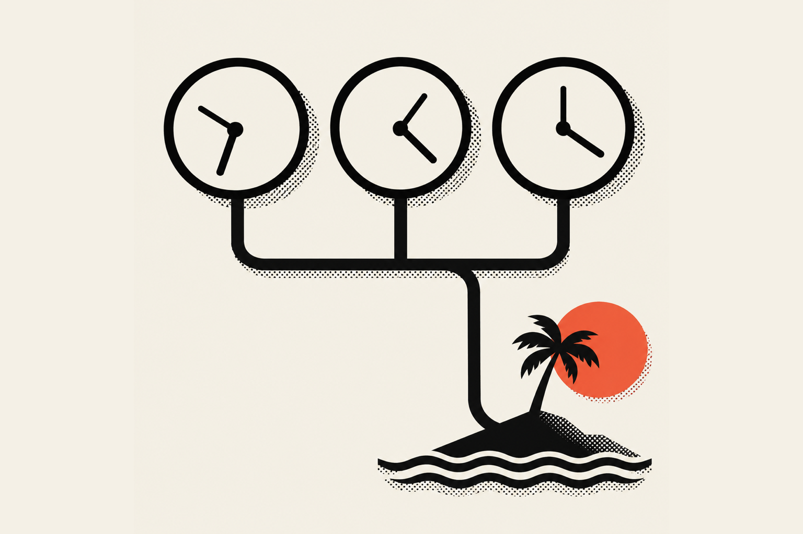

Living in Hawai'i and working remotely works well if your clients are in the United States and you plan for the cost. I run my design and development business from O'ahu with a home office, fiber internet and clients I mostly meet on video calls. The time zone is easy to manage. Living here is very different from visiting.

## What is it like to live in Hawai'i and work remotely?

It's like running any remote business, with an ocean outside and a much bigger rent check. I work from my home office on my own fiber internet, and sometimes from a friend's studio. My clients find me through referrals, and I never have to fly anywhere for work. The hard parts are the cost of living and fitting in.

The money comes first, because it's the part the beach photos leave out. Missouri's economic research center, MERIC, publishes a <a href="https://meric.mo.gov/data/cost-living-data-series" target="_blank" rel="noopener" aria-label="MERIC cost of living data series, opens in a new tab">cost of living index for every state</a>, where 100 is the national average. For the second quarter of 2026, Hawai'i scored 185.8 overall and 302.6 for housing. Housing here costs about three times the national average. That's the number to plan around.

You know the stock photo of the digital nomad with a laptop on the beach? It looks great, honestly, right up until you think about it. The sand in the keyboard and the glare on the screen are absolutely criminal. Real remote work out here happens at a desk, like anywhere else.

## How do you handle the time zone with mainland clients?

I tell every client I'm in Hawai'i, and we work around it. Hawai'i is on Hawaii Standard Time all year and doesn't change its clocks, so it's two or three hours behind the West Coast and five or six behind the East Coast, depending on the season. My day starts at about 8am, which is late morning on the West Coast and early afternoon on the East Coast.

The <a href="https://www.nist.gov/pml/time-and-frequency-division/popular-links/daylight-saving-time-dst" target="_blank" rel="noopener" aria-label="NIST page on daylight saving time, opens in a new tab">National Institute of Standards and Technology</a> lists Hawai'i among the places that don't observe daylight saving time. That's why the gap moves by an hour twice a year even though my clock never does.

Sometimes clients forget. I've woken up to messages sent at 4 in the morning my time, because it was a normal hour for them. Nobody gets upset when I answer a few hours later. If someone keeps forgetting, I remind them I'm in Hawai'i, and the time difference explains the rest.

| Client's time zone | Hours ahead of Hawai'i | When it's 8am for me |
| --- | --- | --- |
| Pacific | 2 in winter, 3 in summer | 10am or 11am for them |
| Mountain | 3 in winter, 4 in summer | 11am or noon |
| Central | 4 in winter, 5 in summer | Noon or 1pm |
| Eastern | 5 in winter, 6 in summer | 1pm or 2pm |

## What does a workday look like?

My day starts at about 8am with client messages and the Slack channel. Then it's calls and building: design, code and the sales calls for Portfolio Optimization. I'd love to say I surf every morning, but lately I've been too busy. I'm bringing the ocean, the hikes and the climbing back two or three times a week, first thing in the morning.

A lot of my work right now is <a href="/work/portfolio-optimization">Portfolio Optimization</a>, a Vamp Network service where I design and build portfolio sites for user-generated content (UGC) creators, the people who make videos and photos for brands. Vamp's marketing events lead creators to book a video call with me, and I close the sale on that call. After that, we talk in Slack while I design and build their site.

For my other work, I send people my portfolio link, and most new clients still come through referrals. I'm also building a LinkedIn strategy to reach clients with bigger budgets. None of that needs me to be anywhere but my desk.

The getting-in-the-water part is a promise to myself, and it's why I live here in the first place. The plan is bouldering, a sketchy hike or bodysurfing my favorite onshore break before the first call.

## How is visiting Hawai'i different from living there?

Visiting is the sights, the beaches, the expensive restaurants and not knowing how to get around. Living here, the island gets small fast. You know a lot of people, you learn the best beaches and hikes and when to go so you miss the crowds, and expensive sushi becomes a treat once or twice a month.

The biggest surprise for people is how local everyday life is. A lot of people grow their own vegetables and spices, and people have mango and papaya trees in the yard, so that fruit never comes from a grocery store. Everybody supports local businesses. Instead of buying honey at the store, you buy raw honey from someone who keeps bees, and there are co-ops for milk and grass-fed beef. If you're brave, you can spearfish for your own dinner, but learn the sustainable practices first and don't overfish an area.

Jobs are another difference. Employers here look for people who aren't a flight risk. If you apply for a job without an 808 phone number or a Hawai'i driver's license, you probably won't be taken seriously, because they figure you'll leave in a few months or a year. That's one more reason to bring your own remote work with you.

## What should you know before moving to Hawai'i for remote work?

Learn about Hawai'i and its community before you buy the ticket, and bring a plan. Housing is hard to find, you won't get all the amenities you had on the mainland, and the first months can be rough. Save enough for six to eight months of rent and food. Most of all, come knowing you'll always be a visitor here, and act like a good one.

Some practical things nobody mentions: air conditioning isn't normal in Hawai'i homes, so plan for that. Have a strategy for your income before you land, and know exactly what you're trying to do here. The <a href="https://www.hiestates.com/blog/remote-working-from-home-in-hawaii/" target="_blank" rel="noopener" aria-label="Hawaii Estates guide to working remotely from Hawai'i, opens in a new tab">Hawaii Estates guide to remote work</a> suggests a long stay before you commit, and puts it well: "Some people can live in paradise, but others prefer just to visit."

### You will always be a visitor, and that's fine

You can call Hawai'i home, but you'll never be from here, and you'll never be local. The people from here are Kanaka, which roughly translates to "the people." If you move here and stay, you become kama'aina, which means roughly "people of the land." It's the word for residents, people who came from somewhere else and made this home. Respect for that difference goes a long way.

In my experience, most people who move here get island fever, miss the mainland or their family, and move back after about a year. If you make it past a year, you'll probably make it to three. Past three, you'll make it to five and seven. Past seven, this is home.

### Show up like a good visitor

The community will accept you if you treat this place like you're not just here to take from it. Here's what I'd tell anyone:

1. Leave every beach and trail cleaner than you found it, including other people's trash. It's not fun. Do it anyway.
2. Volunteer. Go help on a lo'i, a taro patch. Groups like <a href="https://www.huimakaainanaomakana.org/lo-i" target="_blank" rel="noopener" aria-label="Hui Maka'ainana o Makana page on its lo'i, opens in a new tab">Hui Maka'ainana o Makana</a> on Kaua'i restore lo'i with community volunteers, and you'll learn a lot about Polynesian culture.
3. Learn some Pidgin. It's Hawai'i Creole English, which the University of Hawai'i's <a href="https://www.hawaii.edu/satocenter/langnet/definitions/hce.html" target="_blank" rel="noopener" aria-label="Charlene Sato Center at the University of Hawai'i on Hawai'i Creole, opens in a new tab">Charlene Sato Center</a> describes as a language of its own, separate from English and from the Hawaiian language, though it borrows Hawaiian words like pau and puka, and in 2015 the <a href="https://www.hawaiinewsnow.com/story/30515676/pidgin-now-recognized-as-official-language/" target="_blank" rel="noopener" aria-label="Hawaii News Now on Pidgin and the U.S. Census, opens in a new tab">U.S. Census recognized it</a> as a language spoken at home here. You'll sound silly at first and get teased, so laugh at yourself. Locals respect you for trying a few basic sayings.
4. Watch how people greet each other. How you throw a shaka tells people right away whether you live here or you're on vacation.
5. Follow Hawai'i Instagram accounts before you come, so you learn how people talk and act and how the community works.

## Running a business from an island

The day-to-day really is that simple: fiber, a desk, Slack and video calls. I FaceTime my parents and my friends on the mainland, and when they ask me to come back and visit, I ask them why I'd visit them there when they can come visit me here. That kind of changes the conversation.

If you're a business owner wondering whether a designer in Hawai'i can run your project, the answer is yes. Most of my clients work with me remotely, and the time zone hasn't been a problem yet. If you're a designer or developer dreaming about the move, get your remote income dialed in first. I wrote about how long that took me in <a href="/blog/working-for-yourself/switching-careers-in-your-30s">switching careers in your 30s</a>. You can read more <a href="/about">about me</a>, and if you have a project in mind, <a href="/contact">reach out</a>. Mahalo for reading.
