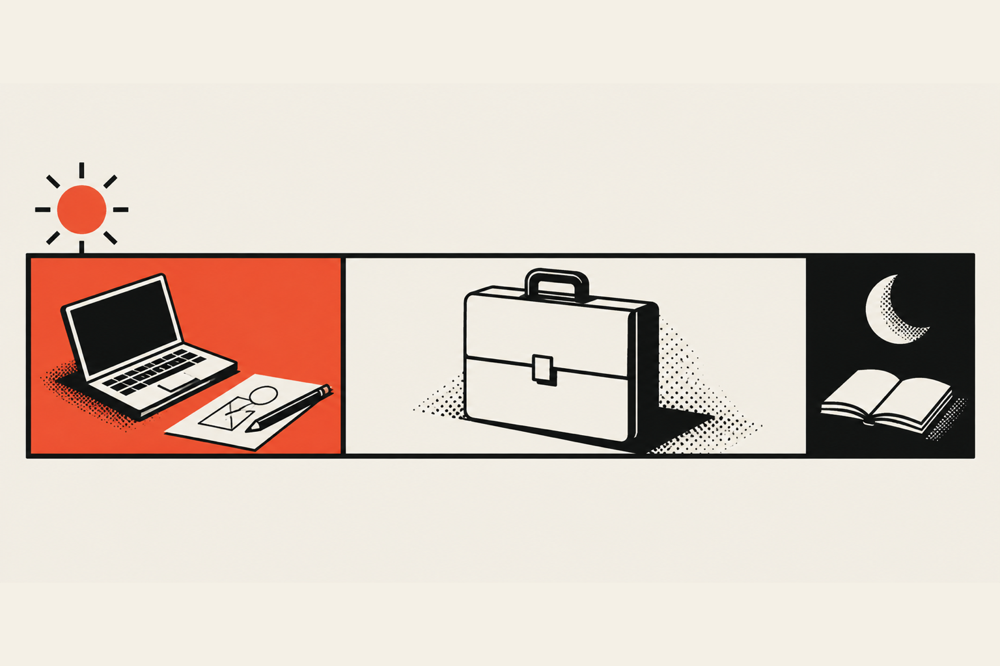
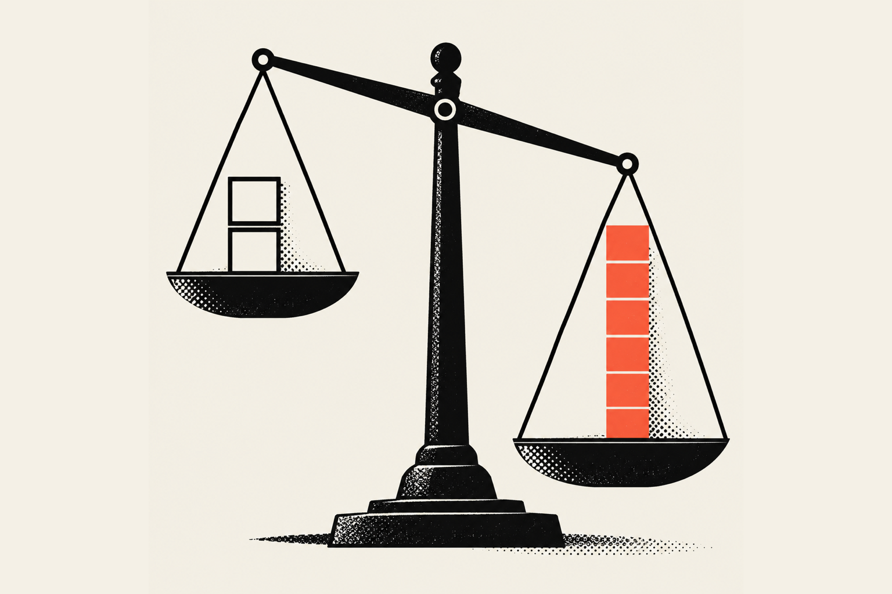

No, your 30s are not too late to switch careers. I left a career I was doing well in during my 30s and rebuilt myself as a designer and developer. It took years longer than I wanted. My advice is to learn the new work while the old job still pays your bills, and to leave only once the new income clearly beats the old one.

## Is it too late to switch careers in your 30s?

It isn't, and the numbers say you have plenty of road left. The Bureau of Labor Statistics found that people born from 1957 to 1964 held an average of 12.9 jobs between ages 18 and 58, and still held 2.9 jobs on average between 35 and 44. Changing direction in your 30s is a normal part of a working life.

That comes from the <a href="https://www.bls.gov/news.release/nlsoy.nr0.htm" target="_blank" rel="noopener" aria-label="Bureau of Labor Statistics report on jobs held over a lifetime, opens in a new tab">BLS report on jobs held over a lifetime</a>, and I find it oddly comforting. Nobody has one job for 40 years anymore, if they ever did.

The switch tends to pay off, too. In a <a href="https://www.pewresearch.org/short-reads/2022/03/09/majority-of-workers-who-quit-a-job-in-2021-cite-low-pay-no-opportunities-for-advancement-feeling-disrespected/" target="_blank" rel="noopener" aria-label="Pew Research Center survey of workers who quit a job, opens in a new tab">Pew Research Center survey of people who quit a job in 2021</a> and found work somewhere else, 56% said they were earning more, and 53% said they had more room to advance.

The better question is whether you're willing to be a beginner again for a while, and honestly, that part is harder on your ego than on your calendar.

## How do you know it's time to leave a career that's working?

You know it's time when the work still pays but you dread it, when the things you used to put up with start costing you sleep, and when you keep finding yourself learning the other thing at night because you want to. Plan the exit before the old career forces it on you. I learned that the hard way.

My old career was a path that went stale. I was good at it and it paid, which is exactly why it was hard to leave. I'd already been freelancing on the side for about five years when I first tried to go full time on design. It didn't work, and I went back.

Then the old career blew up in my face. Everything I couldn't stand about it all hit at once: the stress, the problems it created in my life and a lot of the people I worked with. I walked away with no plan, no nothing. Don't copy that part. It was a hell of a way to learn.

Here's what I'd watch for instead, while you still have a choice:

1. You're good at the job and still feel nothing when you get it right.
2. You spend your free time learning the new skill without anyone asking you to.
3. People already pay you for the new work, even small amounts.
4. You can picture the next five years in the old career, and the picture bums you out.

If the first two are true and the third isn't yet, keep the job and start building.

## How do you learn a new skill while still paying the bills?

You learn it in the hours around the job that pays you, and you keep that job until the new work clearly covers your life. For me that meant freelance projects in the morning, the old job in the afternoon and evening, and an hour or two of learning at night. It's slow, and slow is fine.

My old job ran from 3pm to 9pm. I'd get home, and some nights I'd put in another hour or two of learning or client work. The next morning I'd wake up and work on freelance design projects until I had to leave at 2pm. Then I'd go to work, come home and do it all over again.

The money was not exciting. Most of my clients came from referrals, which is still true today, but back then it was one or two referrals a month at maybe $100 to $300 each. At that rate I basically had a hobby with invoices.

My parents told me to keep a full-time job to pay for everything and build the freelance business as I went. I didn't love hearing it at the time, but it was great advice, and it's still the advice I'd give you.

### Replace your income two or three times over before you quit

The rule I'd follow if I did it again: before you quit, the new work should replace your old monthly income by a factor of two or even three. That sounds extreme, and it's on purpose. Freelance income comes in waves, and you need room for the slow months, the taxes and the client who pays 60 days late.

Most advice keeps the money part vague. Harvard Extension's <a href="https://extension.harvard.edu/blog/how-to-change-careers-in-your-30s" target="_blank" rel="noopener" aria-label="Harvard Extension guide to changing careers in your 30s, opens in a new tab">guide to changing careers in your 30s</a> is solid on the small steps: talking to people in the field, taking classes and doing side projects. It tells you to make a financial plan, but not how much runway you need. My answer is more than you think.

### What happened when I left with no plan

After I walked away, a friend who managed two bars brought me on, even though I'd never worked in a bar in my life. I worked there for 10 months and barely made rent. I wasn't doing any freelance work, but I kept telling people I met at the bar what I could build for them. Nobody hired me.

Then I got tired of waiting and bet on myself. I drove my car from Dallas to San Diego, shipped it to Hawaii in a container and took a one-way flight. I've been here ever since. That's a story for <a href="/blog/working-for-yourself/living-in-hawaii-working-remotely">what living in Hawaii and working remotely is really like</a>.

## Can you teach yourself to code in your 30s?

Yes. I taught myself HTML and CSS around 2016, then JavaScript, and became a front-end developer working with startups and small businesses. I learned from online courses on Udemy and YouTube and by building projects. You don't need a degree to start. What you need is a project you care about and the patience to be bad at it for a while.

You're also in good company. In the <a href="https://survey.stackoverflow.co/2024/developer-profile" target="_blank" rel="noopener" aria-label="Stack Overflow 2024 Developer Survey, opens in a new tab">Stack Overflow 2024 Developer Survey</a>, 82% of developers said they learned to code from online resources, more than said they learned at school.

I'll be honest about my own history with school, because it matters here. I failed out of college more than once before I went back for graphic design and kept a 4.0 at the Art Institute. I left when I became a father and couldn't pay for school and diapers at the same time. Being bad at school did not make me bad at learning. It just meant the classroom wasn't where I learned best.

Learning is a lot faster now than when I started, too. I use AI every day, and it's the best business partner you can have if you train it on how you work. The preschool version, where you type one prompt and ship whatever comes back, gives you AI slop. Used properly, it explains the error, shows you a better way and lets you throw out a bad attempt and start over for free. If I were starting in my 30s today, I'd learn the fundamentals by hand and use AI as the tutor that never gets tired of my questions. If the design and code combination appeals to you, I wrote about <a href="/blog/ux-ui-design/what-is-a-design-engineer">what a design engineer does</a>.

## What changed when clients started taking me seriously?

What changed was me, more than my skills. I started paying close attention to my conversations with clients until I could tell who was ready to invest, who was serious and who my price would scare off. Once I could read that, I stopped chasing the wrong clients and started being treated like the professional I was trying to be.

When I first landed in Hawaii, I talked to people about business, digital marketing and their websites every single day. It worked, sort of. I got clients, but I didn't know I was getting low-quality clients. I heard things like "$1,000 or $2,000 is a big investment for me" from people who had never thought of their website as an investment. To them it was an expense, and they couldn't see what it would earn them back. After about a year and a half of that, it blew up in my face too.

The roast I'd give my younger self: the hustle was legit and the hours were impressive, but the client screening was absolutely atrocious. I said yes to anyone who'd listen.

A lot of the shift came from learning how other people think about business and sales. I've read several of Tony Robbins' books and watched a lot of Alex Hormozi's content, and I learned from Dean Graziosi and Gary Vaynerchuk too. It changed how I present myself and how I walk into a conversation with a prospective client. I'm still going through mindset shifts like that today.

### The client who changed my confidence

For a while I worked inside a business instead of for clients. I helped <a href="/work/aiwi-waffles">'Aiwi Waffles</a> grow from the inside: working with the owner on the food truck, building out the shop, scaling the business and setting up its business systems. I was basically an employee.

I kept pitching UX/UI work on the side, and it kept going nowhere. I'll admit I started to give up. Then I got connected with the CEO and founder of <a href="/work/vamp-network">Vamp Network</a>, and that one project gave me enough confidence to push for other projects and other clients. That's how I run my own small freelance business now.

My clients today still mostly have smaller budgets, but the conversation is different. They ask for my expertise instead of telling me what to do, which is pretty nice. I'm now building toward bigger-budget clients.

## What would I tell you if you're starting now?

Start smaller and stay employed longer than feels exciting. It took me four or five years just to know what I was doing. Learn in the hours you have, take small paid projects and quit only when the new income is two or three times the old one. I took about eight years to live on freelance work. With more focus, you can do it a lot faster.

Here's the order I'd do it in:

1. Pick one skill and learn it in the hours around your job, with real projects.
2. Take small paid work from people you know, even at $100 to $300, and learn how clients think.
3. Watch the conversations. Notice who treats the work as an investment and who sees it as an expense, then spend your time on the first group.
4. Build on referrals. Most of my work still comes from them, so do work people want to talk about.
5. Save a runway and get the new income to two or three times the old one before you leave.

## Where this left me

The switch gave me the work I wanted to do all along: designing and building websites and products for businesses, from Hawaii. You can read more about me on <a href="/about">the About page</a>, and the clients I mentioned are case studies on this site.

If you're a business owner reading this, the story explains how I work. I've been the one-person business watching every dollar, so I treat your website as an investment that has to pay you back. If you're a designer or developer thinking about making the jump, keep your job a little longer than you want to, learn like crazy and bet on yourself when the numbers say you can. Either way, if you want to talk about a project, <a href="/contact">reach out</a>. I'm super stoked to hear what you're working on.
